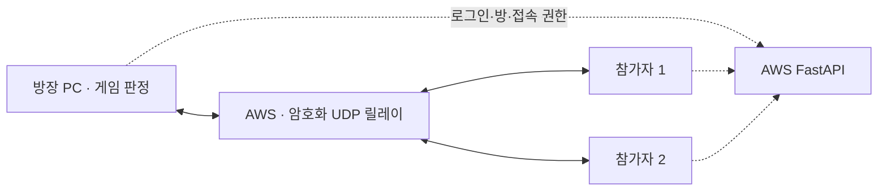

# 자체 계정 게임의 AWS 릴레이

## 사용자 흐름

런처 로그인 → 게임 실행·Boot → 인게임 로비 → 방 생성/참가 → 무기·봇·준비 → 출발. 로그인과 계정 관리는 런처에 남긴다. [인게임 로비 흐름](INGAME_LOBBY_FLOW.md)의 API 호환 배포 조건을 함께 따른다. 공유기 포트포워딩, IP 입력, VPN 설치는 필요 없다. 방장과 참가자 모두 AWS UDP 18001로 나가는 연결을 연다. 방장은 계속 Mirror 리슨 서버로 게임 판정을 담당한다.

## 연결·인증

- 로그인/API/Discord 링크는 기존 HTTPS를 사용한다. 게임 세션만 자신의 출발 파티에 대한 릴레이 자격증명을 HTTPS로 한 번 발급받는다. 런처 세션, 다른 파티, 미참가 계정은 거부한다.
- 방장 `/host` 응답에 릴레이 설정을 포함한다. 참가자는 `/relay`를 호출한다. 방장은 릴레이 응답을 받은 뒤 준비 완료를 알린다. 게시된 방 주소에는 AWS 주소를 사용한다.
- 기존 KCP의 reliable/unreliable 채널을 유지한다. 추가 헤더를 고려해 KCP MTU는 1200바이트다. Unity 씬과 외부 Mirror 소스는 수정하지 않는다.
- AES-256-GCM은 Python cryptography와 기존 Mirror BouncyCastle 구현을 사용한다. 각 접속 키는 난수 32바이트, 접속 ID는 난수 16바이트다. 키는 패킷에 싣지 않는다. nonce는 방향 4바이트 + 단조 증가 uint64 시퀀스이며, 방향별로 분리한다. 재실행 시 반드시 새 자격증명을 사용한다.
- 헤더 `GR01 | peer_id[16] | sequence[8 LE]`를 AAD로 인증한다. 암호문은 `slot[4 LE] | KCP payload | GCM tag[16]`. 빈 payload는 keepalive와 응답이다. 최대 UDP payload는 1248바이트다. 1024패킷 재정렬 창에서 재전송 공격을 거부한다.
- 최초 인증된 UDP 송신 주소에 연결을 고정한다. 게스트끼리 직접 전달하거나 다른 방으로 보낼 수 없다. 기존 challenge/일회용 접속 티켓으로 실제 게임 신원을 다시 검증한다.
- 이는 PC↔AWS 구간 암호화다. AWS 릴레이는 복호화해 상대 연결 키로 다시 암호화한다. 호스트까지의 종단간 암호화라고 부르지 않는다.

## 운영·제한

- 기존 EC2와 FastAPI의 단일 프로세스 이벤트 루프에서 운영한다. Uvicorn worker 수를 늘리지 않는다. 계정·게임 서버를 추가로 EC2에 띄우지 않는다. 규모 확대 시 별도 릴레이 프로세스로 분리해야 한다.
- 연결별 512 KB/s, 초당 1000패킷, 전체 수신 8 MB/s·초당 20000패킷을 제한한다(2초 burst). 최대 등록 수는 방 한도×3이다. 무효 ID/변조 패킷에는 응답하지 않는다. 전송량 제한은 청구 한도가 아니다.
- 2초 임대 검사에서 방 종료/세션 폐기를 반영한다. DB 장애 시 마지막 검증 후 10초가 지나면 전달을 중단한다. API 재시작으로 릴레이 키가 사라지면 기존 진행 방을 닫고 새 파티로 시작한다.
- AWS 보안 그룹: TCP80/443, UDP18001 공개, SSH는 관리자 IP만. PC에는 수신 포트를 열지 않는다.
- 중계 트래픽이 AWS 전송량에 포함된다. 고정 EC2 비용 외 트래픽 비용이 증가하며 크레딧 잔액과 NetworkOut을 확인한다.
- 방장 종료 시 게임 종료, 자동 방장 이전은 없다. 회사·학교 등 외부 UDP 자체를 차단한 회선의 TCP/WSS 우회는 아직 없다.
- 실제 서로 다른 회선의 PC 3대 검증과 장시간 부하/패킷 손실 조건은 별도 기록한다. 같은 PC 3프로세스의 AWS 경유 테스트로 이를 대체했다고 주장하지 않는다.

## 로컬 개발

기본 `GEUMEUM_RELAY_ENABLED=false`는 기존 직접 KCP 개발 경로다. 로컬 릴레이 검증 시 true로 설정하고 public/bind 주소를 127.0.0.1로 유지한다. 운영 설정은 `backend/deploy/aws/service.env.example`을 따른다.

## 진행 중인 방으로 재접속

- 호스트가 살아 있고 방이 `running`이면, 출발 명단에 있던 참가자가 끊겨도 호스트 heartbeat가 해당 자리를 예약 상태로 유지한다. 이탈 후 90초가 지났다는 이유만으로 그 참가자의 자리를 삭제하지 않는다.
- 런처 로그인을 유지한 채 게임을 다시 실행하면 새 게임 세션과 새 릴레이 키를 발급한다. 동일 계정의 이전 게스트 연결만 교체하며, 이전 키는 더 이상 전달에 사용하지 않는다. 같은 게임 세션의 중복 발급, 다른 계정의 자리 탈취, 호스트 슬롯 재발급은 거부한다.
- 게임 세션이 폐기돼도 유효한 부모 런처 세션이 있으면 예약된 참가자가 방 목록에서 사라지지 않는다. 명시적 로그아웃으로 부모 세션까지 폐기한 경우와 호스트 종료는 이 복귀 경로의 대상이 아니다.
- 호스트가 참가자의 이탈을 확인하면 런을 일시정지하고 참가자 스냅샷을 보관한다. 인증된 동일 참가자가 돌아오면 기존 무기·캐릭터와 참가자 상태를 복원한다. API의 자리 보존만으로 게임 상태를 복원하는 것은 아니다.
- 검증은 API 회귀와 실제 게임 3프로세스를 구분한다. 즉시 재실행, 90초 이상 이탈, 반복 복귀, 호스트·잔류 참가자 유지, 미참가 계정 거부를 확인한다. 로컬 통과는 운영 배포나 서로 다른 회선 3PC 검증을 뜻하지 않는다.

### 빠른 재접속 시 이전 연결 정리

릴레이가 동일 참가자에게 새 자격증명을 발급하면 호스트에 인증된 제어 통지를 보낸다. 하향 `source=0`, 본문 4바이트는 재발급한 자리 번호(1 또는 2)를 뜻한다. 본문 없는 keepalive와 구분한다. 게스트가 보낸 데이터의 source는 릴레이가 실제 게스트 자리로 부여하므로 이 통지를 위조할 수 없다.

호스트는 자리별로 수신한 릴레이 시퀀스의 최댓값을 유지한다. 이미 더 새로운 데이터를 받은 뒤 늦게 도착한 통지는 적용하지 않는다. 유효한 통지를 적용할 때는 이전 KCP 연결을 정리하고 그 정리 과정의 종료 패킷이 새 참가자에게 전달되지 않도록 막는다. 참가자 수락과 상태 복원은 기존 게임 인증을 통과한 뒤 수행한다.

통지는 호스트 keepalive에 맞춰 최대 5초 동안 반복하며 새 참가자가 송신을 시작하면 중단한다. 만료되거나 호스트가 사라진 방의 대기 통지는 주기 청소에서 제거한다. 이 경로는 API와 게임 전송 코드 양쪽에 구현되므로 운영 반영 시 게임 빌드와 API를 함께 갱신해야 한다. 통지 전체 손실·심한 패킷 재정렬을 포함한 별도 회선 장애 검증은 정상 로컬 재접속 테스트와 구별한다.
