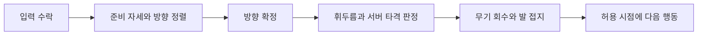

# 그믐 전투 방향 검토 — 소울라이크의 공방과 협동 보스전

> 작성: 2026-09-20 · 상태: **C안 채택 / 일반 피격·후속 무기 개편 핵심 구현 / 체감 평가는 별도**
> 기준: 2026-09-22 코드 대조, 미커밋 변경 포함. 수치는 기본 SO 값이며 장비·특성 적용 후 값과 다를 수 있다.
> 요청: 역동성이 애매한 원인을 검토하고, 다크소울·엘든 링·소울라이크·로스트아크에서 가져올 요소와 그믐 도입 방법을 정한다.
> 사용자 제약: **공격 모션과 무관하게 캐릭터가 끌려가는 이동은 원하지 않는다.**
> 후속 직업 설계: [신궁·무녀 상세 재설계](BOW_AND_BELL_REDESIGN.md). 밤의 통치자·한조 참고, 활/방울 고유 능력과 타격감의 핵심 코드·데이터가 반영되었고 체감 평가는 별도다.
> 최초 비교·조사에 이어 사용자가 **설계 구체화 + 피격 기능 구현**을 선택했다. 이번 구현 범위와 이후 단계는 14절을 기준으로 구분한다. 기존 보스 계약은 유지한다.

## 1. 권고 방향

**한 번의 공격은 몸과 무기의 움직임으로 납득되고, 보스전 전체는 세 사람이 함께 기회를 만드는 전투**를 권한다.

소울라이크와 레이드의 중간 속도를 찾는 방식으로는 정체성이 선명해지기 어렵다. 각각 맡길 역할을 정해야 한다.

| 층위 | 그믐이 가져올 규칙 | 플레이어가 느껴야 할 것 |
|---|---|---|
| 내 행동 한 번 | 공격을 시작하면 핵심 동작을 끝낸다. 발·몸·칼·판정 시점이 일치한다 | 내가 이 공격을 선택했고 그 무게를 책임진다 |
| 보스와 한 번의 공방 | 예고를 읽고 피하거나 카운터한 뒤, 실제로 반격할 공간과 시간을 받는다 | 방금 잘 대응해서 지금 공격할 수 있다 |
| 파티 전투 | 각자의 대응이 공동 그로기로 모이고, 꼬리를 공략해 이후 패턴이 바뀐다 | 셋이 싸움의 흐름을 바꿨다 |

권장 기본안은 **제자리 공격을 먼저 완성하고, 모션에 실제 디딤이 있는 공격만 제한적으로 전진시키는 것**이다. 이동 공격을 전부 금지할 필요도, 모든 공격에 전진을 붙일 필요도 없다. 지금의 불만은 이동량보다 **움직인 이유가 몸에서 보이지 않는 것**으로 해석한다. 이는 사용자 설명에 근거한 가설이며 영상으로 확인해야 한다.

### 먼저 결정할 세 가지

1. 기본 공격 중 WASD 자유 이동은 계속 막는다.
2. 공격의 핵심 구간은 취소할 수 없게 유지한다. 입력 예약과 조기 취소는 별개로 실험한다.
3. 보스는 개인 회피로 생존할 수 있고, 직업별 카운터와 협동으로 더 좋은 공격 기회를 만드는 기존 방향을 유지한다.

## 2. 조사 범위와 증거 수준

| 구분 | 이번에 확인한 것 | 확인하지 않은 것 |
|---|---|---|
| 외부 게임 | 공식 매뉴얼·개발사/퍼블리셔 전투 설명·공식 패치 문서 | 게임별 프레임 계측, 내부 코드, 루트 모션 구현 방식 |
| 그믐 | 현재 C#·Animator 직렬화 값·SO·기획·인수인계 | 실제 조작, 실행 중 활성 Animator, 3인 체감, 동작 영상 |
| 제안 | 현재 구조에 연결할 방법·대안·도입 순서·판정 기준 | 확정 밸런스, 검증된 공수, 재미 개선 효과 |

아래의 **참고 게임 사실**은 외부 출처에 근거한다. **해석·그믐 적용안**은 그 사실에서 도출한 설계 제안이다. 특히 “이 게임은 느리다/빠르다”를 전 시리즈·모든 무기에 적용하지 않는다. 다크소울은 1편 공식 매뉴얼을 기반으로 공통 자원·행동 구조를 보고, 다른 작품은 명시한 출처 범위에서 비교한다.

## 3. 현재 그믐에서 먼저 봐야 할 부분

### 3.1 이미 있는 것

| 항목 | 코드·데이터상 사실 | 의미 |
|---|---|---|
| 공격 이동 제한 | `PlayerActionGate.CanMove`는 공격 중 이동 거부. `PlayerController`는 기본 공격 상태를 전달 | 자유 이동을 켜는 것이 출발점은 아니다 |
| 근접 기본 공격 | 선딜 0.12 + 후딜 0.28초, 스태미나 6, 사거리 2.2m, 각도 90도 | 기본 사이클 0.4초. 숫자만으로 느린 전투라고 단정할 수 없다 |
| 다른 기본 공격 | 활 0.25 + 0.35초, 방울 0.2 + 0.35초 | 직업마다 공격에 묶이는 시간이 다르다 |
| 구르기 | 전체 0.9초, 무적 0.45초, 거리 3m, 소모 25 | 전체 동작·무적·이동 종료 시점을 구분해 관찰해야 한다 |
| 스태미나 | 최대 100, 회복 35/초, 행동 후 지연 0.45초 | 평타뿐 아니라 회피·패링 여유를 함께 봐야 한다 |
| 콤보 | `PlayerAttack.CommitAction`에 3단계 순환, 콤보 유지 창 0.45초. 3타 피해 배율 적용 경로 존재 | 콤보를 새로 만드는 작업은 필요하지 않다. 단계별 타이밍·실루엣 차이를 검토한다 |
| 타격 표현 | 일반 히트스톱 0.04초, 치명타 0.08초, 피격 플래시 0.12초, 검날 궤적 VFX | 효과 유무보다 타이밍과 강도 차이가 우선 |
| 공동 그로기 | 게이지 100, 차사/신궁/무녀 카운터 감소 10/8/13, 그로기 10초 중 기상 예고 2초, 면역 8초 | 이미 방어·보조 행동이 파티 공격 기회로 연결된다 |
| 꼬리·최종 구간 | 꼬리 3덩이, 덩이당 HP 1,350, 보스 HP 25% 게이트, 패턴 봉인·카운터 이관 데이터 | 로스트아크식 협동 목표를 새로 덧붙일 필요가 적다 |

근거: [CombatConfigSO](../../Assets/09.Data/Combat/CombatConfigSO.asset), [PresentationConfigSO](../../Assets/09.Data/Presentation/PresentationConfigSO.asset), [BossPatternSO](../../Assets/09.Data/Boss/BossPatternSO.asset), [PlayerAttack](../../Assets/01.Scripts/02.Combat/Player/PlayerAttack.cs), [PlayerActionGate](../../Assets/01.Scripts/02.Combat/Player/PlayerActionGate.cs), [PlayerController](../../Assets/01.Scripts/02.Combat/Player/PlayerController.cs).

### 3.2 우선 조사할 원인 후보

| 후보 | 관찰된 근거 | 아직 단정할 수 없는 것 | 확인 방법 |
|---|---|---|---|
| 모션과 판정 시간 불일치 | 서버는 SO로 판정·종료 시각을 만들지만, `PlayAttack`은 트리거를 사용한다. 차사 Controller의 Attack1~3은 속도 2, 속도 파라미터 비활성 | 실제 활성 Controller·클립에서 얼마나 어긋나는지 | 기본 공속/최대 공속으로 타격 자세·서버 impact·이동 해제 프레임 대조 |
| 입력 연결의 공백 | `GetKeyDown`에서 요청하고 진행 중 행동은 공통 게이트가 거부한다. 읽은 기본 공격 경로에는 다음 입력을 저장하는 전용 큐가 없다 | 체감 입력 누락의 빈도, 다른 행동 입력의 영향 | 후딜 끝 직전 입력을 반복하고 거부 시각과 다음 행동 시작 기록 |
| 회전으로 생기는 미끄러짐 | 매 프레임 시각 모델은 `FacingDirection`을 따라 회전. 근접 판정의 `ResolveAimForward`도 락온 방향을 사용할 수 있다 | 타격 중 실제 회전량, 발 접지 상태 | 이동 입력 없이 락온 대상만 옆으로 움직이는 실험 |
| 표현만 멈추고 행동 시계는 진행 | 히트스톱은 로컬 플레이어 Animator를 멈춘다. 행동 종료는 별도 게임 시계로 계산 | 종료 직전 히트스톱이 자세 복귀와 얼마나 겹치는지 | 명중/헛스윙/치명타의 모션 종료와 이동 해제 비교 |
| 보스 쉬는 구간의 단조로움 | 1페이즈 마지막 타격 뒤 회복 상태와 전역 간격을 사용. SO 간격은 1P 3초, 2P 기본 2.2초 | 실전에서 이동·후속 패턴과 합쳐 어떤 리듬을 만드는지 | 60초 동안 공격·회복·추적·후속 패턴 시간을 분류 |
| 엇박이 몸에서 읽히지 않음 | `BuildImpactSchedule`은 후속 타격 간격에 서버 난수를 적용. 6번 패턴 jitter는 -0.4~+0.4초 | 모션이 변형된 판정 시간에 맞춰 준비 동작을 보여주는지 | 같은 패턴 반복 녹화, 준비 자세·타격 시각·예고 비교 |

**우선순위는 모션과 판정의 일치 → 입력 연결 → 공방 보상 → 전진 이동이다.** 판정이 먼저 끝났는데 모션이 계속 휘두르고 있다면, 후딜을 더 줄일수록 끌려가는 느낌이 악화될 수 있다.

보스 간격은 단순 합산하지 않는다. 1페이즈에서 회복 타이머와 전역 간격은 함께 진행되며, 돌진 뒤 근접 후속 공격 예외도 있다. `ActiveDuration + 3초`를 무조건 공백으로 계산하면 틀린다. 근거: [Phase1State](../../Assets/01.Scripts/03.AI/Boss/Phase1State.cs), [BossPatternExecutionSpec](../../Assets/01.Scripts/03.AI/Boss/BossPatternExecutionSpec.cs).

### 3.3 기존 문서와 현재 코드의 차이

- [PLAYER_ATTACK_DESIGN](PLAYER_ATTACK_DESIGN.md)의 “requestId만 전송”, “콤보·애니메이션 범위 밖”은 현재 코드와 다르다. 현재는 조준 방향·카메라 ray, 콤보와 cue 경로가 있다.
- [구현 로드맵 U26](../05-implementation-roadmap.md)의 “보스 Attack·Dead 트리거 2종뿐”보다 현재 [BossAnimationView](../../Assets/01.Scripts/05.Art/Boss/BossAnimationView.cs)가 앞서 있다. `AttackKind`, `RepeatIndex`, `IsGroggy`도 전달한다. 다만 `WakeWarning`을 별도 기상 모션으로 구분하지 않고 그로기 bool에 포함한다. 실제 클립·전이 완성도는 미검증이다.
- [애니메이션 파이프라인](ANIMATION_PIPELINE_DESIGN.md)의 `ActionSpeed`, 예측·승인 구조를 이미 구현된 사실로 간주하지 않는다. 현재 플레이어 코드와 Controller를 기준으로 도입 차이를 다시 계산한다.

따라서 오래된 “미구현 목록”을 그대로 작업 목록으로 삼지 않는다. 이번 문서에서는 차이를 기록하며 기존 계약 문서를 일괄 개정하지 않는다.

## 4. 참고 게임 분석

### 4.1 다크소울 — 공격할 기회를 고르는 비용

**확인한 사실:** 공식 1편 매뉴얼은 일반/강공격, 가드, 패링, 회피 계열 조작을 구분하고, 행동·회피가 스태미나를 소비하며 부족하면 해당 행동을 못 한다고 설명한다. [공식 매뉴얼, 조작·스태미나](https://shared.fastly.steamstatic.com/store_item_assets/steam/apps/211420/manuals/DarkSouls_PC_Manual_Online_GB.pdf?t=1721682669)

**설계 해석:** 재미의 중요한 축은 “공격을 얼마나 많이 누르는가”보다 거리·남은 자원·상대의 빈틈을 보고 한 번 더 공격할지를 고르는 데 있다. 무게감은 단순한 느린 속도와 동일하지 않다. 대응에 성공한 뒤 공격할 기회가 없다면 신중함이 대기로 바뀐다.

**그믐 적용:** 공격 핵심 구간의 책임은 유지한다. 평타 1~2타를 넣고 빠질 수 있는 작은 빈틈, 마지막 타격까지 욕심낼 수 있는 큰 빈틈을 보스 패턴별로 구분한다. 현재 0.4초 평타를 느리게 만드는 것부터 시작하지 않는다.

**그대로 가져오지 않을 것:** 솔로에서 읽기 좋은 긴 결투를 세 사람 모두에게 같은 대기 시간으로 복제하는 것. 지목받지 않은 두 명에게도 위치·공격·지원 판단이 있어야 한다.

### 4.2 엘든 링 — 행동의 책임을 유지하면서 대응 선택 확대

**확인한 사실:** 공식 전투 가이드는 입력 예약과 공격 중 행동의 제약을 설명한다. 연타한 회피가 뒤늦게 실행될 수 있으며, 가드 카운터도 적의 후속 공격에 맞을 수 있다. 가드 카운터·충전 강공격·점프 강공격은 자세 무너뜨리기에 기여한다. [Bandai Namco 전투 가이드](https://www.bandainamcoent.com/es_mx/news/elden-ring-introduction-part-4-combat-guide)

**설계 해석:** 입력을 받아주는 것과 공격을 즉시 취소해주는 것은 다르다. 다양한 대응도 아무 때나 안전하게 쓸 수 있어서는 선택의 의미가 작아진다.

**그믐 적용:** 짧은 입력 예약을 먼저 실험하되 공격 중 즉시 구르기·패링은 기본값으로 도입하지 않는다. 기존 패링/정밀 사격/공명이 각각 위험과 보상을 갖도록 선명하게 표현한다. 추가 점프 공격·방패·전회가 없어도 현재 행동의 성공 조건과 보상을 개선할 수 있다.

**그대로 가져오지 않을 것:** 무기별 광범위한 기술 목록과 모든 공격의 자세 피해. 그믐은 “피해는 HP, 카운터는 공동 게이지”라는 계약이 있으므로 별개 규칙을 섞지 않는다.

### 4.3 세키로 — 방어가 공격 기회를 만드는 리듬

**확인한 사실:** 공식 설명에서 튕겨내기는 상대 체간에 피해를 주고, 체간 붕괴는 인살 기회를 만든다. 적마다 공격·방어 대응을 학습하는 구조다. [Activision 게임플레이 해설](https://blog.activision.com/sekiro/2019-03/Sekiro-Shadows-Die-Twice-Gameplay-Overview-Trailer-is-Here)

**설계 해석:** 방어 성공이 단순한 피해 회피로 끝나지 않아 공방의 연결이 강하다. 다만 하나의 근접 결투 리듬을 서로 다른 세 직업에 그대로 요구할 수는 없다.

**그믐 적용:** 기존 카운터 성공 시 해당 결과와 게이지 감소를 즉시 읽게 한다. 실패하지 않았다는 안도뿐 아니라 “지금 우리가 이득을 얻었다”는 소리·보스 반응·HUD 변화가 필요하다. 보스가 실제로 멈추지 않는 결과에 전신 경직 모션을 붙이지 않는다.

**그대로 가져오지 않을 것:** 모든 직업에게 패링 숙련 강제, 별도 체간 게이지 신설, 일반 공격으로 현재 공동 게이지 감소. 기존 직업 정체성과 중복된다.

### 4.4 블러드본 — 위험을 감수하고 다시 들어갈 이유

**확인한 사실:** 개발 측 설명은 빠른 이동·회피와 공격적 적, 피격 직후 반격으로 일부 체력을 회복하는 Regain을 소개한다. 무기를 길게 바꾸면 사거리·위력이 커지는 대신 준비 중 위험이 늘어난다고 설명한다. [PlayStation 개발 소개](https://blog.playstation.com/2014/08/13/bloodborne-on-ps4-new-combat-details/)

**설계 해석:** 역동성은 이동 속도뿐 아니라 다시 진입할 동기에서도 나온다.

**그믐 적용:** 패링으로 쌓은 기존 치명타 기회, 공동 그로기, 꼬리 약점 노출을 진입 동기로 사용한다. 위험한 공격을 피한 뒤 보스가 멀리 도망가서 보상을 놓치게 하지 않는다.

**그대로 가져오지 않을 것:** 전 직업 피격 회복 시스템. 무녀의 치유·신력 경제와 생존 밸런스를 크게 바꾸므로 이번 개선 범위에서 제외한다. 기존 패링 게이지의 보존 규칙도 반격을 유도한다는 이유로 시간제 소멸로 바꾸지 않는다.

### 4.5 P의 거짓 — 성공 뒤 보상을 실행할 시간

**확인한 사실:** 공식 1.2.0.0 패치에는 적 그로기 기회 시간과 일부 몬스터의 자세 붕괴 관련 조정이 기록되어 있다. 이 특정 패치의 변경 사실만 사용하며 최신 전체 밸런스로 일반화하지 않는다. [공식 패치 1.2.0.0](https://www.liesofp.com/en-us/news/patch-notes-version-1-2-0-0)

**설계 해석:** 성공 판정이 있어도 후속 행동에 필요한 시간·거리가 부족하면 보상을 체감하기 어렵다.

**그믐 적용:** 그로기 10초라는 숫자만 보지 않는다. 마지막 카운터 위치에서 꼬리까지 이동하는 시간, 카메라로 부위를 찾는 시간, 첫 공격 준비 시간을 빼고 실질 공격 시간을 측정한다. 신궁이 멀리서 그로기를 만들었다고 그 사람만 보상에 늦게 합류하는지 확인한다.

### 4.6 로스트아크 — 카운터·무력화·부위 파괴를 구분하는 협동

**확인한 사실:** 공식 가이드는 특정 태세에 대응하는 카운터, 게이지를 소진시키는 무력화, 특정 부위를 파괴해 패턴을 바꾸거나 약화시키는 부위 파괴를 구분한다. 카운터는 정면·전용 스킬 조건이 있고 성공 후 공격 기회를 제공한다. 무력화 수치는 스킬에 따라 다르다. [로스트아크 공식 몬스터 가이드](https://lostark.game.onstove.com/GameGuide/Pages/%EB%AA%AC%EC%8A%A4%ED%84%B0)

발탄 공식 소개는 레이드를 보스의 고유 규칙을 이해하고 협동으로 대응하는 활동으로 설명한다. 발탄은 8인 사례다. 그 인원·관문 구조를 3인 그믐에 그대로 적용하는 근거로 쓰지 않는다. [공식 발탄 아카데미](https://www.playlostark.com/en-us/news/articles/lost-ark-academy-valtan)

**설계 해석:** 개인의 성공이 파티 전체의 공격 기회로 바뀌고, 부위 목표를 달성하면 전투 상태가 변한다는 점을 가져올 가치가 있다.

**그믐 적용:** 기존의 `직업별 카운터 → 공동 그로기 → 꼬리 공략 → 패턴 봉인/기회 이관`을 화면과 소리에서 하나의 인과관계로 만든다. 이것은 그믐의 재구성이며 “로스트아크의 카운터가 곧 무력화 게이지 감소”라고 설명하지 않는다.

**그대로 가져오지 않을 것:** 대규모 인원별 지정 자리, 다수의 신규 스킬·배틀 아이템, 특정 직업이 없으면 실패하는 기믹, 한 사람의 실수로 즉시 전멸하는 규칙. 3인·런 중 자유 편성·긴 런의 재시도 비용과 맞지 않는다.

## 5. 가능한 전체 방향 세 가지

| 방향 | 장점 | 비용·위험 | 그믐 적합성 |
|---|---|---|---|
| A. 소울 결투 중심 | 거리·한 타·회피 선택이 강하다 | 비지목자의 대기, 원거리·지원 직업의 관전화를 해결해야 한다 | 개별 공방 규칙의 참고안 |
| B. 레이드 전투 중심 | 파티 목표와 큰 장면을 만들기 쉽다 | 여러 스킬·가독성 좋은 카메라·기믹 제작량이 필요. 평타가 준비 행동으로 약해질 수 있다 | 보스의 전체 흐름에 제한 적용 |
| **C. 몸에 맞는 공격 + 협동으로 여는 빈틈** | 현재 패링·정밀·공명·그로기·꼬리를 활용한다 | 개인 행동 시간과 기믹 회피 가능 시간을 함께 맞춰야 한다 | **권고안** |

C안의 핵심은 모든 장르의 장점을 더하는 것이 아니다. **플레이어 행동은 작은 단위의 책임, 보스 설계는 큰 단위의 협동**을 맡는다. 기존 조작과 4종 보스 템플릿을 유지하면서 완성도를 올릴 수 있다.

## 6. 공격 중 끌려가는 느낌을 해결하는 방법

### 6.1 먼저 네 종류의 움직임을 구분한다

| 움직임 | 허용 방향 |
|---|---|
| 공격 중 이동 입력으로 자유 이동 | 기본 공격에서는 계속 제한 |
| 발 디딤에 따라 공격 자체가 전진 | 해당 모션이 있을 때만 별도 실험 |
| 락온 대상에 맞추려는 회전·자동 접근 | 공격 단계별 제한. 타격 직전·중간의 급회전과 거리 보충 금지 |
| 공격 종료 뒤 일반 이동으로 복귀 | 발 접지와 복귀 자세에 맞춰 연결 |

### 6.2 구현 대안 비교

| 방법 | 장점 | 약점 | 권고 |
|---|---|---|---|
| **제자리 모션 + 이동 잠금** | 현재 구조 재사용, 거리 판단 명확 | 동작·적 반응이 약하면 정적 | **1차 기준안**. 자세·판정·복귀를 먼저 맞춘다 |
| 일정 속도/일정 거리로 캐릭터 밀기 | 구현이 단순 | 발이 심어진 동안도 미끄러짐. 사용자 불만 재현 | 채택하지 않음 |
| **모션의 디딤 구간에서 추출한 이동 곡선** | 실제 발 동작과 서버 이동을 같은 시간표에 맞출 수 있음 | 곡선 제작, 충돌, 지형, 네트워크 보정 필요 | **2차 제한 실험**. 3타 한 개부터 |
| Animator 루트 모션 직접 적용 | 클립의 이동을 직접 활용 | 현재 예측·서버 이동과 중복될 수 있음. 리타게팅과 클립 품질에 의존 | 전면 전환 보류 |
| 목표까지 모션을 늘이거나 비트는 보정 | 거리 차이를 흡수 | 과하면 적에게 자석처럼 끌림. 경사·충돌·각도 검증 비용 | 필요 입증 전 보류 |
| 상체 공격 + 하체 이동 레이어 | 이동 사격에 적합할 수 있음 | 전신 타격의 체중 이동과 충돌, 새 모션 필요 | 활·방울의 후속 선택지. 이번 공통 해결안 아님 |
| 발 IK/접지 보정 | 작은 지면 오차와 접지 보완 | 잘못된 몸통 이동·판정 시간을 고치지 못함 | 마지막 보정으로 사용 |

Unity는 루트 변위가 GameObject 이동에 적용되는 구조와 IK 기능을 설명한다. **루트 모션을 켜면 발 미끄러짐이 자동 해결된다는 근거는 아니다.** 위 서버 곡선 방식은 그믐을 위한 제안이지 참고 게임의 내부 구현을 주장하는 것이 아니다. [Unity Root Motion](https://docs.unity3d.com/6000.0/Documentation/Manual/RootMotion.html), [Unity IK](https://docs.unity3d.com/6000.0/Documentation/Manual/InverseKinematics.html)

### 6.3 공격 한 번의 시간표



제안 필드는 `Impact`, `DirectionLock`, `MoveUnlock`, `DodgeUnlock`, `ParryUnlock`, `ComboLink`, `ActionEnd`처럼 **의미별로** 구분한다. 모두 새 필드로 만들라는 뜻은 아니며, 먼저 기존 cue의 시작·타격·종료와 클립을 맞춰 필요한 차이만 확장한다.

- 입력 예약은 `F`에서 실행할 의도를 저장한다. `D`를 건너뛰는 취소 권한이 아니다.
- 1차에서는 행동 해제 시각을 현재와 동일하게 두고 예약만 비교한다.
- 2차에서 모션 회수가 끝난 구간에만 이동/회피 해제를 실험한다. 한꺼번에 모든 행동을 풀지 않는다.
- 명중 후 히트스톱 때문에 모션이 늦어졌다면, 다음 행동의 자세 전환과 시각 시간 복원을 함께 처리한다. 서버 판정이나 보스 시계 전체를 느리게 하지 않는다.
- 현재 근접은 선딜 후 순간 범위 질의다. 위의 “휘두름”은 시각 구간이며, 이미 지속 무기 궤적 판정이 있다는 뜻이 아니다. 지속 판정 전환은 별도 범위다.

### 6.4 전진 곡선을 시험한다면 지킬 조건

1. 앞으로 디디는 발이 보이는 모션을 확보한다. 제자리 클립에 변위만 더하지 않는다.
2. 준비 때는 거의 정지, 밀어내는 순간에 이동, 발을 심으면 정지하는 시간표를 만든다. 이동량은 클립에서 측정한다. 앞서 대화에서 제안한 0.3~0.5m를 목표로 강제하지 않는다.
3. 서버가 행동 시작 시 방향·이동 곡선·시간표를 확정하고 기존 충돌 이동 경로로 진행한다. 클라이언트 Animator의 `deltaPosition`을 판정 위치의 원본으로 쓰지 않는다.
4. 벽에 막히면 남은 이동량을 다음 프레임에 몰아주지 않는다. 시각 모델도 벽 너머까지 디디지 않게 중단·축소 규칙을 둔다.
5. 적이 멀어져도 부족한 거리를 자동으로 채우지 않는다. 회피한 상대를 따라 급회전하지 않는다.
6. 외형·무기 교체, 경사, 충돌, 정지/재개, 고공속, 원격 보정에서 같은 품질을 확인한 뒤 확대한다.

## 7. 손맛을 만드는 다른 방법과 직업별 적용

### 7.1 3연격의 리듬

현재 근접 프로필은 콤보 단계와 무관하게 같은 기본 선딜·후딜을 선택한다. 우선 기존 클립의 실루엣과 타격 위치를 살리고, 타격 순간을 맞춘다. 이후 단계별 시간표를 분리할 필요가 확인되면 데이터로 확장한다.

| 단계 | 제안 역할 | 보상·대가 |
|---|---|---|
| 1타 | 작은 빈틈을 쓰는 단정한 베기 | 빠르게 판단할 수 있음. 강한 전신 밀침 없음 |
| 2타 | 추가 공격을 선택하는 연결 | 첫 타와 다른 궤적·소리, 다음 타로 갈지 결정 |
| 3타 | 긴 빈틈에 넣는 마무리 | 기존 3타 배율 경로 활용. 적의 더 큰 시각 반응, 더 확실한 회수 동작 |

3타를 매번 끝내야만 손해를 보지 않는 설계로 만들지 않는다. 1~2타에서 멈추고 살아남는 선택도 유효해야 한다. 타이밍을 바꾸면 평균 DPS·초당 스태미나 소모·카운터 여유가 함께 바뀌므로 피해량도 다시 검산한다.

### 7.2 적 반응은 표현과 실제 경직을 나눈다

| 반응 | 게임 판정 영향 | 사용처 |
|---|---|---|
| 타격 부위 움찔·재질 플래시·짧은 소리 | 없음 | 일반 명중의 기본 반응 |
| 공격 중단·이동 정지 | 있음 | 조건을 만족한 강경직, 패링 등 |
| 실제 넉백·다운 | 있음 | 제한된 마무리·특수 성공. 거리와 AI 재접근 재검증 |

일반 적이 모든 평타에 멈추면 3인 연타로 영구 경직된다. 우선 시각 반응을 개선하고, 실제 경직은 저항·재발동 제한을 갖춘 별도 실험으로 둔다. 보스는 평타마다 전신을 멈추지 않는다. 판정이 계속되는 상태에서 큰 쓰러짐 모션을 보여주면 예고의 신뢰가 깨진다.

### 7.3 직업별로 역동성이 생기는 지점

| 직업 | 살릴 순간 | 우선 개선 | 이번에 늘리지 않는 것 |
|---|---|---|---|
| 차사 | 붙기 → 1~2타 → 회피/패링 → 큰 기회 | 접지, 공격/패링 연결, 패링 성공과 치명타 준비의 구분 | 자유 이동 평타, 상시 자동 전진 |
| 신궁 | 안전한 사선 확보 → 발사 → 재배치 → 정밀 중단 | 시위 놓는 프레임과 발사 일치, 정밀 성공의 보스 반응, 원거리에도 읽히는 예고 | 근접과 같은 흔들림·긴 히트스톱 일괄 적용 |
| 무녀 | 근거리 방울 공격 → 표식 시점 판단 → 치유/공명 | 방울 타격·신력 획득·공명 성공을 다른 소리와 형태로 구분 | 전 직업 자가 회복, 치유 역할을 지우는 새 생존 체계 |

### 7.4 이펙트·사운드·카메라

- 검기 전체를 키우기 전에 타격 위치의 짧은 접촉 효과와 소리를 맞춘다. 헛스윙은 바람 소리, 명중은 접촉 소리로 구분한다.
- 평타·3타·치명타·카운터·부위 파괴를 모두 같은 최대 강도로 표현하지 않는다. 큰 순간을 위해 평소 강도를 남겨둔다.
- 동료의 일반 공격이 내 화면을 계속 흔들지 않게 한다. 파티 공통 강조는 그로기·부위 파괴처럼 공동 상태 변화에 한정한다.
- 색은 기존 [진영 색 문법](../class-identity-and-boss-2026-09-03.md)을 따른다. 카운터 가능 여부를 색 하나에만 맡기지 않고 실루엣·문양·소리를 병용한다.
- 카메라 확대·줌보다 근접 시 보스 무기, 내 발밑 위험, 탈출 방향이 함께 보이는지를 먼저 확인한다. 로스트아크식 넓은 바닥 기믹을 오버숄더에 복사하면 화면 밖 정보가 문제가 된다.

## 8. 그믐 보스에 도입할 공방 규칙

### 8.1 개인 공방과 파티 기믹의 역할

근접 연격은 보스 몸과 무기로 시점을 읽게 하고, 낙인·광역·전원 대상 공격은 바닥 예고와 지목 표시로 공간을 읽게 한다. 어느 하나를 숨겨야 소울라이크가 되는 것은 아니다. 특히 패링 불가 파생기는 겉으로도 차이가 있어야 한다.

| 기존 패턴 | 현재 자산 활용 | 개선 제안 | 성공 확인 |
|---|---|---|---|
| 1/6 근접 연격 | 반복 impact·마지막 타 패링 | 각 타 준비/출발/회수와 예고를 맞추고 마지막 타 대응을 구분 | 모션을 보고 마지막 타를 구별하고 성공 결과를 설명 가능 |
| 2 반월 베기 | 기존 파생·기상 후 패턴 | 1번과 템플릿이 같아도 패링 불가 표식·음향을 구별 | 같은 모션인데 답이 달라 억울하다는 반응 감소 |
| 3/7 돌진 | 기존 추적·방향 고정·후속 공격 | 추적 종료를 시각적으로 드러내고 옆으로 피한 뒤 접근 가능한 위치 확보 | 지목자는 회피, 나머지는 측후방 대응 가능 |
| 4/8 낙인·전원 대상 | 기존 장판 중심·지목·공명 | 낙인을 놓는 시점과 폭발 직전을 구분. 힐로 모인 파티가 흩어질 시간을 검산 | 세 사람이 겹치지 않게 이동할 공간과 시간이 있음 |
| 5/9 부채꼴 | 기존 시전·정밀 사격 중단 | 약점·중단 성공·실패 후 탈출 방향을 분리해 표현 | 신궁이 끊었음을 동료도 즉시 인지 |
| 그로기·꼬리 | 기존 10초·기상 예고·부위 게이지 | 쓰러짐, 약점 노출, 기상 준비, 파괴 후 다음 상태를 연결 | 세 사람이 같은 목표와 종료 시점을 앎 |
| 최종 원혼 | 기존 HP·직업 카운터·일반 공격 대안 | 원혼별 대상·남은 수·다음 위험을 명확히 전달 | 특정 직업 부재가 진행 불가로 바뀌지 않음 |

새 패턴 수를 늘리기 전에 이 표를 적용한다. 10개 패턴·4개 템플릿·보스 1마리·자유 편성은 유지한다. 수치와 기존 조건을 바꾸는 제안은 [보스 패턴 계약](BOSS_PATTERN_CONTRACT.md) 개정 대상으로 별도 결정한다.

### 8.2 예고와 공격의 책임은 양쪽에 적용

플레이어가 공격에 묶이는 만큼 보스도 확정한 공격 방향을 존중해야 한다. 준비 중 추적할 수 있더라도 확정 후에는 회피한 플레이어를 타격 순간까지 따라잡지 않는다. 현재 돌진에는 예고 앞 절반 추적 규칙이 있으므로 새 기능 대신 우선 실제 표현을 점검한다.

장판의 충분한 예고 시간은 다음 조건으로 검토한다.

```text
클라이언트가 예고를 본 뒤 남은 시간
  >= 현재 행동의 남은 취소 불가 시간
   + 인지·입력 시간
   + 안전지대까지 이동/회피에 필요한 시간
   + 서버 반영·틱 오차 여유
```

예고 전달 지연은 왼쪽 시간을 이미 줄인다. 같은 지연을 양쪽에서 중복 계산하지 않는다. 모든 상황에서 무조건 탈출을 보장하는 공식은 아니다. **예고 전에 합리적으로 시작한 공격이 보이지 않는 즉사 기믹 때문에 필패가 되는 상황**을 찾는 기준이다. 반대로 예고를 본 뒤 욕심내서 시작한 공격에는 대가를 둘 수 있다.

### 8.3 엇박은 판정 시각만 흔들지 않는다

현재 연격 jitter를 더 크게 하는 것은 우선 해법이 아니다. 예고/모션이 고정인데 판정만 변하면 읽어서 피하는 게임이 성립하기 어렵다.

1. 현재 jitter를 유지한 상태의 가독성을 먼저 녹화한다.
2. 비교안은 고정 리듬 한 가지로 시작한다.
3. 고정 리듬이 읽히면 “기본형/늦은 마지막 타”처럼 식별 가능한 변형을 실험한다.
4. 서버가 선택한 타격 시간표를 모션과 예고가 함께 사용한다. 클라이언트가 독립 난수로 연출하지 않는다.

이 변경은 기존 엇박 계약의 재검토 후보이지, 조사만으로 기존 난수를 제거하라는 결정이 아니다.

### 8.4 작은 보상과 큰 보상을 구분

- 작은 성공: 회피로 유리한 위치를 얻거나, 기존 카운터 효과와 공동 게이지 진척을 얻는다.
- 큰 성공: 공동 게이지 0으로 그로기·꼬리 공략 기회를 얻는다.
- 영구 진척: 꼬리 파괴로 패턴 봉인과 카운터 기회 이관이 발생한다.

카운터 한 번마다 10초 그로기를 새로 주지 않는다. 작은 성공마다 긴 정지가 생기면 공동 게이지의 의미와 보스 압박이 약해진다. 기존 카운터가 실제로 끊는 범위·이미 시행하는 후속 처리를 확인하고 표현을 붙인다.

## 9. 3인 전투 장면 예시

아래는 **개선 후 목표 장면**이며, 현재 자동 실행되는 시퀀스나 새 패턴 목록이 아니다.

1. 보스가 차사를 향해 근접 연격을 준비한다. 차사는 평타를 멈추고 마지막 패링 가능 타를 기다린다. 신궁은 사선을, 무녀는 다음 지원 위치를 잡는다.
2. 차사가 마지막 타를 패링한다. 보스의 해당 결과와 공동 게이지 감소가 보인다. 그로기가 아직 아니면 셋이 무작정 장시간 공격하지 않는다.
3. 보스가 다른 파티원을 지목해 돌진한다. 방향 확정 뒤 지목자는 옆으로 피한다. 동료들은 후속 공격이 있는지를 보고 짧게 때리거나 기다린다.
4. 부채꼴 시전에서 신궁이 정밀 중단에 성공한다. 동료 화면에도 성공을 알리고, 아직 필요한 공동 게이지 양을 읽을 수 있다.
5. 낙인 대응 중 무녀가 시점을 맞춰 공명을 성립시킨다. 누적 결과로 그로기가 열리면 전원이 꼬리 쪽으로 이동한다.
6. 기상 예고가 시작되면 차사는 3타를 더 넣을지 결정하고, 무녀는 이탈 위치에 맞춰 지원한다. 꼬리가 파괴됐다면 어떤 패턴이 사라졌는지 이후 전투에서 확인된다.

카운터 단독 10/8/13만으로 위 세 번 만에 게이지 100이 소진되지는 않는다. 위 장면의 그로기는 **이전 공방에서 쌓은 진척까지 포함한 예시**다. 실제 발생 빈도는 선택기·성공률·면역 시간으로 측정한다.

필드에서는 이 규칙을 작은 단위로 학습시킨다. 창귀의 접근/예고에 대응하고, 다른 적이 측면·원거리 압박을 주되 동시에 대응 불가능한 공격을 겹치지 않게 한다. 잡귀의 모든 공격에 레이드급 장판이나 새 기믹을 추가하지 않는다.

## 10. 구현에 연결할 위치와 순서

### 10.1 단계별 도입

| 단계 | 작업 | 기존 접점 | 통과 조건 |
|---|---|---|---|
| **P0 기준 측정** | 3타·헛스윙·회피·보스 1/3/4/5 패턴 녹화, 시간표 표시 | 개발 도구·보스 트라이·현재 cue | 아래 11절 기준선 기록 |
| **P1 모션과 판정 일치** | 타격 프레임/선딜/종료/복귀 정렬, 공속 변화와 히트스톱 처리 확인 | `PlayerAnimationController`, 현재 Controller, `PlayerActionCue` | 기본/최대 공속에서 무기 동작과 판정 정합 |
| **P2 입력 연결** | 짧은 1칸 예약, 기존 해제 시각 유지 | `PlayerAttack`, `PlayerActionGate`, 요청/거부 경로 | 의도하지 않은 추가 공격·늦은 회피 없이 연결 개선 |
| **P3 공방 표현** | 잡귀 피격 반응, 카운터 결과, 보스 회복·기상·부위 노출 | `CombatFeedbackImpl`, `BossAnimationView`, HUD·SFX·예고 view | 실패 이유와 성공 보상을 사람이 설명 가능 |
| **P4 보스 리듬** | 현재 4템플릿의 간격·방향 확정·엇박 표현 비교 | `Phase1State/Phase2State`, `BossPatternExecutionSpec`, `BossPatternSO` | 3인 모두 공방에 참여, 대기/무조건 연타 감소 |
| **P5 제한 전진** | 디딤 모션이 있는 3타 한 개에 이동 곡선 적용 | 서버 이동·예측·cue·충돌 | 이동이 없는 A안보다 자연스럽고 벽/지연에서 안정 |

P1~P4로 충분히 개선되면 P5는 하지 않아도 된다. 타격감 개선을 보스 BT 전환 전체의 완료 뒤로 미루지 않는다. U42 전환 때에는 기존 실행부와 같은 시간표·공방 계약을 사용하고 두 종류 선택기/판정 원본을 만들지 않는다.

### 10.2 데이터와 권위

| 내용 | 소유·적용 위치 | 원칙 |
|---|---|---|
| 공격별 판정·자원·해제 시각 | 전투 데이터 SO와 서버 실행 snapshot | 밸런스 상수 하드코딩 금지 |
| 클립 타격 표식·전이·발 접지 | 애니메이션 표현 데이터 | 클립 교체 시 타격 시각 재검증 |
| 이동 곡선·회전 확정 | 서버 이동/행동 데이터 | 클라 표현이 실제 위치·명중을 결정하지 않음 |
| 입력 예약 | 소유자 입력과 서버 검증 계약 | 실행 시 생명·자원·행동·무기 상태 재검증 |
| 그로기·경직·넉백·부위 상태 | 서버 판정 | 시각 반응과 실제 행동 중단을 구분 |
| 소리·플래시·카메라·히트스톱 | 클라 표현 데이터 | 서버 시계·다른 플레이어의 조작 시간을 멈추지 않음 |

`PlayerActionCue`의 시작·타격·종료·실행 ID를 활용한다. 새 RPC 체계를 먼저 만들지 않는다. 상세 권위는 [네트워크 권위](NETWORK_AUTHORITY.md), 구현 담당 경계는 [서버·클라이언트 협업](SERVER_CLIENT_WORKFLOW.md)을 따른다.

입력 예약 초기 제안은 **0.10~0.15초, 한 개 의도만 보관**이다. 이 값은 참고 게임의 측정값이 아니다. 공격/회피/패링 충돌 시 우선순위, 새 입력의 덮어쓰기, 만료, 거부 처리를 명시해야 한다. 무기 변경·사망·런 종료·일시정지에서 정리하고, 지연된 요청이 복귀 직후 실행되지 않게 한다. 서버 수신 시각 기반 예약은 RTT에 영향을 받으므로 소유자 측 입력 시각 처리까지 정한 뒤 M3로 확인한다. 클라이언트가 보낸 과거 시각을 그대로 신뢰하지 않는다.

### 10.3 제작량과 담당

- 전투/네트워크: 행동 시간표, 입력 예약, 방향·이동 계약. 서버 계약 변경은 팀장 담당.
- 아트/애니메이션: 기존 3연격 접지·타격 표식 측정, 복귀 전이, 카운터/기상 표현. 추가 모션 필요 여부부터 판정.
- 몬스터/보스: 기존 패턴별 확정 방향·회복·후속 공격·진입 거리. 일반 적 실제 경직은 별도 조정.
- UI/사운드: 카운터 진척·그로기 시작/기상·부위 목표를 우선 구분.

공수는 현재 클립을 재사용할 수 있는지에 크게 좌우된다. P0 측정 전 확정 일정을 만들지 않는다. 최소 산출물은 차사 3타 시간표, 보스 연격 1종과 낙인 1종, 그로기 진입/기상 표현의 비교본이다.

## 11. 비교 실험과 채택 기준

### 11.1 같은 조건에서 한 변수씩

| 비교 | A 기준 | B 실험 | 나머지 고정 |
|---|---|---|---|
| 모션 정렬 | 현재 | impact/종료 일치 | 피해·이동·보스 AI |
| 입력 | 예약 없음 | 짧은 1칸 예약 | 행동 해제 시각·공속 |
| 조기 해제 | 현재 종료 해제 | 회수 완료 뒤 회피만 허용 | 이동·공격·패링 해제 |
| 공격 이동 | 제자리 | 모션 기반 3타 전진 | 다른 타격·피해·카메라 |
| 보스 엇박 | 현행 jitter | 고정 또는 구별 가능한 변형 | 평균 패턴 간격·피해 |
| 타격 표현 | 현재 | 소리·접촉·반응 타이밍 개선 | 서버 피해·경직 |

동일 장비·동일 적·동일 시작 위치·동일 카메라로 A/B 각각 3분씩 진행한다. 사람 3명은 A→B/B→A 순서를 섞고 역할을 바꾼다. 봇은 재현·동기화 점검에 쓰며 사람의 손맛 평가를 대체하지 않는다. 보스 성공률과 처치 시간은 재미의 단독 지표로 쓰지 않는다.

### 11.2 기록할 지표

| 질문/측정 | 방법 | 초기 채택 기준 — 프로젝트 실험 목표 |
|---|---|---|
| 발이 끌려가는가 | 고정 측면 영상과 실제 플레이 화면, 1~5점 평가 | 3명 중 2명 이상이 개선을 선택. 회전·이탈까지 포함 |
| 타격 순간이 맞는가 | 서버 impact 표식과 시각 접촉 프레임 비교 | 로컬 기준 목표 ±2프레임/60fps. 네트워크에서는 수신 지연과 모션 오차를 따로 기록 |
| 의도한 입력이 연결되는가 | 후딜 끝 입력 20회, 수락/거부/시작 시각 기록 | 예약 가능 구간 입력 누락 0/20, 의도하지 않은 추가 행동 0/20 |
| 타격의 책임이 남는가 | 예고를 본 뒤 무리한 공격 10회와 올바른 대응 10회 비교 | 무조건 취소가 지배하지 않고, 올바른 대응에는 반격 기회 존재 |
| 보스가 읽히는가 | 피격 직후 원인·다음 대응을 한 문장으로 답함 | 반복 경험 후 설명 가능 여부와 불명확 사례 수 기록 |
| 세 사람이 참여하는가 | 60초 구간에서 공격·회피·카운터·지원·목적 없는 대기를 분류 | 특정 역할의 할 일 없는 시간이 기준안보다 악화되지 않음 |
| 성공 보상을 쓸 수 있는가 | 그로기 시작→각자 첫 유효 공격→기상 경고 기록 | 진입 거리 때문에 특정 직업이 반복적으로 보상 대부분을 잃지 않음 |

초기 수치는 통계적 재미 증명이나 출시 품질 보장이 아니다. 채택/기각을 위한 팀 내부 기준이며 기준선 측정 후 조정한다. 영상에서 좋은 것과 직접 조작해서 좋은 것을 각각 평가한다.

### 11.3 검증 단계

1. 문서·시간표 검토: 기존 계약과 변경 후보를 구분한다.
2. L1: 구현 시 컴파일·행동 타이밍/중복/취소 회귀 검사. 일반 피격의 실행 결과는 14절에 별도 기록한다.
3. L2: 담당 개발 환경에서 이동 입력, 락온 on/off, 헛스윙/명중/치명타, 공속 기본/최대, 벽·경사·카메라 근접을 관찰한다.
4. L3 M2: 호스트+클라2에서 판정·자원·위치·cue 중복/취소를 확인한다. 1+2봇만으로 M2를 대체하지 않는다.
5. M3: 실제 다른 PC 3대. RTT 실측과 지연 주입 조건을 분리 기록한다. 입력 예약·패링·전진 보정은 호스트와 원격 체감을 각각 확인한다.

채택 실패 시 증상별로 되돌릴 실험 변수만 정한다. 새 전진이 미끄러우면 P5만 기각하고, 모션 정렬·입력 예약·공방 표현의 개선은 독립 평가한다. 기존 다른 작업자의 변경을 파일 전체 복원으로 되돌리지 않는다. 기준: [멀티플레이 검증 절차](../ai/04_MULTIPLAYER_TEST_PROTOCOL.md).

## 12. 최종 도입 권고와 보류 항목

**바로 준비할 것:** 현재 영상 기준선, 차사 3타 모션/판정 정렬, 짧은 입력 예약 비교, 보스 예고→타격→회복/기상 표현, 공동 카운터 결과 전달.

**검증 후 선택할 것:** 회수 구간의 회피 해제, 모션에서 추출한 3타 전진, 일반 적의 제한된 실제 경직, 판독 가능한 엇박 변형.

**이번에 도입하지 않을 것:** 자유 이동 평타, 고정 거리 자동 밀기, 전면 루트 모션 전환, 무제한 공격 취소, 별도 체간 게이지, 전 직업 피격 회복, 신규 보스·대규모 레이드 기믹.

권고하는 첫 완성 장면은 **차사가 제자리에서 자연스럽게 1~2타를 넣고, 보스의 마지막 공격을 읽어 패링한 뒤, 셋이 공동 그로기와 꼬리 노출에 반응하는 장면**이다. 이 장면이 좋으면 그 규칙을 기존 다른 공격에 넓힌다. 이것이 확인되기 전에는 게임 전체를 더 빠르게 만들거나 연출 강도를 일괄 높이지 않는다.

## 13. 출처와 재확인 위치

외부 자료는 2026-09-20 열람했다. 본문 관련 주장에 직접 링크했으며, 아래는 후속 담당자가 다시 확인할 위치다.

| 출처 | 확인한 범위 | 사용상의 제한 |
|---|---|---|
| Dark Souls PC 공식 매뉴얼 | 조작, 스태미나 | 1편 기준. 시리즈별 프레임/취소 창 추정 금지 |
| Bandai Namco Elden Ring Combat Guide | 입력 예약, 행동 제약, 가드 카운터, 자세 붕괴 | 무기별 상세 프레임 출처가 아님 |
| Activision Sekiro Gameplay Overview | 튕겨내기·체간·인살 연결 | 협동 게임의 직접 설계 근거가 아님 |
| PlayStation Bloodborne 개발 소개 | Regain, 공격적 전투, 무기 형태의 대가 | 피격 회복을 그믐에 도입한다는 결정 아님 |
| Lies of P 1.2.0.0 공식 패치 | 그로기 기회·자세 붕괴 조정 사례 | 과거 특정 패치이며 최신 수치 비교 아님 |
| Lost Ark 한국 공식 몬스터 가이드 | 카운터·무력화·부위 파괴 구분 | 특정 레이드의 전체 패턴·타이밍 근거 아님 |
| Lost Ark Academy Valtan | 협동 레이드의 목표와 인원 | 8인 구조를 3인에 복사하지 않음 |
| Unity 6.0 Root Motion/IK 매뉴얼 | 기능 개념 | 프로젝트 Unity 버전에서 구현 시 API·리깅 설정 재확인 |

현재 코드 재확인: [PlayerAnimationController](../../Assets/01.Scripts/02.Combat/Player/PlayerAnimationController.cs), [PlayerPresentation](../../Assets/01.Scripts/02.Combat/Player/PlayerPresentation.cs), [ChasaLocomotion](../../Assets/05.Animator/ChasaLocomotion.controller), [CombatFeedbackImpl](../../Assets/01.Scripts/05.Art/CombatFeedbackImpl.cs), [BossAnimationView](../../Assets/01.Scripts/05.Art/Boss/BossAnimationView.cs), [BossPatternSelector](../../Assets/01.Scripts/03.AI/Boss/BossPatternSelector.cs), [보스 서버 실행](../../Assets/01.Scripts/98.Servers/03.AI/Boss/BossController.server.cs).

**최초 조사 완료 기준:** 출처·현재 구현·가설·제안을 구분했고, 비교 대안·권고·구현 접점·검증 기준을 제시했다. 후속 구현과 검증은 아래에 기록한다. 현재 손맛의 실제 원인과 개선 효과에 대한 사람의 체감 평가는 여전히 별도다.

## 14. C안 실행 설계 — 개인의 공방부터 협동 보상까지

### 14.1 목표와 이번 범위

플레이어는 **예고 관찰 → 공격/방어 선택 → 실행의 책임 → 결과 확인 → 다음 선택**을 반복한다. 보스전은 이 작은 공방을 **직업별 카운터 → 공동 그로기 → 꼬리 공략 → 다음 패턴 변화**로 묶는다. 일반 피격은 잘못 들어간 공격이 실제로 끊긴다는 결과를 만든다. 피격 모션만 추가하고 예정된 공격이 그대로 나가면 이 책임이 보이지 않는다.

이번에는 아래 C1을 구현한다. C2~C6은 실행 가능한 설계이며 아직 구현한 기능으로 취급하지 않는다. 자유 이동 평타·고정 속도 전진·전면 루트 모션 전환은 포함하지 않는다.

| 단계 | 구체 작업과 결과물 | 다음 단계로 넘어갈 조건 | 상태 |
|---|---|---|---|
| C1. 피격의 결과 | 서버 피격 상태, 짧은 행동 제한, 진행 중 행동 취소, 전신 피격 모션, 연속 경직 유예 | 3개 화면의 상태 일치, 예약 타격 취소, 연속 피격에서 회복 가능, 사망/새 런 우선순위 확인 | 이번 구현 |
| C2. 공격 1회의 정렬 | 차사 1~3타별 실제 클립/발 접지/칼 접촉 프레임 표 작성. 서버 impact와 클립 재생 시간 정렬. 방향 확정 시점 분리 | 측면 영상에서 발이 심어진 채 회전·이동하지 않고, 판정/접촉 오차가 목표 이내 | 후속 최우선 |
| C3. 입력 연결 | 후딜 끝 짧은 입력 예약 한 칸. 이동/구르기/공격 우선순위·만료·피격 시 삭제 명시 | 20회 연속 의도한 입력 실행, 추가 공격 0회, 피격 전 예약이 회복 뒤 튀어나오지 않음 | C2 뒤 |
| C4. 보스 한 패턴의 공방 | 1페이즈 한 패턴의 예고/방향 고정/타격/후속/회복 표 작성. 회피 성공 뒤 근접 1~2타의 실질 빈틈 계측 | 세 직업 모두 생존 대응 가능, 무리한 추가 타격은 위험, 올바른 대응은 보상 | C1~C2와 병행 가능 |
| C5. 협동 성공의 연결 | 각 카운터 성공 → 공동 게이지 변화 → 그로기 시작 → 꼬리 노출 → 기상 예고의 시청각 연결 | 비지목자도 목적을 설명할 수 있고, 원거리/지원도 유효 공격 기회에 합류 | C4 통과 뒤 |
| C6. 필요한 공격만 전진 | 차사 3타 중 디딤이 있는 클립 하나만 곡선 실험. 방향/거리/충돌을 서버가 소유 | 제자리 기준안보다 3명 중 2명 이상 선호, 벽/경사/원격에서 끌림 없음 | 선택 사항 |

**권장 첫 완성 범위:** 차사 3타 + 일반 피격 + 보스 패턴 하나 + 공동 그로기/꼬리 진입까지. 전체 보스 패턴·전 직업의 모든 모션을 동시에 바꾸지 않는다. 신궁·무녀도 C1 규칙은 동일하게 적용하고 C2 정렬을 순차 확대한다.

### 14.2 일반 피격 규칙 — 이번 구현

시간의 원본은 일시정지 가능한 `GameplayElapsedSeconds`다. 서버가 피해를 확정한 시각을 시작점으로 보내고, 각 화면은 늦게 받으면 남은 구간만 보여준다. 클라이언트 수신 시점부터 0.24초를 새로 세지 않는다.

| 항목 | 규칙 |
|---|---|
| 발동 조건 | 공격자 netId가 있는 실제 양의 피해, 피격자가 생존, 일반 경직 유예 밖 |
| 일반 피격 시간 | **0.24초 시작값**. `CombatConfigSO.PlayerHitReactionDuration`로 조정 |
| 제한 | 기본 공격·구르기·패링·정밀 사격 시작/발사·치유 시작 불가. 이 짧은 전신 모션 동안 일반 이동/소유자 이동 예측도 중지 |
| 회복 | 종료 시각부터 새 입력 가능. 별도 추가 공격 금지 시간 없음. 피격 전 행동을 자동 재개하지 않음 |
| 경직 유예 | 피격 종료 뒤 **0.35초 시작값**. `PlayerHitReactionResistanceDuration`로 조정. 피해는 그대로 받지만 일반 경직·행동 취소는 재발동하지 않음 |
| 반복 타격 | 경직 중 추가 피해도 HP에 적용. 경직 끝이나 유예 끝을 계속 뒤로 밀지 않음 |
| 무적 | 기존 구르기/패링 무적 및 부활 무적으로 피해가 무효면 피격 반응 없음. 경직 유예 자체는 무적이 아님 |
| 환경 피해 | 공격자 없는 환경 피해는 HP 처리만 유지. 장판/독 등에 매 틱 경직을 붙이지 않음. 현재 계약은 원인 태그가 아니라 `NO_ATTACKER` 기준 |
| 치명 피해 | 쓰러짐·삼켜짐 상태가 우선. 살아 있는 일반 피격 자세로 덮지 않음 |
| 시각 강도 | `HitStrength.Heavy/Critical`은 기존 표현 메타데이터다. 이를 강제 넉백·다운 규칙으로 해석하지 않음 |
| 위치 | 피격 자체의 강제 밀림 없음. 제자리 humanoid 클립을 쓰고 루트 모션은 비활성 유지 |
| 자원 | 취소된 행동에서 이미 지불한 스태미나/신력을 되돌리지 않음. 치유의 기존 재사용 대기 유지 |
| 저장·복귀 | 런 재시작/스냅샷 복원 시 경직과 유예 초기화. 순간 피격을 영속 상태로 저장하지 않음 |

예: `t=0.00` 피격 → `0.00~0.24` 행동 불가 → `0.24~0.59` 행동 가능·재경직 유예 → `0.59`부터 새 일반 경직 가능. `t=0.10`이나 `0.40`에 추가로 맞아도 피해를 받으며, 이 때문에 종료 시각이 연장되지는 않는다. 위 숫자는 다른 게임에서 복사한 값이나 확정 밸런스가 아니다.

### 14.3 무엇을 끊고 무엇을 남기는가

| 맞은 시점/행동 | 처리 |
|---|---|
| 평타 선딜, 아직 서버 타격 전 | 타격 예약·콤보 연속 상태 취소. 모션과 검기 표현도 종료 |
| 평타가 이미 명중한 뒤 | 확정 피해는 유지. 남은 공격 상태를 피격으로 교체 |
| 신궁 연사 | 아직 생성되지 않은 후속 화살 취소. 이미 생성된 투사체의 비행·피해는 유지 |
| 정밀 사격 홀드/준비 | 홀드 세대를 취소하고 소유자에게 알림. 누른 상태를 계속 유지해도 자동 발사하지 않음 |
| 치유 시전 | 아직 확정하지 않은 회복 취소. 이미 끝난 회복은 되돌리지 않음 |
| 패링 실패 후딜 | 개인 행동 후딜 해제 후 일반 경직 적용. 적이 제공하는 카운터 창 자체나 이미 소비한 창의 중복 방지 기록은 지우지 않음 |
| 구르기 무적 중 | 피해 무효이므로 일반 피격 없음 |
| 구르기 무적 종료 후 동작 중 | 실제 피해가 들어오면 남은 구르기 이동 취소 |
| 재경직 유예 중 | 피해만 적용하고 현재 행동 유지. 회피하거나 반격할 최소 기회 제공 |

동일 서버 틱에서 먼저 확정된 결과가 기준이다. 공격의 명중이 먼저 확정됐다면 그 피해를 소급 취소하지 않는다. 앞으로 동시 타격 우선순위 시스템을 추가할 경우 별도 설계가 필요하다.

### 14.4 공격·피격·사망 모션 우선순위

`사망/삼켜짐 → 서버 일반 피격 → 수락된 전투 행동 → 이동/대기` 순서다. 일반 피격이 시작되면 기존 Attack/Heal/Parry/Roll 트리거와 진행 중 행동 표현을 정리한다. 뒤늦게 도착한 피격 이전 행동 cue는 시작 시각으로 거부한다. 공격자가 받는 히트스톱이 피격자의 회복 시간을 늘리지 않도록 피격 중 새 히트스톱을 무시한다.

`Player_Hit.anim`은 보유한 `Succubus_Anim_Set/.../Inplace/hit_front_inplace.fbx`의 `hit_front`를 프로젝트 소유 클립으로 복제한 1차 재사용 모션이다. 외부 원본은 수정하지 않았다. 0.667초 원본을 경직 시간에 맞춰 재생하므로 **0.24초에서의 속도감·각 직업의 무기 자세는 직접 조작 평가가 필요**하다. 우선 공통 전방 반응 한 종류이며, 좌/우/뒤 방향별·무기별 맞춤 피격은 후속 아트 작업이다.

### 14.5 C2·C3의 상세 실행 기준

공격별 표에는 `클립 길이 / 실제 재생 속도 / 준비 시작 / 발 접지 / 방향 고정 / 서버 타격 / 회수 완료 / 이동 해제 / 회피 해제 / 행동 종료`를 기록한다. 먼저 기존 cue의 시작·타격·종료와 맞춘다. 현재 근접 판정은 순간 범위 질의이므로 무기가 닿아 보이는 모든 프레임에 피해를 주는 것으로 바꾸지 않는다.

방향은 준비 때 정렬하고 핵심 타격 구간에는 고정한다. 시각 모델만 고정하고 서버 판정이 계속 락온 대상을 따라가면 안 된다. 회수에서 얼마나 회전을 되돌릴지는 발 접지 영상으로 정한다. 최대 공속에서도 같은 정규화 시점이 유지되어야 한다.

입력 예약은 **다음 행동 한 개, 우선 0.10초 비교 실험**으로 시작한다. 가장 최근 유효 입력으로 교체하고, 실행 직전에 생존·자원·무기·런 상태를 다시 검사한다. 피격/사망/무기 교체/씬 전환에서는 버린다. 피격 중 입력을 회복 뒤 자동 실행하도록 예약하지 않는다. 구르기를 공격보다 우선할지, 최신 입력으로 교체할지는 테스트 조건을 나눠 판단하고 이번 코드에 몰래 섞지 않는다.

### 14.6 보스가 지켜야 할 피격·반격 시간

보스 연속 공격은 일반 피격 규칙 도입 후 다시 계측해야 한다. 첫 피격 뒤 다음 타격까지 시간이 경직 잔여시간보다 짧으면 플레이어가 피할 수 없다. 후속 타격 시각뿐 아니라 회피 입력 전달·구르기 무적 시작·안전 위치 이동까지 포함해 회피 가능성을 본다. 재경직 유예는 이런 확정 연타를 자동으로 해결하지 않는다.

- **일반 연타:** 첫 실수를 해도 회복 뒤 회피를 선택할 여지가 있는지 확인한다. 공격 추적 방향도 회피 직전까지 무한 갱신하지 않는다.
- **의도된 확정 연타:** 별도 예고와 피해 예산을 가진 패턴으로 명시한다. 모든 연타가 우연히 확정 연타가 되지 않게 한다.
- **마지막 타격 회피 성공:** 차사가 안전 지점에서 접근하고 1~2타를 넣을 시간을 실제 거리로 잰다. 숫자로만 0.8초 빈틈을 주고 접근에 전부 쓰게 하지 않는다.
- **공동 그로기:** 플레이어의 일반 경직과 별개인 기존 보스 상태다. 일반 평타마다 보스 전신을 움찔시키거나 패턴을 취소하지 않는다.
- **강한 피격/넉백/다운:** 이번 범위 밖. 추가한다면 별도 반응 종류·슈퍼아머·유예 정책·벽 충돌·기상 보호를 함께 설계한다.

### 14.7 구현 접점과 검증 기록

원본 상태는 `PlayerStatus`, 밸런스는 `CombatConfigSO`, 동기화 데이터는 `PlayerHitReactionCue`, 표현은 `PlayerAnimationController`가 맡는다. 각 행동 컴포넌트에는 서버 중단 메서드와 피격 중 수락 거부를 연결했다. 기존 Player 프리팹에 NetworkBehaviour를 추가하지 않는다.

자동 회귀 검증은 실제 피해 적용, 종료 경계, 반복 피해/유예, 환경·무적 예외, 사망, 새 런, 미발동 공격/연사/치유/정밀 사격 취소, 모든 플레이어 Animator의 피격 클립 연결을 포함한다. 검증 실행 결과와 남은 항목은 작업 완료 시 이 절에 기록한다.

2026-09-20 검증 결과:

- **EditMode:** 전체 576개 중 575 통과, 실패 0, 기존 NavMesh EditMode 제한 1개 제외. 이번 피격·충돌·Animator 테스트 14개 포함.
- **M2:** 같은 PC의 개발 빌드 호스트+원격 클라이언트2에서 세 직업의 피격 generation/시작/종료 시각 동일, 일시정지 중 경직 유지, 재개 후 경직 종료 확인. 검·방울은 피격 직후 서버 공격 요청 `Busy` 확인. 활의 검증용 기본 aim 요청은 `InvalidInput`에서 먼저 거부되므로 이 결과를 피격 게이트 검증으로 계산하지 않는다.
- **동료 밀림:** 세 사람을 같은 위치에 겹쳐 배치한 뒤 2초 이상 수평 위치가 분리되지 않고 세 화면에서 일치. Player–Ground/Default/Enemy/Boss 접촉 설정 유지 확인.
- **빌드:** C# 컴파일 오류 없음. 개발 빌드 성공. 기존 외부 WeatherMaker 테셀레이션 셰이더 오류 1건은 별개로 남아 있다.
- **남은 검증:** 실제 다른 PC 3대의 Steam/M3, 높은 지연, 사람의 모션 속도·반격 체감 평가, 보스 자연 연타의 회피 가능 시간 계측. 이번 결과를 C2~C6 완료나 재미 개선의 증명으로 해석하지 않는다.

### 14.8 플레이어끼리 밀리는 문제 — 함께 적용

기존 물리 충돌 행렬은 Player–Player 접촉을 허용했다. Rigidbody가 접촉을 해소하면서 동료를 밀거나, 공격·피격으로 멈춘 캐릭터의 위치까지 바꾸는 원인이 된다. **Player–Player 물리 접촉만 해제**한다. 사람·봇 모두 같은 Player 레이어를 사용하므로 같은 규칙을 적용한다.

동료끼리는 서로 통과할 수 있으며, 몸으로 길을 막거나 구르기로 동료를 밀 수 없다. 지면·벽·적·보스와의 충돌과 플레이어를 찾는 명시적 범위 질의는 유지한다. 동료 간 겹침을 피하려고 별도 밀어내기 힘을 추가하지 않는다. 시각적 겹침이 문제가 되면 봇의 목적지 분산·스폰 간격부터 조정한다.

변경 위치는 `ProjectSettings/DynamicsManager.asset`의 충돌 행렬이다. Unity 6 에디터 저장 과정에서 설정 파일 형식도 현 버전으로 직렬화되며, 중력·마찰·이동 속도를 조정하는 작업은 아니다. 회귀 검증은 Player–Player 제외와 Player–Default/Ground/Enemy/Boss 충돌 유지, 3인 겹침 배치 후 위치 분리를 확인한다.
