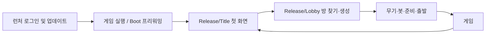

# 런처 로그인과 인게임 로비

## 책임과 흐름

2026-09-23 사용자 결정: 로그인·회원가입·계정 관리와 설치·업데이트는 런처에 유지하고, 방 찾기·생성·파티 준비·출발은 게임 안으로 이동한다.

런처는 방을 선택하기 전에 게임 자식 세션을 생성해 기존 PID 검증 Named Pipe로 전달한다. 비밀번호나 부모 런처 토큰을 게임에 전달하지 않는다. 게임은 받은 세션을 검증·갱신하고 Boot 준비가 끝나면 로비를 표시한다.

기존 Release/Title·Release/Lobby 씬과 영속 매니저를 사용한다. Title은 Dev_Title의 배경·로고·아무 키 안내·메뉴 구성을 재사용하고, 원정대 찾기·만들기를 계정 흐름에 연결한다. Dev_Title 원본과 씬 GUID, 빌드 씬 목록은 유지한다. 방 목록·파티 준비는 Lobby 안의 화면 단계다. 계정 프런트엔드 경로와 기존 개발 KCP·Steam·전용 서버·이전 방 지정 IPC 경로를 구분한다.

## API와 권위

- 게임 자식 세션의 방 생성·참가·준비 요청은 유효한 부모 런처 세션에 묶는다. 기존 `RoomMember.launcher_session_id` 및 호스트·릴레이·게임 티켓의 부모 일치 검증을 유지한다.
- 계정 변경과 추가 게임 세션 발급 등 런처 전용 권한을 게임에 일괄 개방하지 않는다.
- 방장만 봇과 출발을 변경하며 무기 선택·준비 상태·정원·출발 명단 확정은 계속 API가 검증한다. UI의 버튼 제한은 서버 검증을 대신하지 않는다.
- 방 목록은 수동 새로고침, 참가 중인 파티는 기존 주기로 presence와 준비 상태를 갱신한다. 다른 방을 둘러보는 것만으로 현재 파티를 떠나지 않는다.
- 설치된 실제 build identity와 API 허용 build가 맞지 않으면 출발을 차단하고 업데이트를 안내한다.

## 세션 종료와 복귀

새 인게임 경로는 한 판 종료나 연결 종료 후 네트워크와 선택 방 상태를 정리하고 Title 첫 화면으로 돌아온다. 인증이 유효하면 게임 프로세스와 계정 세션을 유지해 다음 방에 참가할 수 있다. 세션이 폐기되면 접속을 중단하고 런처에서 다시 로그인하도록 안내한다. 전용 서버의 프로세스 종료 정책은 유지한다.

호스트의 로비 복귀는 API 방 종료를 먼저 요청한다. 종료 확인에 실패하면 방 ID를 보존하고 다음 방 생성 전에 재시도해 이전 호스트 임대가 남는 것을 막는다. 게스트 연결 종료는 방을 삭제하지 않으며 기존 재접속 예약을 유지한다. Mirror가 비활성화한 영속 SessionManagers를 복구해 로비 입력과 다음 호스트 시작을 준비한다.

## 호환성과 배포

새 게임의 방 변경 요청에는 게임 자식 세션을 허용하는 API가 필요하다. API의 이전 런처 요청 호환성을 유지하되, 새 런처와 게임을 배포하기 전에 해당 API 변경을 함께 반영해야 한다. 이 문서 작성 작업만으로 운영 서비스가 배포되지는 않는다.

## 검증

`AccountLobbyUiBuilder.CreateOrUpdate()`가 `AccountLobbyUI.prefab`을 만들고 기존 `SessionNetwork.prefab`에 연결한다. 이어 `ReleaseTitleBuilder.Build()`가 Dev_Title을 읽어 출시 Title을 배선한다.

오프라인 계정 화면은 자체 `FrontendEventSystem`을 사용한다. 기존 `RunEventSystem`은 NetworkIdentity가 붙은 SessionManagers의 자식이어서 Mirror가 스폰하기 전에는 함께 비활성화된다. 기존 테스트가 패널 메서드를 직접 호출해 실제 클릭 불가를 놓쳤으므로, `front_*` 검증 명령은 EventSystem 레이캐스트와 포인터 이벤트를 사용한다. 게임 연결 중에는 전용 입력을 끄고, 복귀 후 기존 입력 시스템이 활성화되어 있으면 양보한다.

2026-09-23 검증: Unity EditMode 계정·로비 테스트 24개, 백엔드 테스트 90개, 런처 계정·패치 테스트 90개 통과. 런처 실제 서버 테스트 7개는 해당 일반 테스트 실행에서 환경 게이트로 건너뛰었다. 실제 게임 통합 검증은 별도로 수행한다.

`backend/scripts/smoke_ingame_lobby.py`는 로컬 API 18766·릴레이 18767 및 실제 Boot 시작 개발 빌드를 대상으로 임시 계정 3개를 생성한다. 방 생성·참가·준비·출발·Field 진입·전원 로비 복귀·같은 프로세스의 봇 방 재출발을 검사하고 화면 PNG를 남긴다. 검증 계정과 자신이 실행한 프로세스만 정리한다. 운영 주소나 실행 파일이 없는 설정은 거부한다.

최종 Windows 개발 빌드 `win64-frontend-20260923-035539`에서 해당 통합 검사 1/1 PASS(33초). 같은 PC의 실제 게임 3프로세스와 로컬 암호화 릴레이를 사용했다. 1280×720 홈·목록 및 3인 파티 화면, 960×540 게스트 파티 화면을 캡처해 확인했다. 게임 로그 3개에서 예외·오류·assertion 및 새 글꼴 경고는 없었다. 서로 다른 회선의 3인 검증은 수행하지 않았다.

빌드는 Succeeded이나 기존 외부 WeatherMaker 물 셰이더의 `UnityTessellationFactors` 오류 1건이 남는다. 기존 BarrierVisual Alpha 경고와 종료 시 ParryController 서버 비활성 경고는 별도 개선 범위다.

## 운영 배포

### 방 찾기 입력 및 출시 Title 후속 수정 (미배포)

게임0.0.13 사용자 피드백으로 오프라인 EventSystem 누락을 수정하고 Release/Title을 Dev_Title 스타일의 계정 첫 화면으로 구성했다. 로그인은 런처에 유지한다. 생성 창을 열면 뒤 메뉴를 숨기고, 이전 방 이름 검증 오류만 초기화한다. 기존 홈 카드는 제거했다.

Unity 계정·타이틀·입력 회귀32/32 PASS. 검증용 빌드 `win64-20260923-1410`에서 실제 게임3프로세스의 포인터 경로 E2E PASS: 타이틀 안내→방 찾기→빈 목록/이름 오류→타이틀 생성 창→참가·준비→3인 Field→타이틀 복귀→봇 방 재출발. 생성 창 뒤 메뉴의 클릭 거절도 확인했다. 이는 uGUI 레이캐스트와 포인터 이벤트 검증이며 OS 마우스·키보드 입력 또는 서로 다른 회선 검증을 의미하지 않는다. 1280×720 타이틀/방 목록/생성 창/파티와960×540 게스트 파티를 직접 캡처 검수했다.

최종 게임 빌드는 성공했다. 기존 WeatherMaker 물 테셀레이션 셰이더 오류1건은 남아 있다. 개발 검증의 응답 파일 읽기는 공유 읽기·쓰기·삭제를 허용해 게임의 응답 파일 교체와 충돌하지 않게 했다. 이 후속 수정은 아래 운영0.0.13 배포 이후 작성했으며 아직 R2/API에 재게시하지 않았다.

### 기존 운영 배포

2026-09-23 사용자 배포 요청으로 게임 **0.0.13 / win64-20260923-1318 / internal seq19**, 런처 **1.2.13**을 R2에 게시했다. 정규 Development 빌드로 3프로세스 인게임 로비 통합 검사를 다시 실행해 1/1 PASS(35초)를 확인했다. 소스는 `9088f414d98e-dirty`이며 미커밋 변경을 포함한다.

AWS API에는 `rooms.py`와 허용 build ID만 반영했다. 변경 직전 활성 방 0을 두 번 확인하고 원본 소스·환경을 백업했다. API 실효 build `win64-20260923-1318`, HTTPS ready, UDP 릴레이 리스닝을 확인했다. DB 마이그레이션 및 Discord 변경은 없다.

원격 채널 서명 검증, 공개 게임 DLL·build identity·런처 실행 파일의 로컬/manifest SHA256 일치, 최종 sync-server -Check의 게임·런처 일치를 확인했다. 사용자는 런처 재실행 후 런처 1.2.13과 게임 0.0.13으로 업데이트한다. 게시 후 사용자 PC의 실제 설치·접속 및 서로 다른 회선의 3인 플레이는 미검증이다.
