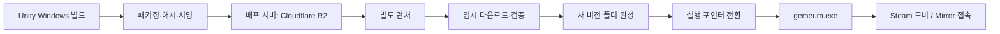

# 그믐 별도 런처·패치 시스템 설계서

> 작성 2026-09-19 · 갱신 2026-09-20 · 상태: P1~P4·런처 자기 업데이트 구현, **Cloudflare R2로 운영 중**
> 사용자 확정: 별도 런처에서 게임 다운로드·업데이트.
> 확정: Windows x64, C# WPF 런처, Cloudflare R2 정적 배포(2026-09-20 전환 완료), 파일 단위 패치. 용도는 팀 내부 테스트 배포이고 출시는 Steam이 한다.
> 구현 현황은 12장, 운영 절차는 13장, 런처 자기 업데이트는 11장.

## 1. 권장 구조

**Unity와 별개인 작은 런처가 배포 목록을 확인하고, 변경 파일만 다운로드하여 새 버전 폴더를 완성한 뒤 실행 대상을 전환한다.** 기존 게임 폴더를 직접 덮어쓰지 않으므로 다운로드 중단이나 검증 실패에도 이전 설치가 남는다.

게임 전체를 매번 ZIP으로 받는 방식 대신 파일별 SHA-256을 비교한다. 1차에서는 변경된 파일 전체를 받으며, 파일 내부의 바이너리 차분·청크 패치는 실제 전송량을 측정한 뒤 판단한다. Unity 대형 데이터 파일 하나가 바뀌면 그 파일 전체를 다시 받는 한계는 있다.



배포와 멀티플레이 연결은 분리한다. 별도 런처를 만든다고 Steam 네트워크 의존성이 없어지는 것은 아니다.

## 2. 설계 시점에 확인한 사실

아래는 **구현 전(2026-09-19 오전)** 코드 상태다. 인증기·로비·빌드 메뉴는 이후 P4에서 바뀌었고, 바뀐 내용은 5장 "구현 위치"에 있다.

| 확인 대상 | 당시 상태 | 설계에 반영할 점 |
|---|---|---|
| `ProjectSettings/ProjectVersion.txt` | Unity 6000.4.7f1 | 빌드 환경 고정 |
| `GeumeumBuildMenu.cs` | Windows x64, `Builds/Development`, `Builds/Release`, `gemeum.exe` | 기존 빌드 결과를 패키징 입력으로 사용 |
| `GeumeumAuthenticator.cs` | `_buildId = "dev"`, 요청 `Build` 문자열 비교 | 배포 빌드 식별자를 자동 주입 |
| `SteamLobbyService.cs` | 로비 `BUILD`에 `Application.version` 게시, `IsGeumeumLobby`는 게임·스키마 검사 | 로비 사전 검사와 실제 접속 검사 기준 통일 |
| `Identity/AuthMessages.cs` | `Build` 필드와 `BuildMismatch` 코드 존재 | 1차는 메시지 구조 유지 가능 |
| `Packages/manifest.json` | Addressables 직접 의존성 없음 | 1차는 Unity Player 파일 배포 |
| `steam_appid.txt` | 개발용 값 480 | 실제 AppID·Steam 외부 실행 동선은 배포 전 검증 필요 |
| `GeumeumBuildMenu.cs` | 개발 빌드에 AppID 파일 복사, 릴리스에는 미복사 | 기존 릴리스를 런처에서 바로 실행해도 된다고 가정하지 않음 |
| `RunLeaderboardStore.cs` | 로컬 JSON, 스키마 버전 1 | 업데이트·롤백이 사용자 기록을 삭제하면 안 됨 |

관련 소스는 [빌드 메뉴](../../Assets/01.Scripts/00.Common/Editor/GeumeumBuildMenu.cs), [인증기](../../Assets/01.Scripts/01.Network/GeumeumAuthenticator.cs), [Steam 로비](../../Assets/01.Scripts/01.Network/Steam/SteamLobbyService.cs), [리더보드 저장](../../Assets/01.Scripts/04.Systems/Results/RunLeaderboardStore.cs)다.

## 3. 범위와 기술 선택

### 1차 제공 기능

- 최초 설치, 업데이트 확인, 변경 파일 다운로드, 일시정지·재개·재시도.
- 파일 검증·복구, 디스크 공간 확인, 설치 버전 표시, 게임 실행.
- 개발 테스트 채널 `internal`과 배포 채널 `stable` 분리.
- 실패 시 기존 버전 보존, 관리자에 의한 배포 롤백.
- 패치 노트와 오류 코드·로컬 로그.

로그인 서버, 런 저장, 게임 중 리소스 교체, C# 핫 리로드, 자체 P2P 배포는 1차 범위에 넣지 않는다. 비공개 배포가 필요하면 저장소 접근 제어를 별도 연결한다. 채널 이름만으로 접근 통제가 되지는 않는다.

| 요소 | 제안 | 이유 |
|---|---|---|
| 런처 UI | C# + WPF, 구현 시 지원 중인 .NET LTS 고정 | 팀 C# 경험과 현재 Windows 빌드 활용 |
| 배포 형태 | self-contained Windows x64 | 사용자에게 .NET 별도 설치 요구 최소화 |
| 패치 핵심 | UI와 분리한 .NET 클래스 라이브러리 | 장애 주입·자동 검증 가능 |
| 저장소 | 정적 파일 서버. Cloudflare R2(2026-09-20~). 같은 폴더를 Kestrel로 LAN에 여는 경로도 유지 | 별도 동적 API·DB 불필요. 서버를 바꿔도 주소만 바뀐다 |
| 무결성·진위 | 파일 SHA-256 + 메타데이터 ECDSA P-256 서명 | 손상 파일과 무단 배포 구별 |
| 저장 방식 | 버전별 폴더 + 작은 활성 포인터 파일 | 실패 복구와 롤백 단순화 |

WPF는 Windows 데스크톱 프레임워크다. 다른 OS 지원을 확정하면 UI 기술을 재선정하되 패치 핵심 라이브러리는 재사용한다. [Microsoft WPF 개요](https://learn.microsoft.com/en-us/dotnet/desktop/wpf/overview/)

## 4. 구성 요소와 책임

| 구성 요소 (`launcher/`) | 책임 |
|---|---|
| `Launcher.UI` | WPF 화면. 상태·진행률·버튼·오류 안내, 설정, 런처 자기 업데이트 호출. 직접 파일 조작은 하지 않고 `Patch.Client`에 맡긴다 |
| `Patch.Core` | 배포 계약. manifest·채널·런처 배포 정보 모델, 엄격 JSON, 경로 규칙, SHA-256, 서명, 로컬 저장소 게시(`RepoPublisher`) |
| `Patch.Client` | 런처 엔진. 설치 잠금·상태 파일·버전 전환·복구(`Installer`), HTTP/폴더 저장소와 Range 이어받기(`RemoteRepository`), 게임 실행(`GameProcess`), 런처 교체(`LauncherUpdater`) |
| `Release.Packager` (`geumeum-pack`) | 게시 도구. 빌드 폴더 검사, 파일 목록·해시·서명, 로컬 HTTP 서버, R2 업로드 |
| `Patch.Core.Tests` | 위 세 라이브러리의 자동 검증(xUnit) |
| 게임 `BuildIdentity` | 배포 버전 원본을 제공하고 접속 호환 검사에 사용 (`Assets/01.Scripts/01.Network/Identity/`) |

코드 위치는 저장소 루트 `launcher/` 하나로 둔다. 패키징 도구도 여기에 넣는다. `GeumeumBuildMenu.CopyTools`는 개발 빌드에 필요한 실행·Steam 로그 확인 스크립트 8개만 명시적으로 복사한다. `tools/teaser` 같은 제작 도구는 포함하지 않는다. Unity 연결은 기존 `00.Common`·`01.Network` 영역 안에서 수행한다.

게임 쪽 `BuildIdentity`는 빌드 스크립트가 `gemeum_Data/StreamingAssets/build-identity.json`으로 쓴다. StreamingAssets는 빌드에 자동 포함되고 런타임에 `Application.streamingAssetsPath`로 읽을 수 있어 별도 에셋 생성이 필요 없다. 패키징 도구는 이 파일의 `releaseId`와 manifest의 `releaseId`가 같은지 검사한다.

## 5. 버전 계약

| 필드 | 의미·변경 규칙 |
|---|---|
| `releaseId` | 배포 산출물의 불변 ID. Unity 빌드 메뉴가 빌드 시각으로 찍는다. 예: `win64-20260919-1432`. 재사용 금지 |
| `displayVersion` | 사람이 부르는 **테스트 버전**. 2026-09-20부터 0.0.1에서 시작해 게시할 때마다 끝자리 +1(`-Version`으로 큰 단위 지정). 게시 스크립트가 번호를 정해 빌드의 `build-identity.json`에 쓰고 패키징하며, 마지막 번호는 `Builds/test-version.json`에 둔다. Unity `bundleVersion`은 쓰지 않는다(공용 ProjectSettings 충돌). 접속 호환·정렬 기준으로는 쓰지 않는다 |
| `sequence` | 채널 게시 순번. 롤백 배포도 증가 |
| `protocolVersion` | Mirror 메시지·직렬화 계약 버전 |
| `contentVersion` | 판정 데이터·콘텐츠 묶음 버전 |
| `minLauncherVersion` | 해당 배포를 처리할 런처 최소 버전 |

**1차 멀티플레이는 `releaseId`가 같은 빌드끼리만 허용한다.** 표시 버전이 같거나 프로토콜만 같아도 다른 배포면 거부한다. 프로토콜·콘텐츠 버전은 진단 정보로 남기며, 서로 다른 릴리스의 호환 허용은 후속 정책이다.

빌드 단계에서 공통 `BuildIdentity`를 게임에 포함하고, 동일 입력으로 배포 manifest를 만든다. manifest 자체 해시를 게임 안에 넣으면 자기 참조가 생기므로 넣지 않는다. 패키징 도구는 게임의 내장 releaseId와 manifest의 releaseId가 같은지 검사한다.

`Application.version`은 표시용으로 두고 로비 `BUILD`와 인증 요청 `Build`는 내장 releaseId를 읽게 바꾼다. 로비 발견·초대·직접 로비 ID 참가 모두 사전 검사하고, 최종 승인은 기존 `GeumeumAuthenticator`에서 다시 검사한다. 기존 신원·nonce·입장 잠금 검사를 유지한다. KCP 개발 경로에도 동일 정책을 적용한다.

`dev` 공통값의 배포를 금지한다. 빌드 ID는 호환성 표식이며 악성 클라이언트에 대한 치트 방지 증명은 아니다.

에디터 호스트 + 빌드 클라이언트로 테스트하는 현재 방식은 엄격 일치와 충돌한다. 규칙은 다음과 같다.

- 에디터 실행은 식별자가 `editor`다. 에디터끼리만 붙는다.
- 플레이어 빌드인데 `build-identity.json`이 없거나 읽지 못하면 `unknown`이다. `unknown`은 자기 자신과도 붙지 않는다.
- 빌드 메뉴는 빌드마다 새 releaseId를 찍는다. 같은 커밋이라도 따로 빌드하면 서로 붙지 않는다. 팀 테스트는 한 사람이 만든 빌드를 런처로 나눠 받아 한다.
- 에디터 호스트에 빌드 클라이언트를 붙여야 하면 메뉴 `그믐/빌드/에디터 빌드 불일치 허용`을 켠다(EditorPrefs에 저장). Development 빌드는 실행 인자 `-allow-build-mismatch`로 같은 동작을 한다. 두 스위치 모두 `UNITY_EDITOR || DEVELOPMENT_BUILD`에서만 컴파일되고, 켜져 있어도 경고 로그를 남긴다.

구현 위치:

| 파일 | 역할 |
|---|---|
| `01.Network/Identity/BuildIdentity.cs` | `StreamingAssets/build-identity.json` 읽기, `IsCompatible`, 불일치 허용 스위치 |
| `00.Common/Editor/GeumeumBuildMenu.cs` | 빌드 성공 뒤 정체성 파일 기록. `contentVersion`은 소스 커밋 12자리, 커밋 안 된 변경이 있으면 `-dirty` |
| `01.Network/GeumeumAuthenticator.cs` | 직렬화 필드 `_buildId`를 없애고 `BuildIdentity`로 비교. 씬·프리팹에 남은 `_buildId: dev` 줄은 다음 저장 때 Unity가 지운다 |
| `01.Network/Steam/SteamLobbyService.cs` | 로비 `BUILD`에 releaseId 게시. 초대·로비 ID 참가 시 방장이 아니면 `game`·`schema`·`build`를 사전 검사하고 어긋나면 로비를 떠난다. 로비 데이터가 아직 없으면 인증기에 맡긴다 |

`Build` 메시지 필드와 `BuildMismatch` 코드는 그대로다 — 메시지 구조는 바뀌지 않았다. 로비 목록 검색 경로는 현재 코드에 없어 사전 검사 대상이 아니다.

## 6. 서버 파일과 메타데이터

```text
/channels/stable/envelope.json
/channels/internal/envelope.json
/releases/<releaseId>/manifest.json
/objects/sha256/<fileHash>          ← 게임 파일과 런처 exe가 같이 들어간다
/notes/<releaseId>.txt
/launcher/latest.json               ← 최신 런처를 가리키는 서명 문서 (11장)
/launcher/GeumeumLauncher.exe       ← 처음 받는 사람용 고정 주소
```

파일 객체와 릴리스 manifest는 불변으로 게시한다. 같은 URL의 내용을 덮어쓰지 않는다. 채널 envelope만 최신 배포를 가리키도록 교체한다. payload와 서명을 한 응답에 담아 서로 다른 시점의 문서·서명을 읽는 경합을 피한다.

서명 envelope의 계약:

```json
{
  "keyId": "release-key-1",
  "payloadBase64": "<정확한 UTF-8 payload 바이트의 Base64>",
  "signatureBase64": "<P-256 SHA-256 서명의 Base64>"
}
```

서명 대상은 Base64 디코딩한 원본 payload 바이트다. JSON을 다시 직렬화하여 검증하지 않는다. 서명 형식은 IEEE P1363 고정 길이로 명시하고 송수신 구현이 일치해야 한다. 런처 내장 공개키 목록에서 keyId를 찾으며 알 수 없는 키는 거부한다. 서명 검증 기능은 [.NET ECDsa.VerifyData](https://learn.microsoft.com/en-us/dotnet/api/system.security.cryptography.ecdsa.verifydata)를 이용한다.

payload에는 `schemaVersion`, `channel`, `platform`, `sequence`, `issuedAtUtc`, `expiresAtUtc`, `releaseId`, `manifestSha256`, `manifestSize`, `minLauncherVersion`을 넣는다. URL은 신뢰된 배포 origin과 검증된 ID로 조합한다. 서명이 올바른 payload에 고정된 해시로 manifest 원본 바이트를 검증한 뒤 파싱한다.

manifest 개념 예시(아래 `<...>`는 실제 배포 시 계산값으로 치환):

```json
{
  "schemaVersion": 1,
  "releaseId": "win64-20260919-001",
  "displayVersion": "0.4.1",
  "platform": "win-x64",
  "protocolVersion": 1,
  "contentVersion": "20260919-001",
  "entryPoint": "gemeum.exe",
  "files": [
    { "path": "gemeum.exe", "size": 123456, "sha256": "<64자리 소문자 hex>" },
    { "path": "gemeum_Data/globalgamemanagers", "size": 234567, "sha256": "<64자리 소문자 hex>" }
  ]
}
```

실제 파일 목록은 Unity 빌드 출력 전체에서 생성한다. DLL·데이터·필수 네이티브 플러그인을 임의로 제외하지 않는다. 개발 도구·로그·비밀 파일은 빌드 유형별 명시적 규칙으로 제외하고 누출 검사를 한다.

2026-09-20: 빌드 성공 후 이전에 복사된 `teaser`와 Unity의 `DoNotShip` 디버그 폴더를 정리한다. 패키저도 제작 도구·프로젝트 원본 폴더와 C# 소스·프로젝트 파일·PDB/MDB 심벌을 제외한다. 개발 빌드 자체의 PDB는 로컬 디버깅용으로 유지하며 배포 목록에서만 제외한다. DLL·StreamingAssets·Steam 플러그인·`steam_appid.txt`는 보존한다. 기존에 서명·게시한 배포는 수정하지 않고 다음 새 빌드 게시부터 제외 규칙을 적용한다.

메타데이터 크기·파일 개수·각 파일 크기·전체 설치 크기에 상한을 두고 정수 overflow, 중복 JSON 필드, 미지원 스키마, 중복 경로를 거부한다. 만료된 envelope와 저장된 채널 최고 sequence보다 낮은 응답은 거부한다. 만료 기간은 게시 시점 기준 **180일**을 기본값으로 둔다 — 팀이 방학·시험 기간에 게시를 멈춰도 마지막 배포가 만료로 막히지 않게 하기 위해서다. 동일 sequence의 payload가 달라져도 거부한다. PC 시간 오차는 별도 오류로 안내한다. 신규 설치에서 과거의 유효한 서명 배포를 완전히 식별하려면 외부 최신성 기준이 필요하며, 서명만으로 이를 보장하지 않는다.

## 7. 로컬 설치와 안전한 전환

```text
<InstallRoot>/
  state/active.json
  state/active.backup.json
  state/transaction.json
  versions/<releaseId>/...
  staging/<transactionId>/...
  cache/<hash>.part
  logs/...
```

기본 위치는 사용자 쓰기 권한이 있는 `%LOCALAPPDATA%/Geumeum/Game`이다. 런처 설정(설치 위치·채널·배포 서버 주소)은 설치 폴더 밖 `%LOCALAPPDATA%/Geumeum/launcher-settings.json`에 둔다. 사용자 지정 경로는 로컬 NTFS 볼륨을 1차 지원 범위로 제한한다. staging과 versions, state는 같은 볼륨에 둔다. 시스템 폴더 설치나 관리자 상시 실행은 기본 동선에 넣지 않는다.

### 설치 순서

1. 설치 경로 기준 배타 잠금을 얻는다. 런처 두 개가 같은 설치를 갱신하지 못하게 한다.
2. 미완료 transaction을 복구하고 활성 버전·게임 실행 여부를 확인한다.
3. 채널 서명·만료·sequence, manifest 해시·경로·크기를 검증한다.
4. 목표 목록과 기존 파일의 실제 SHA-256을 비교한다. 크기·수정 시각만으로 정상 판정하지 않는다.
5. 필요한 디스크 공간을 계산한다. **새 버전 전체 복사 크기 + 누락 다운로드 임시 크기 + 여유 공간**을 현재 가용 공간과 비교한다. 보유 중인 기존 버전은 이미 공간을 점유한 상태다.
6. 변경 없는 파일도 검증 후 staging으로 복사한다. 1차는 하드링크를 사용하지 않아 두 버전 사이의 쓰기 전파를 피한다.
7. 변경 파일을 `.part`로 받아 크기·SHA-256 검증 후 staging의 목표 경로에 이동한다.
8. staging 전체가 manifest와 일치하는지, 추가 실행 파일이 없는지 확인한다. 삭제된 파일은 목표 목록에 없으므로 새 버전에 포함하지 않는다.
9. 같은 볼륨 내 staging 폴더를 완성된 `versions/<releaseId>`로 이동한다. 기존 같은 ID가 있으면 manifest 일치 여부를 확인하고 임의 덮어쓰지 않는다.
10. transaction에 `Prepared`를 기록·flush한다. 새 active 파일을 임시 파일로 작성·flush하고 기존 active를 백업하면서 원자적으로 교체한다. 최초 설치는 기존 파일 없는 경로를 따로 처리한다.
11. 재읽어 active와 대상 manifest의 일치를 확인한 뒤 transaction을 `Committed`로 기록한다.

원자 교체만으로 정전 복구가 전부 해결되었다고 보지 않는다. 재시작 시 active·backup·transaction·완성된 버전을 함께 검증한다. 유효한 새 active면 커밋을 마무리하고, 그렇지 않으면 유효한 backup을 복구한다. 둘 다 불량이면 실행을 차단하고 복구 설치를 안내한다. 파일 교체·flush 의미와 전원 차단 시 동작은 대상 파일시스템에서 검증해야 한다.

경로는 상대 경로만 허용하고 `..`, 절대·UNC 경로, 드라이브 접두사, ADS의 `:`, 예약 장치명, 끝의 공백·점, 대소문자 충돌, 파일/디렉터리 충돌을 거부한다. 정규화된 최종 경로가 설치 루트 내부인지 확인한다. 루트와 하위 경로의 reparse point·심볼릭 링크도 거부한다. 삭제·정리는 확인된 자체 캐시와 버전 폴더에만 수행한다.

사용자 기록과 설정은 설치 버전 밖에 유지한다. Unity company/product 식별자를 패치마다 바꾸지 않는다. 리더보드 스키마를 변경하는 릴리스는 이전 게임으로 돌아갔을 때 읽을 수 있는지 별도 검증하며, 읽을 수 없는 경우 해당 롤백을 허용하지 않는다.

## 8. 다운로드·오류 처리

1차 전송 객체는 압축 없는 원본 파일로 두어 파일 해시와 전송 해시를 일치시킨다. 동시 다운로드 3개, 무응답 timeout 30초, 실패 재시도 3회(최대 4회 시도)와 1·2·4초 지수 backoff를 쓴다(`InstallerOptions`). 대형 파일은 전체 시간보다 무응답 구간 timeout을 적용한다.

재개 정보에는 목표 hash·전체 크기·현재 길이·강한 ETag를 저장한다. `Range`와 가능한 경우 `If-Range`를 사용한다. 206이면 Content-Range 시작·끝·전체 크기를 검증하고 이어 쓴다. 200이면 기존 part를 비우고 처음부터 쓴다. 416이면 로컬 길이·해시를 검사해 완료 또는 재다운로드를 결정한다. 응답의 변형 압축을 허용하지 않고 마지막에 전체 SHA-256을 확인한다. [HTTP Range 규격](https://www.rfc-editor.org/rfc/rfc9110.html)

| 상황 | 행동 |
|---|---|
| 연결 끊김·런처 종료 | part와 transaction 보존, 재시작 때 재검증 후 재개 |
| 파일 해시 불일치 | 해당 part 폐기 후 제한 재시도, 반복 실패 시 중단 |
| 서명·스키마 오류 | 설치 및 새 버전 실행 차단, 우회 버튼 없음 |
| 파일 404 | 배포 불완전 오류, 다른 릴리스 파일로 대체하지 않음 |
| 디스크 부족·권한 오류 | 기존 버전 유지, 확보할 공간 또는 경로 조치 안내 |
| 백신 격리·잠긴 파일 | 파일명과 복구 안내, 백신 끄기를 요구하지 않음 |
| 게임 실행 중 | 1차는 설치·복구·전환·삭제를 보류 |
| 메타데이터 서버 장애 | 마지막 검증 설치는 선택 실행 허용, 최신 여부 미확인 표시 |

오프라인 실행은 게임의 Steam 연결 가능 여부와 별개다. 자체 중앙 인증 서버가 없는 구조에서 런처만으로 모든 구버전 실행을 강제 차단할 수 없다. 구버전끼리 접속하는 것도 원격 최소 버전 정책을 게임에 추가하지 않으면 가능하다. 1차 보장은 서로 다른 releaseId의 혼합 접속 차단이다.

## 9. UI와 실행 흐름

```text
시작 → 이전 런처 정리 → 런처 업데이트 확인 ─(새 버전)→ 교체·재시작
                         ↓(최신)
       상태 복구 → 게임 업데이트 확인 → 설치 계획 → 다운로드 → 검증 → 적용 → 게임 시작 가능
                                          ↘ 공간 부족 / 오류 / 일시정지 → 조치 후 재개
```

메인 화면에는 설치된·최신 버전, 채널, 배포 서버, 설치 위치, 패치 노트, 다운로드 바이트·속도·남은 시간, 현재 단계, 기본 버튼 하나를 표시한다. 버튼은 `설치 / 업데이트 / 일시정지 / 계속 / 게임 시작 / 실행 중 / 런처 받기 / 다시 시도`로 상태에 맞춰 바뀐다. 파일 검사와 복사는 다운로드 진행률과 구분하여 표시한다. 설정에는 배포 서버 주소, 설치 위치, 채널, 파일 검사·복구, 로그 폴더 열기를 둔다. 배포 서버 주소를 비우면 런처에 내장된 주소를 쓴다.

실행은 검증된 manifest의 entryPoint만 허용하고 작업 디렉터리를 해당 버전 폴더로 설정한다. 명령줄은 런처 코드에 고정된 `-steam -logFile <설치 위치>/logs/game.log`뿐이고, 원격 문서에서 명령줄이나 스크립트를 받지 않는다. `-steam`은 `tools/run-steam-lobby.bat`과 같은 Steam 로비 경로다. Steam 클라이언트가 꺼져 있으면 게임을 켜지 않고 안내한다. 직전 실행 로그는 `game-previous.log`로 하나 남긴다. 런처가 띄운 게임은 프로세스 핸들로, 직접 실행한 게임은 설치 경로의 프로세스를 주기적으로 찾아 실행 중으로 표시하고 그동안 설치·전환을 막는다.

기존 Steam 초기화가 독립 경로 실행에서 성립하는지 먼저 확인한다. Steam 재실행 API가 별도의 Steam 설치 경로로 넘겨버리는 경우 런처가 패치한 파일과 실제 실행 파일이 달라질 수 있다. 실행 경로·작업 디렉터리·로비 진입을 묶어 검증해야 한다.

**이 런처의 용도는 팀 내부 테스트 배포다.** 출시는 실제 Steam AppID로 Steam이 배포한다. 따라서 런처가 실행하는 빌드는 개발용 AppID 480과 `steam_appid.txt`를 그대로 쓰며, 480 경로가 곧 정식 동선이다. `steam_appid.txt`는 패키징 제외 대상이 아니다.

업데이트 후 게임이 빨리 종료됐다는 이유만으로 자동 롤백하지 않는다. 정상 종료와 크래시를 구분하기 어렵다. 실패 로그와 복구 선택을 제공하고, 배포 담당자가 문제가 확인된 릴리스를 롤백한다.

## 10. 게시·롤백·키 관리

### 게시 순서

1. 고정된 Unity·패키지·외부 에셋 환경에서 빌드한다. 소스 커밋, 외부 에셋 목록, 빌드 설정을 기록한다.
2. 새로운 releaseId로 빌드 정체성을 생성한다. 기존 빌드 폴더 잔여 파일이 섞이지 않은 독립 출력물을 만든다.
3. 파일 검사·manifest 생성 후 모든 객체와 manifest를 먼저 업로드한다.
4. 실제 다운로드 경로에서 게시 완료·해시·재개 동작을 확인한다.
5. `internal` envelope를 마지막에 게시하고 신규 설치·직전 버전 업데이트·3PC 접속을 검증한다.
6. 동일 산출물을 재빌드 없이 `stable`로 승격한다. 채널 sequence와 서명 envelope는 새로 발행한다.

객체·manifest는 장기 캐시 가능한 불변 URL로, 채널 envelope는 짧은 TTL과 재검증 정책으로 제공한다. 업데이트 계획을 시작하면 목표 manifest를 고정하고 중간에 최신 채널로 갈아타지 않는다.

롤백은 새 sequence의 서명 envelope가 이전 releaseId를 가리키게 게시한다. sequence를 낮추거나 기존 manifest를 수정하지 않는다. 이전 게임과 기록 스키마의 호환성을 확인한 뒤 시행한다. 실행 중인 런을 즉시 종료하지 않고 다음 런처 확인 때 전환한다.

런처는 현재·직전 정상 버전을 보존하고 실행 중인 버전은 삭제하지 않는다. 원격에서도 현재 및 롤백 대상 manifest·객체를 유지한다. 객체 정리는 유지 대상 모든 manifest에서 참조되지 않음을 확인한 뒤 수행한다.

서명 개인키는 저장소·런처·게임에 포함하지 않고 배포 비밀 저장소에 둔다(현재 `%USERPROFILE%\.geumeum\keys\`). 파일 해시만으로는 공격자가 파일과 해시를 함께 바꾸는 것을 막을 수 없어 서명이 필요하다. 진위는 서명과 해시가 보장하므로 전송은 R2(HTTPS)와 팀장 PC 서버(http) 모두 허용한다 — http 구간에서 누가 내용을 바꿔도 서명·해시 검증에서 설치가 막힌다. 다만 http는 내용이 암호화되지 않아 빌드를 엿볼 수는 있다. redirect는 따라가지 않는다. 키 교체는 기존 신뢰 경로로 검증된 새 런처에 새 공개키를 먼저 추가한 후 전환한다. 키 유출 시에는 새 신뢰 기반의 런처 재배포가 필요할 수 있다.

## 11. 런처 자체 업데이트

**런처 1.2.0부터 런처가 스스로 업데이트한다.** 팀원은 아무것도 하지 않는다.

### 배포 정보 계약

`launcher/latest.json`은 채널 envelope와 같은 형식(`keyId`·`payloadBase64`·`signatureBase64`)으로, 같은 릴리스 키로 서명한다. payload:

```json
{ "schemaVersion": 1, "platform": "win-x64", "version": "1.2.0",
  "sha256": "<64자리 소문자 hex>", "size": 71758182, "issuedAtUtc": "2026-09-19T11:41:00Z" }
```

exe 본체는 게임 파일과 같은 `objects/sha256/<sha256>`에 둔다. `launcher/GeumeumLauncher.exe`는 처음 받는 사람용 고정 주소일 뿐 자동 업데이트는 이 파일을 읽지 않는다.

### 런처 쪽 순서 (`Patch.Client/LauncherUpdater`)

1. 시작하자마자 exe 옆의 `GeumeumLauncher.exe.old*`·`.new*`를 지운다. 직전 런처가 아직 끝나는 중이면 0.5초 간격으로 10번까지 기다린다.
2. `latest.json`을 받아 내장 공개키로 서명을 확인한다. 404면(도입 전) 넘어간다. 네트워크 오류면 게임 확인 단계가 같은 이유로 안내하므로 조용히 넘어간다.
3. 버전이 지금보다 **높을 때만** 진행한다. 같거나 낮으면 아무것도 하지 않는다 — 오래된 서명 문서를 다시 보내 되돌리는 공격을 막는다.
4. exe를 `GeumeumLauncher.exe.new`로 받고 크기·SHA-256을 서명된 값과 대조한다. 다르면 지우고 중단한다.
5. 실행 중인 exe는 덮어쓸 수 없지만 이름은 바꿀 수 있다. `현재 exe → .old`, `.new → 원래 이름`으로 옮긴다. 두 번째 이동이 실패하면 `.old`를 원래 이름으로 되돌린다.
6. 같은 인자로 새 exe를 띄우고 지금 런처를 끈다. 새 런처가 1단계에서 `.old`를 지운다.

실패하면(폴더 쓰기 권한 없음, 서명 불일치 등) 경고 문구만 남기고 지금 런처로 계속 쓴다. 채널의 `minLauncherVersion`에 걸리면 "런처 받기" 버튼이 자동 교체를 한 번 더 시도하고, 그래도 안 되면 브라우저로 고정 주소를 연다. 자기 업데이트는 Release 빌드에서만 돈다(Debug 빌드는 bin 폴더를 바꾸지 않는다).

### 게시 쪽 규칙 (`RepoPublisher.PublishLauncher`)

- 버전은 exe의 파일 버전(`Launcher.UI.csproj`의 `<Version>`)에서 읽는다.
- 이미 더 높은 버전이 게시돼 있으면 거부한다. 같은 버전에 다른 exe를 올리는 것도 거부한다 — 버전을 올려야 팀원 런처가 받는다.
- 객체와 고정 주소 exe를 먼저 쓰고 `latest.json`을 마지막에 바꾼다. R2 업로드도 같은 순서다.

1.1.0 이하 런처는 이 기능이 없어서, 채널 최소 런처를 1.2.0으로 올려 한 번만 "런처 받기"로 받게 했다(2026-09-19). 설치 프로그램·exe의 Windows 코드 서명(Authenticode)은 없다. 처음 받을 때 SmartScreen 경고가 뜰 수 있다.

## 12. 구현 단계와 완료 조건

| 단계 | 산출물 | 통과 기준 |
|---|---|---|
| P0 실행 검증 | 외부 경로에서 실행한 기존 빌드 | `%LOCALAPPDATA%` 경로에서 AppID 480으로 Steam 초기화·로비·3PC 접속, 실제 실행 경로 확인 |
| P1 패키징 | manifest·객체·서명 도구 | 동일 입력의 파일 목록 재현, 잘못된 경로·서명·ID 불일치 거부. **같은 소스 빌드 2회의 변경 파일 수·바이트 측정** — Unity 재빌드에서 `globalgamemanagers`·`sharedassets*`가 매번 바뀌면 파일 단위 패치의 실효가 작아 청크 패치 결정을 앞당긴다 |
| P2 패치 핵심 | 계획·다운로드·복구·전환 | 아래 장애 시나리오 자동 검증, 이전 설치 보존 |
| P3 WPF 런처 | 설치·업데이트·진행률·복구·실행 UI | 새 Windows 사용자 환경에서 설치부터 게임 실행까지 완료 |
| P4 게임 연결 | 공통 BuildIdentity·로비·인증 검사 | 동일 릴리스 3인 정상, 다른 릴리스 입장 차단 |
| P5 운영 리허설 | internal → stable, 롤백 | 실제 서버로 v1 설치 → v2 업데이트 → v1 롤백 및 기록 보존 |

첫 구현은 **P0의 Steam 실행 경로 확인과 P1의 배포 산출물 계약**부터 한다. 이 두 가지가 정해져야 런처 UI와 다운로드 구현을 실제 게임에 연결할 수 있다. 일정은 P0 결과와 실빌드 크기 측정 후 산정한다.

### 구현 현황 (2026-09-19)

P1~P4와 런처 자기 업데이트가 코드로 있다. 2026-09-20 R2로 이전하며 팀장 PC 서버는 이전 런처 전환용으로 유지한다. `dotnet test launcher/Patch.Core.Tests -c Release`로 자동 검증한다(60개 통과).

| 프로젝트 | 내용 |
|---|---|
| `Patch.Core` | manifest·envelope 모델, 경로 규칙, 엄격 JSON(중복 필드 거부), SHA-256, ECDSA P-256/P1363 서명, `BuildIdentity` 대조, 로컬 저장소 게시(`RepoPublisher`) |
| `Patch.Client` | 런처 엔진(P2). 설치 잠금, 업데이트 확인(서명·만료·sequence·같은 seq 다른 내용 거부), 로컬 파일 해시 재사용, 3병렬 다운로드·Range 이어받기·재시도, staging 검증, 폴더 이동(백신 검사 대기 재시도), `active.json` 원자 교체, 강제 종료 복구, 현재·직전 버전만 보존, 검사·복구, 게임 실행·실행 중 감지 |
| `Launcher.UI` (`GeumeumLauncher.exe`, 현재 1.2.7) | WPF 런처(P3). 기본 버튼 하나, 진행률·속도·남은 시간, 패치 노트, 설정(배포 서버 주소·설치 위치·채널·검사·복구·로그 폴더). 게임 시작은 Steam 로비 경로(9장). 시작 시 자기 업데이트(11장). 서명 공개키와 기본 배포 주소는 `launcher-config.json`에 내장 |
| `Release.Packager` (`geumeum-pack`) | `keygen` · `pack` · `publish-channel` · `verify-channel` · `diff` · `serve`(Kestrel, 로컬/LAN, 관리자 권한 불필요) · `publish-launcher` · `upload`(R2) · `upload-launcher` · `verify-remote` |
| `Patch.Core.Tests` | P1 계약 + P2 엔진: 신규 설치·재실행 0바이트, 변경·추가만 전송, 5개 지점 강제 종료 복구, HTTP 중단 후 206 이어받기, If-Range 불일치 시 처음부터, 변조 객체·누락 객체 거부, 오래된 sequence·같은 seq 위조 거부, 롤백 시 재다운로드 0, 검사·복구, 설치 잠금, 런처 최소 버전. 런처 자기 업데이트: 새 버전 교체·정리, 같거나 낮은 버전 무시, 변조 exe 거부, 모르는 키 거부, 게시 쪽 다운그레이드·같은 버전 다른 exe 거부, 교체 실패 시 원상 복구 |
| `launcher/scripts/` | `sync-server.ps1`(로컬↔서버 버전 비교 후 다른 것만 게시, 패치 노트 자동, 게시 기록), `publish-build.ps1`(빌드 → 패키징 → 서명 → 검증 → 선택: R2 업로드·공개 주소 검증), `publish-launcher.ps1`(단일 exe 68MB → 서명 게시 → 선택: R2), `serve-repo.ps1`(같은 저장소를 이 PC에서 LAN으로 — 지금은 대비책), `import-r2.ps1`(암호화된 R2 자격 증명을 프로세스 환경 변수로만 읽기) |
| `.claude/skills/sync-patch-server` | 위 `sync-server.ps1`을 쓰는 Claude Code 스킬 |

실제 데이터 검증(로컬 HTTP 서버, 2026-09-19):

- `Builds/Development` 3,493MB 신규 설치 → 게임 시작 → 설치 폴더의 `gemeum.exe`가 실행됨 → 종료 후 런처 복귀.
- 설치 도중 실패 후 재시작 → 파일 7,175개 재사용, 남은 328MB만 받아 완료.
- P4가 들어간 19:07 재빌드로 업데이트 → **15,306개 중 28개(487MB)만 전송**, 약 15초에 전환, 직전 버전 보존.
- 이 과정에서 테스트가 놓친 결함 두 개를 찾아 고쳤다. 0바이트 파일 다운로드 실패, 백신 검사 중 폴더 이동 거부.
- 팀장 PC 서버(`http://169.212.47.146:8765`)에서 **팀원 PC가 런처를 받아 설치까지 성공**(팀장 확인).
- 런처 게임 시작 → 명령줄 `-steam -logFile …`, 게임 로그에 "Steam 경로로 시작한다"·"Steam 초기화 성공".
- 런처 자기 업데이트: 1.2.0 exe 실행 → 1초 안에 1.3.0 발견·교체·재시작, `.old` 정리(임시 저장소로 확인).
- 운영 중 찾아 고친 결함: 없는 노트 파일로 게시가 반쯤 끝나 재실행이 막히던 문제, 새 빌드 게시 때 최소 런처 버전이 1.0.0으로 되돌아가던 문제.

빌드 2회 변경량 실측: 코드 변경이 있는 재빌드에서 전체의 14%가 바뀌었고, 그중 413MB가 `sharedassets0.assets` 한 파일이다. 파일 단위 패치로 86%를 아낀다. 청크 패치는 R2 실사용 속도를 본 뒤 판단한다(아직 미정).

2026-09-20 R2 전환 검증: 객체 13,301개 업로드, 공개 주소에서 서명·manifest·객체 해시 일치, 런처 1.2.6 → 1.2.7 자동 교체 확인(13장).

지금도 미검증: 네트워크가 느린 환경의 일시정지 버튼, 다른 PC에서의 전체 신규 설치, 런처로 받은 같은 빌드로 3인 Steam 로비 접속(P4 L3).

### 필수 검증 목록

| 검증 | 기대 결과 |
|---|---|
| 신규 설치·동일 버전 재실행 | 설치 성공, 변경 없으면 게임 파일 다운로드 0바이트 |
| 한 파일 변경·추가·삭제 | 변경·추가 파일만 전송, 삭제 파일은 새 버전에 없음 |
| 대형 파일 중단·재개 | 206/200/416 응답별 데이터 중복·손상 없음 |
| 다운로드·검증·폴더 이동·포인터 교체 전후 강제 종료 | 재시작 후 완전한 이전 또는 새 버전만 실행 |
| manifest 변조·잘못된 서명·오래된 sequence | 설치 차단, 기존 설치 보존 |
| 경로 탈출·링크·대소문자·ADS·예약명 | 설치 루트 밖 쓰기 0건 |
| 공간 부족·파일 잠금·런처 중복·게임 직접 실행 | 전환·삭제 경합 없이 안내 |
| 설치 후 파일 손상 | 검사·복구로 해당 파일 재다운로드 |
| 중간 채널 변경·캐시 지연 | 하나의 releaseId로 끝까지 설치 |
| 신규/구버전 혼합 3PC, Steam 초대·로비 ID·KCP | 버전 불일치 거부, 기존 신원·재접속 정책 유지 |
| 롤백 후 리더보드 로드 | 기존 기록 보존, 미지원 스키마는 명시적 오류 |

Unity 코드 변경 시 L1·L2를 수행하고 네트워크 연결 변경은 저장소 지침에 따라 L3 3인 검증까지 수행한다. 위 표 중 아직 실행하지 않은 것: 공간 부족 안내(코드만 있음), 중간 채널 변경(설치는 확인 시점 manifest를 고정해 쓰지만 전용 테스트 없음), 혼합 3PC, 롤백 후 리더보드.

## 13. 운영 안내

### 지금: Cloudflare R2 (2026-09-20 전환 완료)


버킷은 `gemeum`(APAC, Standard), 다운로드 주소는 `https://pub-780b594bb88c41ba9cac34715968764a.r2.dev`다. 런처 1.2.7부터 이 주소를 내장한다. `r2.dev`는 개발용으로 요청 제한이 있다([Cloudflare 문서](https://developers.cloudflare.com/r2/buckets/public-buckets/)).

평소 `launcher/scripts/sync-server.ps1`로 게시한다. 소스의 내장 주소를 기본으로 사용하고, `%USERPROFILE%/.geumeum/r2-config.json`의 주소와 같으면 게임·런처를 R2에 업로드하고 공개 주소에서 서명·파일을 검증한다. `-Check`는 읽기만 한다. `-Only game|launcher`로 한쪽만 게시할 수 있으며, 환경 변수만 쓰는 다른 PC에서는 `-Upload`를 명시한다.

S3 키는 `%USERPROFILE%/.geumeum/r2-credentials.xml`에 Windows DPAPI로 암호화해 저장한다. `import-r2.ps1`은 현재 사용자로 이를 복호화해 게시 프로세스의 환경 변수에만 넣는다. 키는 런처·저장소·로그에 넣지 않는다. 토큰 권한은 `gemeum` 버킷의 Object Read & Write다.

기존 PC 서버는 이전 런처가 1.2.7을 자동으로 받아 R2로 넘어갈 때까지 유지한다. 이전 PC 주소(`http://169.212.47.146:8765`)가 사용자 설정에 남아 있으면 1.2.7이 그 항목만 지우고 내장 R2 주소를 사용한다. 설치 위치와 채널은 보존한다. PC 서버에 접속할 수 없는 팀원은 R2의 `/launcher/GeumeumLauncher.exe`를 새로 받아 실행한다.

전환 검증(2026-09-20): 테스트0.0.1의 13,301개 객체 업로드, 서명·manifest·5개 객체 원격 검증, 433,519,900바이트 게임 파일과 76.2MiB 런처의 공개 다운로드 SHA-256 일치. 실제 1.2.6→1.2.7 자동 교체 후 R2 채널·패치 노트 표시 확인. 다른 PC의 전체 신규 설치·3인 Steam 접속은 별도 검증이 필요하다.

#### 누가 언제 무엇을 하나

| 언제 | 누가 | 할 일 |
|---|---|---|
| 새 게임 빌드 | 팀장 | Unity `그믐/빌드/개발용 빌드` → `launcher/scripts/sync-server.ps1` (테스트 버전을 매기고 R2까지 올린다) |
| 런처를 고쳤을 때 | 팀장 | `launcher/scripts/sync-server.ps1 -BumpLauncher` — 버전을 올려 서명 게시한다. 팀원 런처가 다음 실행 때 스스로 바꾼다(11장) |
| 처음 | 팀원 | `https://pub-….r2.dev/launcher/GeumeumLauncher.exe`를 받아 실행 → 설치 → 게임 시작. **Steam을 먼저 켜 둔다** |
| 이후 | 팀원 | 런처를 켜면 런처는 알아서 바뀌고, 게임은 **업데이트** 버튼만 누른다 |

R2는 켜 두고 말고 할 것이 없다. 게시만 하면 팀원이 언제든 받는다.

**평소에는 `launcher/scripts/sync-server.ps1` 하나로 한다.** 로컬 빌드·런처 버전을 서버와 비교해 다른 것만 게시하고, 패치 노트는 서버 빌드와 로컬 빌드 사이의 git 커밋 제목으로 자동 작성하며, `Builds/publish-history.md`에 게시 기록을 남긴다. `-Check`는 비교만, `-BumpLauncher`는 런처 코드가 바뀌었는데 버전이 그대로면 패치 버전을 올려 게시, `-Force`는 오래된 빌드로 되돌리기, `-Only game|launcher`는 한쪽만. 로컬 빌드가 서버보다 오래되면 `-Force` 없이는 게시하지 않는다. Claude Code에서는 `sync-patch-server` 스킬이 이 스크립트로 비교·게시·보고한다("서버에 올려줘", "빌드 버전 확인해줘").

`publish-build.ps1`의 동작:

- 이미 패키징된 빌드면 패키징을 건너뛰고 채널 게시만 한다. 이미 게시된 빌드를 다시 돌리면 "바꿀 것이 없다"로 끝난다.
- 노트 파일이 없으면 시작 전에 멈춘다. 패키징은 파일 목록을 마지막에 기록해서 중간 실패가 반쯤 끝난 상태를 남기지 않는다.
- `-MinLauncher`를 주지 않으면 채널의 기존 최소 런처 버전을 이어받는다.
- 롤백: `-Promote -ReleaseId <이전 id>`. 팀원 PC에 직전 버전이 남아 있으면 다시 받지 않고 바로 전환된다.

모두 같은 빌드여야 같이 접속된다(5장). 게시했으면 팀원에게 런처를 한 번 켜 달라고 알린다.

#### 최초 1회 설정 (팀장)

1. Cloudflare 대시보드 → R2 → 버킷 생성(예: `geumeum-patch`).
2. 버킷 → Settings → Public access → **R2.dev subdomain 허용**. 나온 `https://pub-….r2.dev` 주소를 `launcher/Launcher.UI/launcher-config.json`의 `baseUrl`에 넣는다. 커스텀 도메인을 연결하면 그 주소를 쓴다(r2.dev는 요청 수 제한이 있어 팀 테스트 규모에만 적합).
3. R2 → Manage API tokens → **Object Read & Write**, 이 버킷만 허용하는 토큰을 만든다. Access Key ID·Secret을 받는다.
4. 게시하는 PC에만 암호화된 자격 증명을 두거나 아래 프로세스 환경 변수를 사용한다. 저장소·스크립트에 값을 적지 않는다.
   `R2_ACCOUNT_ID`, `R2_ACCESS_KEY_ID`, `R2_SECRET_ACCESS_KEY`, `R2_BUCKET`
5. 서명 개인키는 `%USERPROFILE%\.geumeum\keys\release-key-1.private.pem`에 있다(저장소 밖). 게시 담당자가 둘 이상이면 이 파일을 안전한 경로로 넘긴다. 공개키는 이미 `launcher-config.json`에 들어 있다.
6. `launcher/scripts/sync-server.ps1 -Only launcher`로 R2 주소가 들어간 새 버전의 런처를 올린다. 기존 PC 서버에도 같은 서명된 런처가 게시되므로 기존 사용자는 자동 업데이트로 전환한다.

#### 새 빌드 올리기 (게시 담당)

1. Unity `그믐/빌드/개발용 빌드`.
2. 패치 노트를 텍스트 파일로 쓴다(선택).
3. `launcher/scripts/sync-server.ps1` (직접 쓴 노트가 있으면 `-Notes 파일`). 게시 담당이 아닌 PC에서 낮은 수준 명령을 쓸 때만 `publish-build.ps1 -Upload -Url https://pub-….r2.dev`.
4. 팀원은 런처를 켜면 업데이트 버튼이 뜬다. 3PC로 확인한 뒤 stable로 올릴 때는 `publish-build.ps1 -Promote -ReleaseId <id> -Channel stable -Upload`(재빌드 없음).

롤백은 이전 releaseId로 `-Promote`를 다시 하면 된다. 새 sequence가 이전 배포를 가리킨다.

#### 팀원

`GeumeumLauncher.exe`를 받아 실행 → 설치 → 게임 시작. .NET 설치는 필요 없다. 설치 위치 기본값은 `%LOCALAPPDATA%\Geumeum\Game`. 문제가 생기면 설정 → 로그 폴더 열기로 로그를 보낸다.

R2 연결 전에는 `geumeum-pack serve --out Builds/PatchRepo`로 로컬 저장소를 HTTP로 내보내고, Debug 런처를 `--repo http://localhost:8765/`로 실행해 같은 흐름을 확인할 수 있다.

### 예전 운영: 팀장 PC 서버 (2026-09-19~20, 지금은 대비책)

R2로 옮기기 전에는 팀장 PC(`http://169.212.47.146:8765`)가 배포 서버였다. `launcher/scripts/serve-repo.ps1`이 `Builds/PatchRepo`를 Kestrel로 내보내고, 런처 1.2.6까지는 이 주소를 내장했다. 지금은 평소에 켜 둘 필요가 없다.

남겨 두는 이유는 두 가지다. 아직 1.2.6 이하 런처를 쓰는 팀원이 있으면 그 런처가 이 주소에서 1.2.7을 받아 R2로 넘어간다. 그리고 R2를 쓸 수 없는 상황(요청 제한·계정 문제)에서 같은 저장소 폴더를 그대로 LAN에 열 수 있다.

되살릴 때: `serve-repo.ps1` 실행 → 관리자 PowerShell에서 방화벽 허용(`New-NetFirewallRule -DisplayName "Geumeum patch server" -Direction Inbound -Protocol TCP -LocalPort 8765 -Action Allow -Profile Any`) → 팀원은 런처 설정에서 서버 주소를 그 주소로 넣는다. PC 주소는 DHCP라 바뀔 수 있다.

## 14. 남은 결정

- R2 커스텀 도메인 전환 여부. 현재 r2.dev 주소는 13장에 확정했으며 주소를 아는 사람 누구나 받을 수 있다.
- 청크 패치 도입 여부. 실측상 재빌드 변경분 487MB 중 413MB가 `sharedassets0.assets` 한 파일이다. R2 실사용 다운로드 시간을 보고 판단한다.
- 코드 서명 인증서·릴리스 서명키 관리 주체와 stable 게시 담당자.

- 서명 개인키 백업. 지금은 팀장 PC 한 곳에만 있다. 잃어버리면 새 키를 넣은 런처를 모두 수동으로 다시 받아야 한다.

커스텀 도메인은 개발용 주소의 요청 제한을 실측해 결정하고, 나머지는 stable 채널을 처음 쓸 때 확정한다.
