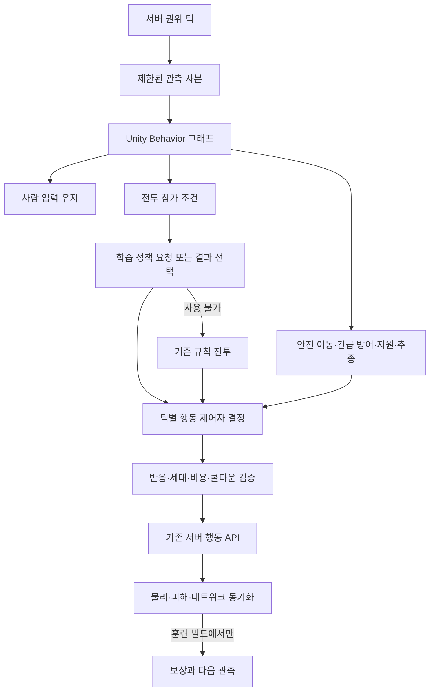

# 플레이어 BT + ML-Agents 학습형 봇 설계

작성일: 2026-09-19

> 상태: **설계 초안 — ML-Agents 연결·훈련·학습 모델 검증은 미구현**.
> 현재 구현은 Unity Behavior 1.0.16 기반 규칙형 봇이다. 이 문서는 그 위에 학습형 전투 판단을 추가하는 제안이다. 아래 수치와 성능 기준은 초기 실험 목표이며 측정 결과가 아니다.
> 선행 문서: [플레이어 BT·봇 보충 설계 18장](PLAYER_BT_AND_BOT_DESIGN.md), [공통 서버 API](SERVER_API_REFERENCE.md).

## 1. 목표와 적용 범위

**Unity Behavior가 파티 행동의 우선순위를 결정하고, ML-Agents로 훈련한 모델이 전투 중 위치 선정·기본 공격·구르기를 선택한다.** **첫 실험부터 사람 0명·봇 3명으로 런을 반복하고, 1회차부터 N회차까지 실제 점수와 학습 경과를 분석한다. 최종 적용 목표는 같은 조건에서 반복 플레이한 개발팀 사람 3명의 성적보다 살짝 낮은 봇 성능이다.** 기존 BT 비교는 학습 효과를 확인하는 보조 기준이다. BT 자체를 신경망으로 자동 변환하는 기능을 전제하지 않는다.

ML-Agents는 관측·행동·보상을 정의한 Unity 환경에서 강화학습과 모방학습을 지원한다. 훈련은 Python 도구와 연동하고, 게임에서는 훈련된 정책을 추론에 사용한다. [공식 개요](https://unity-technologies.github.io/ml-agents/ML-Agents-Overview/)

| 항목 | 1차 범위 | 후속 범위 |
|---|---|---|
| 대상 | 서버가 제어하는 협동 봇 | 여러 학습 봇의 공동 전략 |
| 학습 행동 | 전투 이동 방향·기본 공격·일반 구르기 | 패링 타이밍·정밀 사격 홀드·대상 선택 |
| BT 유지 | 실행 금지, 사람 입력, 결계/입구 안전, 긴급 방어, 치유·구조, 추종, 성장·장비 | 지원 행동 학습은 별도 평가 후 결정 |
| 훈련 방식 | 직업별 PPO, 필요하면 시연 기반 BC 추가 | 협동 보상과 MA-POCA 비교 |
| 게임 실행 | 고정 모델을 호스트에서 추론 | 모델 교체는 빌드 업데이트 때만 |

사람의 캐릭터를 AI가 대신 조작하거나 실제 플레이 중 모델 가중치를 계속 학습하지 않는다. 목표는 **사람 기준 점수에 가까우면서 조금 낮고, 동료로서 안정적인 봇**이다. **사용자 확정: 사람 3명은 총 10회, 봇 3명은 총 100회 진행한다. 사람 평가는 정상적인 전체 런이 가능해진 뒤 시작하며, 기존 사람 기록은 없고 기록 시스템도 미정이다.** 세부 회차 배분과 목표 격차는 제안 상태다. 아래 사람 평균의 95%, 허용 구간 92~97%는 초기 제안이며 사용자 확정값이나 측정 결과가 아니다.

## 2. 현재 코드에서 확인한 조건

| 확인된 위치 | 현재 동작 | 결합 시 필요한 변경 |
|---|---|---|
| `PlayerBrain.Tick()` | 서버 권위 틱에서 Unity Behavior 그래프를 동기식 평가 | 학습 요청·결과 적용 단계와 연결 |
| `Resources/BT/PlayerBehavior.asset` | Blocked → Human → PrepareBot → Safety/Defend/Support/Combat/Follow/Idle | Combat 앞에 학습 정책 선택 분기 추가 |
| `PlayerBrain.PrepareBot()` | 관측뿐 아니라 예약 공격·방어를 분기 선택 전에 실행 | 관측과 실제 행동 실행을 분리해야 함 |
| `Combat()` | 전투 참가 조건, 접근/후퇴, 기본 공격, 정밀 사격이 한 함수에 있음 | 공통 참가 조건·정밀 행동과 정책 선택을 분리 |
| `BotPerception.Target.Point` | 현재 콜라이더/Transform 위치를 읽음 | 모델에 직접 제공하지 않고 지연된 관측 사본 사용 |
| `BotObservation`, `BotThreatTracker` | 반응 지연·누락·제한된 위협 관측 | 학습과 추론에서 동일하게 적용 |
| `AuthorityTickScheduler` | 등록된 콜백을 순서대로 실행, 정지 시 시뮬레이션 콜백 중단 | 모든 봇 요청을 모으고 Academy를 한 번 진행하는 단계 필요 |
| Mirror·RunManager·GameDB·각 Locator | 프로세스 전역 상태와 단일 런 전제 | 초기 병렬 훈련은 프로세스 단위로 격리 |
| `NetworkTime.time`과 런 시간 | 행동 예약·쿨다운과 런 정지 시간이 서로 다른 용도로 사용됨 | 학습 배속 전 시간 체계 동등성 검증 필요 |

Unity 6000.4.7f1과 Behavior 1.0.16은 현재 설치되어 있다. `com.unity.ml-agents`는 현재 manifest에 없다. 규칙형 BT의 과거 테스트 결과는 학습형 모델 검증 실적으로 사용하지 않는다.

## 3. 전체 구조



모델 출력은 행동 요청이다. HP, 피해, Transform, Rigidbody, 무적, 재화, 승패를 직접 변경할 수 없다. 클라이언트에는 학습 Agent를 만들지 않는다. 서버의 기존 상태·애니메이션 동기화를 사용한다.

### 제안 BT

```text
On Start
└─ Try In Order
   ├─ Blocked
   ├─ Human
   └─ PrepareBotObservation
      └─ Try In Order
         ├─ Safety
         ├─ EmergencyDefend
         ├─ Support
         ├─ CombatEligible → Try In Order
         │                  ├─ ScriptedSpecialCombat
         │                  ├─ LearnedCombat
         │                  └─ RuleCombat
         ├─ Follow
         └─ Idle
```

`CombatEligible`은 기존 리더 이탈 제한·관측 반응 준비·전투 참가 조건을 공유한다. `ScriptedSpecialCombat`은 1차 모델 범위 밖인 보스 기상 후퇴·정밀 사격/원혼 대응을 유지한다. `RuleCombat`은 기존 전투 정책이다. 흐름은 Unity 기본 노드로 작성하고 게임 전용 리프만 추가한다.

현재 그래프는 매 판단을 완료하는 동기식 계약이다. `LearnedCombat` 안에서 Python이나 비동기 작업이 끝날 때까지 Running을 반환하며 기다리지 않는다. 요청을 등록하고 이번 틱의 정지/유효한 유지 입력을 선택한 경우에도 Success다. **요청 대기를 Failure로 처리해 RuleCombat까지 실행하면 안 된다.** 모델 없음·버전 불일치·추론 오류로 학습 제어권을 포기한 경우에만 Failure를 반환한다.

## 4. 틱 순서와 단일 행동 제어자

새 `BotPolicyCoordinator`가 프로세스의 Academy 진행을 한 곳에서 담당한다. 현재 플레이어별 Brain→이동 처리 사이에 곧바로 추론을 넣으면 봇 순서에 따라 다른 월드 상태를 읽으므로, 다음 단계 분리가 선행 조건이다.

1. 이전 물리 스텝의 사건을 수집하고, 모든 참가자의 관측·생명 상태·정지 상태를 고정한다.
2. 모든 봇의 BT를 평가해 `Safety / Defense / Support / SpecialCombat / LearnedCombat / RuleCombat / Follow` 중 행동 제어자 하나를 선택한다.
3. 학습 제어권을 가진 봇 중 결정 시점인 Agent의 `RequestDecision()`을 모은다.
4. 서버 전체에서 `Academy.EnvironmentStep()`을 정확히 한 번 호출한다. 자동 Academy stepping과 자동 DecisionRequester는 함께 사용하지 않는다.
5. `OnActionReceived()`는 결과 봉투만 기록한다. 서버 행동 API를 직접 실행하지 않는다.
6. 봉투와 현재 제어권을 재검증한 뒤 이동 입력 및 최대 하나의 단발 행동을 실행한다. 기존 서버 상태 갱신/물리 이동은 이후 정해진 순서로 처리한다.

Academy의 자동 진행을 끄고 수동 EnvironmentStep을 호출하는 기능은 공식 코드에 있다. 설치 버전의 API와 실행 순서를 다시 확인해 연결한다. [공식 Academy 구현](https://github.com/Unity-Technologies/ml-agents/blob/develop/com.unity.ml-agents/Runtime/Academy.cs)

`PrepareBot()`의 기존 `ExecuteDefense()`·`_scheduled.TryConsume()` 호출은 이 구조에서 6단계로 옮긴다. ML이 꺼진 상태로 먼저 기존 테스트를 통과시킨 뒤 학습 제어자를 연결한다. 새 정책이 행동을 낸 뒤 기존 예약 공격을 추가로 실행하는 경로는 금지한다.

### 요청·결과 봉투

`ParticipantId, RunId, SceneRevision, BrainGeneration, PolicyGeneration, EpisodeId, DecisionId, Target(netId, partId), ObservedAt, ExpiresAt, Action`을 보관한다. 학습 패킷에 네트워크 ID를 관측 특성으로 넣는다는 뜻은 아니다.

- 각 Agent에는 미완료 결정 하나만 허용한다. 같은 DecisionId의 단발 행동은 한 번만 소비한다.
- 모드/대상 부위/런/씬/정책/에피소드 세대가 바뀌면 기존 봉투와 예약을 폐기한다.
- Support·Safety 등의 상위 분기가 전투를 중단하면 이동 유지값도 지운다. 모델 결과가 늦게 와도 재생하지 않는다.
- 일시정지 동안 추론·보상 시간·학습 스텝을 진행하지 않는다. 재개 시 과거 입력을 버리고 새 관측부터 시작한다.
- 학습 모드 최초 진입 시 출력이 없으면 정지한다. 재요청 사이에는 유효 기간 안의 이동 방향만 유지한다. 공격/구르기는 자동 반복하지 않는다.
- 추론 오류가 발생하면 해당 정책을 그 런에서 비활성화하고 규칙 BT로 복귀한다. 같은 프레임에 재시도를 반복하지 않는다.

## 5. 관측 설계: V1, 88개 실수

모델은 원본 서버 객체 대신 불변 `BotPolicyObservation`을 읽는다. 기본 결정 간격은 현행 BotConfig의 0.1초를 시작점으로 한다. 관측 3회 스택을 사용하면 모델 입력은 264개가 된다. 값의 순서·개수·정규화는 스키마 파일과 단위 테스트로 고정한다.

| 구간 | 개수 | 필드 |
|---|---:|---|
| 자기 상태 | 12 | HP/스태미나/신력 비율 3, 로컬 평면 속도 2, 공격 중/구르기 중/패링 준비 3, 직업 one-hot 3, 학습 전투 허용 1 |
| 현재 대상 | 12 | 관측 유효 1, 마지막 관측 상대 위치 2, 관측으로 추정한 속도 2, 현재 가시 여부 1, 관측 나이 1, 대상 종류 one-hot 5 |
| 위협 2개 | 24 | 각각 유효 1, 상대 중심 2, 예고 방향 2, 반경 1, 추정 도달 시간 1, 관측 나이 1, 자신 대상 여부 1, 예고 형태 one-hot 3 |
| 동료 2명 | 16 | 각각 위치 관측 유효 1, 상대 위치 2, HP 비율 1, 생명 상태 one-hot 3, 구조 중 여부 1 |
| 주변 지형/파티 | 12 | 8방향 장애물 거리 8, 결계 중심 방향 2, 부호 있는 안전 여유 거리 1, 마지막 확인한 리더 거리 1 |
| 직전 정책 출력 | 12 | 이동 one-hot 9, 단발 행동 one-hot 3 |
| **합계** | **88** | 초기 스택 값은 0으로 채움 |

대상 종류는 근접 잡귀/원거리 잡귀/보스 본체/부위/원혼, 예고 형태는 원형/방향성 범위/직선의 고정 분류다. 모르는 종류는 모든 분류 비트를 0으로 둔다. 위치는 관측 시점의 자기 전방·우측 축을 기준으로 변환하고 거리/속도/시간은 SO의 상한으로 정규화 후 clamp한다. 모든 값은 유한수여야 한다.

위협 슬롯 순서는 관측된 자신 대상 여부→거리로 정하고 같은 예고는 종료까지 슬롯을 유지한다. 남는 슬롯은 0으로 채운다. 동료는 ParticipantId의 안정적 순서를 사용하되 ID 숫자는 입력하지 않는다. 동료 위치는 보이는 위치 또는 마지막 관측 위치, HP/생명 상태는 파티 HUD에 허용된 정보만 사용한다. NavMesh/장애물 판정과 결계 정보도 규칙 봇과 같은 범위를 사용한다.

### 정보 누출과 반응 제한

- 서버가 아는 적의 다음 패턴, 내부 카운터 창, 실제 미래 명중 시각, 보이지 않는 현재 위치를 넣지 않는다.
- `Target.Point`를 모델 직전에 읽지 않는다. 최초 관측 시 복사한 데이터가 `ReadyAt`을 지난 뒤 입력에 공개된다. 늦게 공개되는 관측도 원본 시각과 관측 나이를 유지한다.
- 관측 누락·시야·가림·피격 기억은 `BotSkillProfileSO`를 따른다. 관측이 없어진 대상을 최신 위치로 추적하지 않는다.
- 행동 마스크 역시 정보 통로다. 자신의 비용/쿨다운/행동 잠금과 공개된 관측만 사용한다. 적 내부 타격 창의 참/거짓으로 패링 가능 마스크를 만들지 않는다.
- 반응 지연은 관측 공개 단계에서 한 번 적용한다. 행동 적용 시에는 최소 반응 시각을 재검증하되 같은 지연을 다시 무작위로 더하지 않는다. 조준 오차는 실행 어댑터에서 한 번 적용한다.

ML-Agents의 벡터 관측은 매번 순서와 크기를 일치시켜야 한다. 관측·결정 요청·행동 수신의 패키지 계약은 공식 Agent 문서를 따른다. 위 88개 구성은 이 프로젝트의 제안이다. [공식 Agent 설계](https://github.com/Unity-Technologies/ml-agents/blob/develop/com.unity.ml-agents/Documentation~/Learning-Environment-Design-Agents.md)

## 6. 행동과 실행 계약

V1은 연속 출력을 사용하지 않고 이산 branch 두 개를 사용한다. 직업별 모델은 같은 스키마를 사용한다.

| Branch | 크기 | 의미 |
|---|---:|---|
| 이동 | 9 | 정지 + 자기 기준 8방향. 대각선은 정규화 |
| 단발 행동 | 3 | 없음 / 기본 공격 / 구르기 |

이동은 NavMesh에 투영한 짧은 목표와 기존 `BotNavigation`으로 이동 방향을 만들고, `PlayerController.ServerReceiveMoveInput`에 전달한다. 직접 이동시키지 않는다. 기본 공격의 대상 선택과 조준 레이는 V1에서 기존 어댑터를 사용한다. 구르기 방향은 이동 branch를 사용하며 정지와 구르기가 함께 선택되면 마지막 유효 회피 방향을 쓰고, 그것도 없으면 구르기를 거부한다.

실행 API는 `PlayerAttack.ServerRequestAttack`과 `PlayerRollController.ServerRequestRoll`이다. 비용·쿨다운·공격 중 이동 제한·유효 방향 검증을 유지한다. 마스크와 실제 실행 사이에 상태가 바뀔 수 있으므로 서버 API가 마지막으로 재검증한다. 각 branch의 무행동 항목은 항상 열어 두고 branch 전체를 마스킹하지 않는다.

긴급 예고 회피와 패링, 치유·구조, 정밀 사격은 BT에 남는다. 따라서 **V1 평가로 패링이나 정밀 사격을 모델이 학습했다고 주장하지 않는다.** V2에서 이 행동을 추가할 때는 시작/유지/해제/취소와 보유 자원을 관측에 넣고 스키마·모델을 함께 교체한다.

## 7. 훈련 환경과 에피소드

### 환경 격리

처음에는 **Unity 프로세스 하나당 훈련 월드 하나**로 운영한다. 전역 Mirror/RunManager/Locator를 유지한 채 같은 씬에 훈련장을 수십 개 복제하면 참가자·적·보상·런 상태가 섞인다. 로컬 PhysicsScene만 분리해도 전역 레지스트리는 격리되지 않는다.

훈련 빌드는 **사람 0명 + 검/활/방울 봇 각 1명**으로 시작한다. 첫 기준선도 3봇이며, 이후 학습·평가 역시 같은 편성을 유지한다. 처음에는 세 봇 모두 기존 BT이고, 학습 단계에서 직업별 전투 정책을 연결한다. 가짜 사람 슬롯이나 실제 Steam 계정으로 조건을 우회하지 않는다.

현재 `BotParty.TryFill()`은 사람 슬롯 최소 1개를 요구하므로 실험 전용 서버 시작 경로가 필요하다. 일반 매칭의 시작 조건을 무조건 완화하지 않는다. 구현 전에 아래를 해결한다.

- 0개 클라이언트의 준비/씬 로딩 ACK, 참가자 등록, 런 시작·종료·재시작을 완료할 수 있어야 한다.
- 사람 리더에 의존하는 `ResolveLeader`/전투 참가·추종을 보완한다. 실험 파티의 봇 대장과 BT 목표 이동을 두어 필드 진행·성장·보스 입구까지 자율 진행한다. 사람에게 없는 숨은 적 위치는 제공하지 않는다.
- 보스 입구의 사람 연결 전제와 집결 조건을 점검한다. 봇도 동일한 실제 도착·진행 조건을 충족해야 한다. 강제 텔레포트·보스 처치·QA 단계 건너뛰기로 얻은 점수는 비교 대상이 아니다.
- 전멸/구조·씬 전환·결과 확정·다음 런에서 세 봇의 수명이 유지되는지 검증한다.
- 실험 기록은 `cohort=bot_only, human_count=0, bot_count=3`으로 구분한다. 기존 `RunPartyKind`에는 봇 전용 구분이 없으므로 기존 숫자를 재해석하지 않는다. 실험 결과를 일반 리더보드에 올리지 않는다.

학습 전투만 연결해도 전체 런이 저절로 진행되는 것은 아니다. **3봇의 자연스러운 전체 런 수행과 모든 시도 기록이 본훈련의 선행 조건**이다.

후속 병렬화는 서로 다른 KCP 포트·ML-Agents 통신 포트·로그 폴더를 가진 별도 프로세스로 한다. 첫 실행은 timeScale=1이다. 처리량을 측정한 다음 CPU/GPU/메모리 여유에 맞게 프로세스 수를 늘린다.

### 시간 동등성

`Time.timeScale`만 높이면 NetworkTime 기준 공격/반응/쿨다운과 물리 이동의 시간 비율이 달라질 수 있다. 배속은 관련 실행기와 타이머를 조사하고, 동일 시드의 timeScale=1 기준에서 게임 시간당 이동 거리·공격 횟수·회피 창·재생량이 일치하는 것을 확인한 뒤 사용한다. 필요하면 공통 시뮬레이션 시계 어댑터를 먼저 설계한다. 배속 전에는 학습 시간을 단정하지 않는다.

### 에피소드 수명

| 사건 | 훈련 처리 | 실제 게임 처리 |
|---|---|---|
| 전체 런 승리/전멸 등 실제 종결 | 팀 런 결과를 확정하고 최종 보상 처리 | 실제 런 규칙 유지 |
| 개별 봇 사망/구조 | 해당 Agent 학습 구간 경계를 기록하되 팀 런은 계속 | 구조 가능한 상태를 임의로 전멸 처리하지 않음 |
| 학습 전투 제어권 종료 | 해당 전투 구간을 중단 경계로 기록 | BT의 새 분기로 즉시 전환 |
| 시간 상한/씬 전환/환경 복구 | 중단 종료로 처리하여 시간 잘림과 패배를 구분 | 런/씬 세대에 따라 입력 폐기 |
| 일시정지 | 스텝과 에피소드 시계 정지 | 기존 재접속 대기 유지 |
| 다음 에피소드 | 훈련 환경에서만 초기 상태 재구성 | `OnEpisodeBegin`으로 실제 플레이어를 리셋하지 않음 |

`EndEpisode`와 `EpisodeInterrupted`의 설치 버전 의미를 확인해 종료/중단에 매핑한다. BT의 강제 개입 이후 행동은 직전 ML 행동의 성공 보상으로 잘못 이어 붙이지 않는다. 중단 순간까지의 실제 사건만 결산하고 다음 전투 진입 때 새 학습 구간을 시작한다.

리셋은 HP만 복구하는 것으로 끝내지 않는다. 투사체·예고·적/보스 상태·공격/구르기/정밀/구조 상태·스태미나·신력·입력 버퍼·위치/속도·마크/CombatClock·보상 중복 키·관측 스택·예약·요청 번호 세대를 정리한다. 초기 구현은 기존 런 종료/재시작 경로로 정확성을 확보하고, 빠른 부분 리셋은 상태 동등성 테스트 후 도입한다.

## 8. 보상 설계

**학습 보상(reward)과 게임 결과 점수(Score)는 별개다.** 아래 보상은 행동 학습을 돕고, 최종 성능 선택은 11장의 실제 팀 점수로 한다. 보상 합계를 게임 점수처럼 표시하거나 목표 점수를 결과창에 대입하지 않는다.

보상은 훈련 전용 `BotTrainingRewardCollector`가 **서버에서 확정된 사건**으로 계산한다. 버튼 요청 수락은 명중이나 패링 성공이 아니다. 계수는 `BotRewardProfileSO`에 보관하고 아래 값은 첫 실험용이다.

| 사건 | 초기 보상 | 남용 방지 |
|---|---:|---|
| 유효 적 HP 감소 | `+1 × 실제 감소량 / 해당 적 초기 HP` | 출처별 실제 피해, 초과 피해 제외, 적 생명주기별 합계 상한 1 |
| 자기 HP 감소 | `-1 × 실제 감소량 / 자기 최대 HP` | 피해 확정 시 한 번, 회복해도 누적 피격 페널티를 환불하지 않음 |
| 시나리오 목표 완료 | +1 | 에피소드당 한 번, 완료 조건은 서버 사실 |
| 훈련 봇 사망 | -1 | 사망 세대당 한 번 |
| 전투 경과 | 초당 -0.002 | 정지 시간 제외, 결정 횟수 대신 시뮬레이션 시간 사용 |
| 안전 경계 밖 체류 | 초당 -0.02 | Safety 개입 이전의 정책 제어 구간만 계산 |
| 실행 불가 출력 | 요청당 -0.005 | 중복 요청은 한 번. 개입/세대 변경 때문에 폐기한 출력은 제외 |

살아 있는 매 순간에 양의 보상을 주지 않는다. 구석에서 시간을 끌거나, 쓸모없는 구르기/공격 요청을 반복하는 전략에 이익이 없어야 한다. 명중·회피 보상이 보스 무적/페이즈 HP 하한에서 허위 증가하지 않아야 한다.

V1에서는 패링·구조·치유를 BT가 수행하므로 그 성공에 대한 직접 행동 보상을 ML에 지급하지 않는다. 보스/협동의 공동 보상은 V2에서 팀 기여와 개입 구간을 정의한 뒤 추가한다. 예고가 취소된 것을 회피 성공으로 세지 않으며, 단순 요청 횟수로 전투 실력을 평가하지 않는다.

진단 로그에는 `proposedAction / maskedAction / acceptedAction / rejection / controller / rewardReason / eventId`를 함께 남긴다. 같은 대상의 같은 피해 사건이 여러 hitbox나 콜백으로 중복 보상되지 않도록 `(episode, source, targetLifeGeneration, eventId)`로 중복을 막는다. 모델 입력에는 이 보상용 비공개 원본 상태를 전달하지 않는다.

## 9. 학습 순서와 설정

| 단계 | 실행 | 남길 결과 |
|---|---|---|
| P0 | 패키지 호환·추론, 단일 제어자와 0인 서버 진행 검증 | 버전 잠금·회귀 결과 |
| P1 | 봇 1~10회: 규칙 BT 3명 기준선 | checkpoint 0, 성공/패배 모두 기록 |
| P2 | 봇 11~70회: 세 봇 파티에서 직업별 ML 학습 | 학습 60런의 점수·보상·스텝·체크포인트 |
| P3 | 봇 71~90회: 고정 후보 최대 2개를 각 10회 평가 | 사람 검증 기록과 비교하여 후보 하나 선택 |
| P4 | 봇 91~100회: 선택 모델/설정 고정 평가 | 미사용 조건의 최종 10런, 재학습/재선택 금지 |

**봇 100회는 세 봇이 함께 진행한 팀 런 총 100회이며, 봇마다 100회인 300런이 아니다.** 위 10+60+20+10 배분은 총량을 지키기 위한 제안이다. 기존의 기준선 30회·100학습런마다 별도 30회·최종 100회 계획을 대체한다. 별도 평가 런을 총 100회 밖에 자동으로 추가하지 않는다. 모든 100회를 가중치 갱신에 사용하면 독립적인 고정 모델 평가가 남지 않으므로 학습과 평가를 나눈다.

사람은 정상 런과 기록 수집이 준비된 뒤 **총 10회** 진행한다. 초기 배분 제안은 1~5회 검증용, 6~10회 최종 비교용이다. 최종 비교용 5회는 후보를 고정한 뒤 실시하고 모델 선택에 사용하지 않는다. 전체 10회 통계도 제공하되 선택에 사용한 데이터가 섞인 탐색 결과로 표시한다. 사람 플레이 숙련 변화도 함께 보고한다. 봇 최종 10회는 사람 최종 5개 환경 조건마다 정책 시드를 달리하여 2회씩 실행하는 안이며, 분석에서 이를 독립적인 사람 표본 10개로 취급하지 않는다.

사람 기록이 준비되기 전에는 봇 기준선과 학습까지 진행할 수 있지만, 사람 대비 후보 선택과 최종 평가는 기다린다. 70회 시점에 정상 행동을 학습하지 못했으면 목표 미달을 기록하고 원인을 분석한다. **100회가 충분한 학습량이라는 보장은 없다.** 별도 대규모 커리큘럼이나 추가 시드 실행을 이 예산에 숨기지 않는다. 추가 실험이 필요하면 필요량을 제시하고 새 계획으로 구분한다.

기술적 크래시도 시도 번호와 예산을 소비한다. 무효 런을 지우고 성공할 때까지 100회를 채우지 않는다. 미완료/무효 때문에 평가 표본이 부족하면 실제 유효 표본 수와 판단 보류를 보고한다. 개발 중 기능 검증은 별도 QA 실험으로 구분하며 점수 표본에 섞지 않는다.

**전체 런 1회**, **Agent 전투 구간 1개**, **학습 결정 1스텝**을 구분한다. 세 봇이 한 게임을 하면 팀 런은 1회다. 기록에는 최초 기준선부터 이어지는 `attempt_index`와 별도의 `training_run_index`를 둔다. 미니 전투 커리큘럼을 추가할 수 있지만 전체 런 N에 합산하지 않고 다른 experiment로 기록한다.

직업별 PPO 모델을 두며, 초기에는 한 직업을 학습하고 나머지 두 직업의 정책은 고정하는 순환 방식을 사용한다. 어느 단계든 플레이어는 봇 3명이다. 체크포인트는 검/활/방울 모델 버전 세트를 묶어서 보관한다. 같은 런에서 학습 가중치가 갱신되면 사용한 정책 버전 범위와 갱신 스텝을 기록한다. **공식 평가에서는 세 모델을 모두 고정하고 학습·탐험용 설정을 끈다.** 정책의 확률적 추론 여부와 난수 시드도 고정된 평가 계약으로 기록한다.

PPO의 초기 후보는 MLP 128×2, 스택 3, batch 512 / buffer 8192 / learning rate 0.0003 / gamma 0.99 / lambda 0.95 / time horizon 64다. 직업별 별도 BehaviorName을 사용한다. 처리량 pilot 후 N과 스텝/시간 상한을 함께 정하고, 상한으로 중단하면 계획 N과 실제 완료 횟수를 구분한다. 학습 보상이 증가해도 평가 점수가 정체되면 보상·관측·자율 진행 실패 원인을 분석한다.

설치한 릴리스의 YAML 스키마를 확인하여 설정을 고정한다. [공식 훈련 설정](https://github.com/Unity-Technologies/ml-agents/blob/develop/com.unity.ml-agents/Documentation~/Training-Configuration-File.md)

### 사람 플레이 모방

선택적으로 같은 관측/행동 스키마의 시연을 수집해 BC로 시작한 뒤 PPO로 미세 조정한다. 녹화 영상만으로 현재 모델을 학습시키는 구성은 아니다. 사람 입력을 8방향 이동과 단발 행동으로 변환하고, 같은 반응 필터와 마스크를 적용한 훈련 환경에서 시연한다. 기존 BT도 시연 생성기가 될 수 있다.

시연은 성공뿐 아니라 접근·후퇴·헛공격·위험 회피를 포함한다. 관측에 아직 공개되지 않은 정보로 사람이 행동한 샘플은 제외한다. 시연/훈련/검증/최종 테스트의 시나리오와 시드를 분리한다. BC와 PPO 혼합 방법은 선정 릴리스의 지원 설정을 따른다. [공식 모방학습 설명](https://unity-technologies.github.io/ml-agents/ML-Agents-Overview/#imitation-learning)

## 10. 버전·파일 배치와 배포

### 호환성 확인 선행

Unity Behavior와 ML-Agents의 버전 번호는 별개다. ML-Agents Unity 패키지, Python `mlagents`/`mlagents-envs`, Python, PyTorch, 추론 런타임을 **같은 공식 릴리스의 지원 조합**으로 잠근다. 현재 Unity 6000.4.7f1과의 호환은 아직 확인하지 않았다. 패키지 최신 번호를 추정하여 이 문서에서 고정하지 않는다. [공식 설치 문서](https://github.com/Unity-Technologies/ml-agents/blob/develop/com.unity.ml-agents/Documentation~/Installation.md)

P0에서 예제 학습→ONNX 출력→Unity CPU 추론까지 실행하고, 실제 버전·OS·장치·릴리스 태그를 `training/mlagents/environment.md`에 기록한다. 문서의 develop 링크는 API 조사 근거이며, 구현 시 선택한 릴리스 태그로 고정한다.

### 제안 위치 — 아직 생성하지 않음

| 위치 | 내용 |
|---|---|
| `Assets/01.Scripts/02.Combat/Player/ML/` | Agent 어댑터, 관측 작성기, 출력 검증/서버 행동 어댑터 |
| `Assets/01.Scripts/01.Network/` | 서버 전체 요청/단계 조정용 `BotPolicyCoordinator` |
| `Assets/01.Scripts/02.Combat/Player/Dev/ML/` | 훈련 환경 리셋, 보상 수집, 시연 입력 |
| `Assets/01.Scripts/00.Common/Data/` | `BotLearningConfigSO`, `BotRewardProfileSO`, `BotPolicyManifestSO` |
| `Assets/09.Data/Resources/BT/` | 기존 PlayerBehavior 그래프 수정 |
| `Assets/09.Data/ML/` | 정책 manifest·설정·직업별 승인된 모델 |
| `Assets/00.Scenes/Dev_PlayerTraining.unity` | 훈련 전용 씬 후보, 기본 플레이 빌드에서는 제외 |
| `training/mlagents/` | 버전 lock·YAML·실행/평가 스크립트·스키마·실험 요약 |
| 로컬 실험 출력 디렉터리 | 체크포인트·TensorBoard·대량 시연. 승인 모델과 구분 |

새 에셋/폴더는 `.meta`를 포함한다. 씬/훈련 전용 빌드 설정을 추가하는 구현 단계에서는 팀에 구조 변경을 알린다. 기존 팀원 Dev 씬은 수정하지 않는다. ML SDK의 런타임 의존성은 게임 빌드에 필요할 수 있으나, 환경 리셋·보상·훈련 시작 코드는 전용 빌드 define/구성으로 제외한다.

manifest에는 모델 해시, ModelVersion, ObservationSchemaVersion, ActionSchemaVersion, 직업, Unity/ML 패키지 버전, 훈련 시드·설정 해시, 평가 결과, SkillProfile/밸런스 데이터 해시를 넣는다. 모델의 크기만 맞고 의미/정규화 순서가 다른 경우도 거부한다. 런 중에는 모델을 교체하지 않는다.

게임은 Inference Only로 실행하며 Python 프로세스를 요구하지 않는다. 승인 모델이 없거나 manifest가 맞지 않으면 학습 분기만 꺼서 규칙 BT로 출발한다. 초기 추론은 호스트 CPU 기준으로 검증하고, GPU 사용은 렌더링 경합과 장치 차이를 측정한 뒤 검토한다.

## 11. 회차 기록·데이터 분석·사람 기준 보정

### 11.1 비교 단위와 사람 기준

1. 같은 빌드·점수 규칙·난이도·맵 분포·초기 장비/자원·직업 구성·시간 제한에서 사람 3명과 봇 3명을 비교한다. `Standard` 전체 런을 기본 비교 단위로 하고, 보스 연습은 별도 실험으로 분리한다.
2. 사람도 첫 회차부터 모두 기록한다. 사람 기준 H는 사전에 정한 평가 구간의 **모든 유효 런 점수 평균**이다. 가장 잘한 한 판이나 최고점만 기준으로 삼지 않는다. 숙련 후 성능이 목적이면 연습 횟수와 이후 평가 구간을 수집 전에 고정한다. 현재 10회 계획에서는 검증 5회와 최종 5회를 각각 요약하며, 최종 판단의 H는 후반 5회 평균이다.
3. 사람의 연습 효과를 볼 수 있도록 1~N_human 점수 곡선을 함께 그린다. 봇의 학습 런 수와 사람의 플레이 런 수가 같은 학습량이라는 주장은 하지 않는다.
4. 사람 시연을 학습에 사용했다면 그 시연과 최종 평가 데이터/환경 시드를 분리한다. 검증에서 후보를 고르고 최종 홀드아웃에서는 다시 선택하지 않는다.
5. 개발팀 한 팀의 반복 기록은 그 팀에 대한 보정이다. 모든 일반 플레이어의 95% 실력이라고 일반화하지 않는다. 역할을 바꾼 경우 팀/역할 구성을 기록하고 층별로 분석한다.

게임 난수 시드와 정책/학습 시드는 별도다. 환경 난수 경로를 점검하여 재현 가능한 조건 목록을 만든다. 같은 시드라도 행동이 다르면 전투 경로가 달라질 수 있다. 재현성이 검증되지 않은 데이터를 같은 조건의 쌍이라고 주장하지 않는다.

### 11.2 별도 실험 기록 저장

현재 `RunLeaderboardStore`는 권위가 확정된 Standard 승리 기록만 저장한다. **리더보드만 읽으면 패배가 빠져 평균이 부풀려지므로 실험의 원본으로 사용하지 않는다.** **사람 플레이 기록 시스템의 제품 형태와 UI는 아직 미정이다.** 구현 제안은 사람/봇이 같은 결과 계약을 쓰는 별도 `ExperimentRunRecorder`이며, 서버에서 시작 사건과 종료 사건을 append-only JSONL로 기록한다. 사람의 키 입력 전체나 영상은 점수 비교의 필수 조건이 아니고, 모방학습용 시연은 별도 기능이다. 분석용 CSV는 이 원본에서 생성한다.

| 묶음 | 필수 기록 |
|---|---|
| 식별 | schema_version, experiment_id, attempt_id, attempt_index, training_run_index, retry_of, session_id, run_id, result_revision |
| 실험 구분 | baseline/train/validation/final/human, cohort, human_count, bot_count, team_id, 직업별 참가자 ID |
| 재현 조건 | build/commit, Unity/패키지, map/scenario, environment_seed, policy_seed, training_seed, 난이도·장비·밸런스·BT·SkillProfile 해시 |
| 모델 | 세 직업 checkpoint/hash, 시작/끝 정책 버전, 학습 스텝 범위, observation/action/reward 버전 |
| 결과 | start/end, termination_reason, outcome, authoritative/score_valid, score_rule_version, 원본 Score, 게임 시간, 처치·사망·구조·피해·회복 |
| 진단 | reward_sum/항목별 보상, BT/ML 제어 시간, 정책 거부·복귀 횟수, 추론 지연, qa_modified, invalid_reason |

- 점수는 `RunResultSnapshot.Score`를 원본 그대로 저장한다. 패배에도 권위 점수가 확정되면 그대로 포함한다. 유효 점수가 없는 경우 `null`과 이유를 남기고 임의로 0점으로 바꾸지 않는다.
- 시작 후 프로세스가 죽어 종료 기록이 없으면 수집기가 미완료 시도를 식별한다. 재실행은 새 attempt_id와 retry_of로 연결한다. 실패한 시도를 덮어쓰지 않는다.
- 저장 중복은 실험 시도 ID와 서버 결과 revision으로 막고, 점수 정정 이력은 보존한다. 파일은 프로세스별로 분리해 경합을 피한다.
- 게임 규칙의 시간 초과/전멸은 실제 결과로 포함한다. 기술적 크래시·임의 외부 중단·QA 강제 승리는 별도 집계한다. 유효 표본 수뿐 아니라 **전체 시작 수, 패배 수, 무효/미완료 수와 사유**를 항상 보고한다. 누락이 많은 후보는 평균만으로 합격시키지 않는다.
- 기존 M2의 강제 단계·처치·결과 주입 기록은 기능 테스트 증거이며 사람/봇 점수 기준선으로 재사용하지 않는다.

### 11.3 분석 결과물

`runs.jsonl → 검증/중복 확인 → runs.csv → summary.json + report.html` 파이프라인을 제안한다. 모든 요약에는 데이터/분석 설정 해시와 포함·제외 기준을 남긴다.

- **최초~N회차 곡선:** 모든 개별 점수와 이동 평균, 패배/무효 표시. 학습 중 점수와 고정 모델 평가 점수는 다른 곡선으로 표시한다.
- **체크포인트 평가:** 평균·중앙값·표준편차·IQR·하위 10% 점수·95% 신뢰구간, 승률과 전멸률, 실제 시간. 승리한 런만의 시간은 조건부 지표로 표시한다.
- **사람 비교:** 같은 조건의 점수 분포와 평균 비율 B/H, 목표 구간, 신뢰구간. 직업별 피해·생존·구조는 팀 점수의 원인을 설명하는 보조 지표다.
- **실패 분석:** 벽 끼임·진행 정지·파티 이탈·구조 누락·정책 오류·기술 중단의 빈도와 대표 리플레이/로그 링크.

환경 조건이 실제로 대응할 때 조건별 쌍을 보존한 bootstrap으로 B/H의 95% 신뢰구간을 계산한다. 반복 팀/세션과 훈련 시드의 의존성을 고려하고 세 봇을 독립적인 3개 팀 표본으로 세지 않는다. 현재 100회 예산은 하나의 학습 시드로 시작하며, 다중 훈련 시드 재현성은 미검증으로 표시한다. 후속 독립 시드 실험은 별도 예산이다. 사람 표본도 재표집하여 H의 불확실성을 반영한다. **사람 총 10회, 특히 최종 5회는 작은 표본이다.** 신뢰구간은 탐색적 추정이며 5% 격차를 입증했다고 단정하지 않는다. 평균이 목표에 가까워도 불확실성이 크면 보정 후보로만 기록한다.

### 11.4 목표 성능과 실제 적용

초기 제안은 `목표 T = 0.95 × H`, 검증 후보의 평균 비율 범위는 `0.92 ≤ B/H ≤ 0.97`이다. **이는 통계적 성능 목표이며 모델의 가중치에 0.95를 곱하거나 결과 점수를 수정하는 기능이 아니다.** H가 0이거나 상대 비교가 불안정할 정도로 작으면 비율 보정을 보류하고 별도 절대 격차 기준을 정한다.

1. 검증에서 여러 체크포인트와 제한된 SkillProfile 후보를 평가한다. 정상적으로 학습된 모델의 관측 반응 지연·조준 오차 같은 기존 공정성 설정을 조절하되 HP/공격력을 몰래 바꾸거나 구조를 고의로 포기시키지 않는다.
2. 설정을 바꾸면 실제 점수가 어떻게 달라지는지 재측정한다. 반응 지연과 점수가 선형·단조 관계라고 가정하지 않는다. 후보 탐색 범위/횟수를 미리 정해 과도한 선택 편향을 줄인다.
3. 목표와 가장 가까운 안전한 후보를 하나 고정한다. 모델 3개 + SkillProfile + BT/밸런스 버전 + 관측 계약을 하나의 배포 단위로 취급한다.
4. 미사용 환경 조건에서 사람과 봇을 최종 평가한다. 초기 합격 제안은 **평균 비율 92~97%, 비율의 95% 신뢰구간이 90% 이상·100% 미만**이며 행동/안정성 기준도 만족해야 한다. 이 허용 범위 역시 확정할 실험 설정이다.
5. 신뢰구간이 넓으면 ‘판단 보류’, 범위를 벗어나면 ‘목표 미달’로 보고한다. 최종 테스트 결과를 보고 후보를 바꾸면 그 테스트는 검증 데이터가 되며 새로운 홀드아웃이 필요하다. 조건을 만족하는 후보가 없으면 성능을 맞췄다고 선언하지 않는다.

게임에 넣는 것은 승인된 ONNX 모델과 SkillProfile이다. `ExperimentBenchmarkManifest`에는 H/B/비율/신뢰구간/표본 수/조건/체크포인트를 기록한다. 표시용 목표 점수를 실제 판정에 대입하지 않는다. 게임 중 학습하거나 플레이어 점수에 맞춰 몰래 결과를 보정하지 않는다.

**3봇 팀의 95% 성적은 봇 한 명이 사람 한 명의 95% 실력이라는 뜻이 아니다.** 출시 전 사람1+봇2, 사람2+봇1도 별도 검증해 협동 품질·역할별 편차를 확인한다. 혼합 파티에서 같은 점수 비율을 보장하려면 별도 실험이 필요하다.

### 11.5 필수 안전·실행 기준

| 구분 | 통과 기준 |
|---|---|
| 권위/수명 | 클라이언트 실행·중복 단발 행동·지난 세대 출력·정지 중 행동 0 |
| 정보 제약 | 비공개 패턴/창/숨은 위치 참조 0 |
| 안정성 | NaN·모델 누락·스키마 불일치·추론 오류 시 규칙 복귀, 오류율 별도 보고 |
| 자율 진행 | 사람0+봇3 실제 출발·필드·보스 진입·결과·다음 런; 성공/패배 모두 저장 |
| 행동 품질 | 시간 끌기·고의 무행동·파티 이탈·구조 포기·벽 끼임 사례 검토 |
| 비용 | 봇2개 관측+추론+검증 P95 2ms/P99 5ms 잠정 목표, 실험 봇3개도 별도 측정 |
| 멀티플레이 | M2 사람1+봇2/사람2+봇1/사람3, 재접속·씬 전환·두 번째 런; 자체 계정 릴레이 M3 및 Steam 호환 회귀 별도 |

CPU/GPU·빌드·워밍업·표본 수를 기록한다. 동기 추론을 시간 초과 중간에 강제 종료할 수 있다고 가정하지 않는다. 호출 완료 후 초과를 기록하고 다음 결정부터 규칙 BT로 전환한다. 평가 중 규칙 복귀가 일어난 런을 감추지 않고, 모델 단독 성능과 실제 배포 파이프라인 성능을 구분한다.

## 12. 구현 순서와 완료 정의

1. **3봇 실험 기반:** 0인 서버 시작·봇 대장/목표 진행·보스 입구·종료/재시작. 일반 파티 회귀 확인.
2. **기록기:** 최초 시도부터 모든 결과 저장, 점수/보상 분리, 크래시·중복·재시도 처리. 3봇 기준선을 수집하고, 사람 테스트는 정상 런이 가능해진 뒤 10회 시작.
3. **ML 호환성/실행 분리:** 패키지 예제→모델 추론, 버전 잠금, 단일 제어자·서버 Academy·88관측/[9,3]·세대/취소/복귀 검사.
4. **훈련 연결:** 3봇 파티에서 직업별 정책 순환 훈련, 정확한 리셋·사건 보상·시간 동등성. 처리량을 측정하고 봇 총 100회 안에서 학습/평가 배분과 스텝 상한을 고정.
5. **N회차 실험/분석:** 체크포인트 고정 평가, 회차별 점수·분포·실패 원인 분석. 사람 기준과 데이터 조건 점검.
6. **성능 보정:** 검증에서 모델/SkillProfile 선택, 최종 홀드아웃 확인, 기준 미달이면 미달로 보고.
7. **게임 적용:** 승인 manifest·모델 연결, 혼합 파티·M2/M3·성능·복귀 검증 후 개발 빌드.

필수 테스트는 관측 순서/유한수, 지연 관측, 마스크 무행동, 단발 중복 방지, 모델 대기 중 이중 정책 방지, BT 개입 후 출력 폐기, 리셋 잔류, 정지 중 Academy 정지, 배속 시간 동등성에 더해 **0인 3봇 시작, 실패 점수 보존, 누락/중복 결과, 훈련/평가 분리, 사람 기준 계산**을 포함한다.

현재 완료는 이 설계 수정이다. ML 패키지·실험 기록기·3봇 전용 실행기·학습·분석 보고서·ONNX 모델·새 빌드는 아직 생성하지 않았다. 실제 사람 점수와 봇 학습 데이터가 없으므로 현재 몇 점이 나오는지 또는 사람의 몇 %인지 제시할 수 없다.
