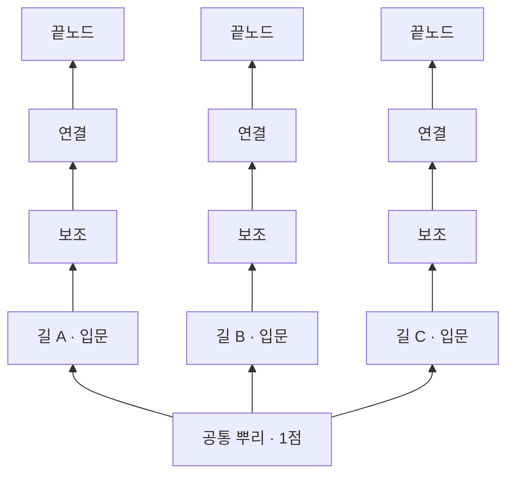

# 플레이어 전투 개편안 — 끊고, 새기고, 거둔다

작성: 2026-09-21 · 코드 대조: 2026-09-22 · 검·활·방울 핵심 코드·SO 반영, 수치·재미·외부 3PC 검증 별도

구현 업데이트: 방울 R 지원 영역·명시 설치·방울 특성은 [구현 기록](BELL_RESONANCE_IMPLEMENTATION.md)을 참고한다. 검·활 전투·특성의 코드 반영은 [검·활 구현 기록](SWORD_BOW_REWORK_IMPLEMENTATION.md)을 참고한다. 전체 화면 구상과 재미·밸런스는 별도 검증 대상이다.

## 1. 제안의 중심

**차사는 적의 공격을 받아 자기 공격으로 바꾸고, 신궁은 위험을 감수해 만든 약점을 직접 꿰뚫고, 무녀는 동료가 공격할 자리에 힘을 주는 진을 펼친다.**

스킬을 하나 더 갖는 것보다, 같은 적을 보면서 서로 다른 기회를 찾게 만드는 개편이다. 차사는 “다음 칼을 받을까, 여기서 베어낼까”, 신궁은 “지금 들어가 약점을 만들까, 지금 있는 각도를 지킬까”, 무녀는 “울림을 더 쌓을까, 지금 거두어 팀을 살릴까”를 판단한다.

첫 추천은 **공방을 이어가는 검 + 거리와 사선을 바꾸는 활 + 자리를 설계하는 방울**이다. 새 직업·무기·궁극기·보스 추가 없이 세 무기의 기본 행동을 다시 묶는다. 검사 R, 방울 설치 입력, 시선과 모션, 연결형 특성 트리를 하나의 전투 방향 아래 바꾼다.

이 문서는 팀장이 요청한 대대적 개편의 검토안이다. 기존 기획·운영 코드의 확정 사양을 자동으로 덮어쓰지 않는다. 수치는 첫 실험용 가설이고 재미·공수·온라인 체감은 아직 검증되지 않았다.

## 2. 왜 지난 수정으로는 부족했는가

| 현재 확인된 구조 | 문제 가설 | 이번에 바꿀 판단 |
|---|---|---|
| 검 R은 넓고 강한 단발 베기 | 평타와 쓰는 목적이 겹치고 쿨다운마다 누르기 쉬움 | 우클릭으로 적의 공격을 받은 뒤 모은 표식을 회수하는 R |
| 검 패링 게이지 100 이후 다음 공격 무작위 배율 | 정확한 방어가 눈앞의 선택으로 이어지지 않음 | 성공 직후 사용할지, 다음 타격까지 유지할지 선택 |
| 활은 근접 쐐기 설치와 사격 파열 구현 | 특색의 재료는 있으나 방향·자세·약점 피드백이 연결되지 않으면 단순 딜 사이클로 보임 | 접근→부위 조준→파열의 세 순간을 명확하게 표현 |
| 방울 R은 조준 방향 전방 고정5m로 즉시 요청, 서버가 지면 결정 | 사용자가 원하는 위치를 확인하고 결정할 과정이 없음 | R로 설치 조준 시작, 클릭으로 확인 |
| 특성은 무기당 2열×5행, 같은 열의 앞 행 모두 필요 | 9포인트로 10개 중 하나만 포기하므로 빌드 차이가 좁음 | 공통 뿌리와 갈림길, 특화 끝노드가 있는 트리 |
| 입력/표현/서버 행동이 여러 부분 파일에 나뉨 | 방향·이동·상하체를 여러 경로가 덮으면 의도가 화면에서 깨짐 | 한 행동의 방향·타격·종료를 같은 기준으로 표현 |

근거: [현재 R 스킬](WEAPON_ACTIVE_SKILLS.md), [기존 공방 방향](COMBAT_FEEL_AND_BOSS_DIRECTION.md), [게임 디자인](../02-game-design.md), `PlayerAttack.skills.cs`, `TalentRules.cs`, `TalentTreeSO.asset`. 모션의 개별 원인은 재현 조사가 필요하다. 첨부 화면 한 장으로 전체 애니메이션 오류를 확정하지 않는다.

추가 정적 감사에서 확인한 구체적 원인: 모델은720도/초로 회전하므로180도 전환에0.25초가 필요하지만 검 선딜은0.12초다. 락온은 서버의 요청 방향과 로컬 표현 양쪽에서 우선하며, 현재 기본 aim은 커서 월드점이 아닌 카메라 yaw 정면이다. 플레이어 Animator5종은 모두 단일 Base Layer이고 여러 행동이 같은 레이어를 직접 제어한다. 따라서 시선·입력 정책과 행동 표현 우선순위부터 정리해야 한다. 이는 코드상 원인 후보가 구체화된 것이며 실행 중 재현을 대신하지 않는다.

## 3. 참고작에서 가져오는 원리

세키로는 공격과 적시 튕겨내기로 적의 체간을 무너뜨리고, 그 결과 열린 기회를 마무리로 연결한다. 체력과 체간 회복도 연결된다. 여기서 가져올 것은 **방어 성공이 다음 공격 선택을 바꾸고, 상대 동작을 읽을수록 공방을 오래 이어가는 구조**다. [FromSoftware 공식 매뉴얼](https://www.fromsoftware.jp/manual/sekiroshadowsdietwice/stadia/mechanics.html)

그믐은 리슨 서버 기반 3인 전투다. 개인 체간·모든 적의 체간·인살 컷신을 한꺼번에 추가하면 기존 공동 그로기와 보스 부위 계약을 재설계해야 한다. 이번 권고안은 기존 공동 그로기를 유지하고 검의 연속 대응에서 세키로의 원리를 활용한다. 보스 즉사·전원 화면 정지·공통 패링 강요는 범위 밖이다.

엠버 앤 블레이드의 공식 소개는 무기·스킬과 성장 조합을 통한 플레이 스타일을 강조한다. 사용자는 그중 **연결된 노드를 해금하는 성장 트리**를 원한다고 명시했다. 아래 트리는 이 요청에 맞춘 그믐 고유 설계이며 해당 게임의 정확한 트리 구조를 복제했다고 주장하지 않는다. [공식 소개](https://emberandblade.com/)

| 대안 | 장점 | 이번 판단 |
|---|---|---|
| 모든 무기에 체간·튕겨내기 통일 | 공통 문법이 빠르게 생김 | 활·방울까지 검처럼 싸우게 되고 보스 계약 수정이 큼 |
| 모든 무기에 긴 콤보·여러 쿨다운 스킬 | 즉시 화려해짐 | 버튼은 늘지만 현재의 모션·판단 문제를 가리기 쉬움 |
| 무기마다 다른 성공 조건, 공통 행동 품질 개선 | 기존 자산을 살리며 역할이 선명해짐 | **추천**. 검 한 무기로 먼저 손맛을 입증하고 확장 |

## 4. 공통 조작 — 내 입력이 몸에서 보이게

### 방향과 이동

- 자유 조준 공격은 입력 순간의 카메라/마우스 조준점을 바라본다. 왼쪽 이동 자세였다가 오른쪽을 쏘면 준비 구간에 발과 골반이 돌아서며 타격 시 무기·몸·공격 방향이 일치한다.
- 카메라를 돌렸다고 이미 발사한 화살이나 진행 중인 베기가 뒤따라 휘지 않는다. 준비 구간에서 허용된 조준만 갱신하고 타격 확정 이후 방향은 고정한다.
- 기본 조작은 기존3인칭 카메라와 중앙 조준점 기준이다. “마우스 방향”은 마우스로 돌린 카메라의 조준점 방향으로 정의한다. 방울 설치만 임시 자유 커서를 사용해 지면점을 고른다. 준비 시간 안에 큰 각도 회전이 불가능한 행동은 타격이 시작되기 전에 몸 방향을 즉시 정렬하고 짧은 디딤/상체 블렌드로 연결한다. 판정을 늦춰 입력감을 바꾸는 보정은 별도 실험 없이 도입하지 않는다.
- 활 정밀 사격과 방울 설치는 수동 조준이 우선한다. 락온은 카메라 도움만 주고 다른 부위나 적으로 사격·설치 지점을 끌어가지 않는다. 검 락온 공격은 입력 순간 대상 방향을 사용하되 타격 구간 자동 추적은 없다.
- 이동 입력은 현재 공격 방향을 덮어쓰지 않는다. 후딜 종료 후 이동 방향으로 돌아간다. 큰 각도 전환에서 상체만 180도 비틀지 않는다.
- 실제 디딤이 있는 공격에만 짧은 전진을 준다. 벽을 통과하거나 거리 밖 적에게 자동으로 달라붙지 않는다. 기존 “모션과 무관하게 끌려가는 이동은 싫다”는 조건을 유지한다.

### 입력 예약과 취소

입력 예약은 한 칸, 마지막 0.12초부터 허용하는 실험값으로 시작한다. 새 입력으로 무한 연타를 쌓지 않는다. UI·사망·피격·무기 교체·씬 변경은 예약을 비운다. 거부된 행동을 나중에 몰래 발동하지 않는다.

예약 우선순위는 회피 > 우클릭 방어/치유 > R/Q > 기본 공격. 높은 우선순위는 낮은 예약을 덮고, 같은 우선순위는 최신 입력으로 교체하며 낮은 우선순위는 무시한다. 조준 모드의 확인/취소는 이 큐 앞에서 소비한다. 실제 패링 판정은 실행 시각 기준이며 예약한 과거 시각으로 성공을 소급하지 않는다. 입력 타이밍을 읽는 패링은 원칙적으로 즉시 실행하고, 잠금 중 예약은 후딜 끝 연결에만 쓴다.

준비/타격/회복 구간을 구분한다. 준비의 일부와 회복 말미에만 지정된 방어·회피 전환을 허용한다. 타격 확정 이후 비용 환불이나 무제한 캔슬은 없다. 모든 공격에 같은 캔슬 시각을 적용하지 않고 클립의 디딤과 회수 자세에 맞춰 데이터로 정한다.

## 5. 차사 — 적의 박자를 빼앗는 검

### 기본 리듬

**짧은 베기 → 적의 반격을 받아냄 → 한 번 더 받을지, 틈을 베어낼지 결정.**

좌클릭 3타는 각각 짧은 가로베기, 반대편 절단, 내려베기로 실루엣을 구분한다. 같은 모션을 속도만 달리하지 않는다. 3타는 확실한 빈틈에서 선택하는 마무리이며 매번 끝까지 누르는 것이 정답이 아니다. 적이 패링 불가 공격을 하면 구르기로 이탈하고, 패링 없이도 평타와 기본 R로 전투가 성립한다.

### 우클릭: 연속 받아치기

기존 패링 입력을 유지한다. 현재도 성공 패링의 행동잠금은 즉시 해제되므로, 성공 후딜 제거를 새 기능으로 세지 않는다. 이번 핵심 변경은 **적의 연격 중간타에도 별도의 흘려내기 판정을 제공하는 것**이다. 자동 방어는 아니며 매 타격마다 눌러야 한다. 실패 패링은 기존 회복을 지켜 연타 난사를 억제한다.

**성공하면 반격 표식1개, 최대3개를 얻는다.** 검 손잡이 옆 세 칸의 작은 문양으로 표시한다. 한 타 후 바로 베어도 되고, 다음 타를 더 받아 강한 베기를 노려도 된다. 같은 적의 같은 패턴 실행 안에서만 쌓이며 다른 실행에서 얻으면 기존 것을 지우고1개로 시작한다. 기본 유지2초이며 다음 성공으로 갱신한다. 패턴의 정상 종료 또는 카운터 등에 의한 취소 후에는 최대1.2초의 회수 창만 남긴다. 기존 만료시각을 늘리지는 않는다. 마지막 특수 카운터 성공은 표식 추가 후 이 종료 처리를 한다. 대상 사망/파괴는 즉시 지운다. 준비 구간이2초를 넘는 적 연격에서는 소멸하므로 적별 적합성을 검사한다.

사망·피격·무기 교체·씬 변경·일반 회피·만료 시 표식은 사라진다. 일시정지는 서버 게임 시계와 함께 만료도 정지한다. 파생 피해·동료 패링·R 적중으로 새 표식을 얻지 않는다. 표식3개를 다른 전투로 저장해 가는 기능은 없다.

현재 활성 규칙은 ParryGauge.CounterMarks와 R 예약·소비다. 구 0~100 개인 게이지와 다음 명중 치명 강화는 현재 사용 경로가 아니다. 반격 R은 확정 뒤 빗나가도 소비하며 옛 게이지 옵션을 중복 적용하지 않는다.

### R: 받아베기

R의 주된 역할은 **우클릭으로 모은 표식을 베기로 회수하는 기술**이다. 표식이 없을 때에도 쓸 수 있도록 기본 베기 경로는 남기며, R 자체에 방어 판정은 없다. 방어 입력을 우클릭 하나로 통일해 같은 타격에 두 방어 기술이 경쟁하지 않게 한다.

| 상황 | 동작 | 결과 |
|---|---|---|
| 표식 없이 R | 짧게 검을 모은 뒤 넓게 횡베기 | 패링 기회가 없는 상황의 능동 공격. 전방140도/3m로 앞의 여러 적을 견제, 강제 보스 경직 없음 |
| 우클릭 패링 후 표식을 가진 상태로 R | 수비 준비를 생략하고 짧게 딛는 사선 베기 | 표식 전부를 소비하는 반격. 1/2/3개에 따라 피해가 달라짐 |
| 준비 중 적 공격에 맞음 | 자세가 무너지며 취소 | R에는 방어/무적 없음. HP 피해·피격 적용 |
| 헛치거나 적이 물러남 | 검이 빈 공간을 가르고 회수 | 비용은 확정 이후 환불하지 않음 |

첫 실험값: 기본 피해1.4B, 반격 표식1/2/3개는 **1.2/2.6/4.5B**. 모두 스태미나16. 기본 R은5초 쿨다운, **표식 R은 기본 R 쿨다운과 독립적으로 표식이 있을 때만 사용 가능**하며 기본 쿨다운을 초기화하거나 연장하지 않는다. R 키는 표식이 있으면 표식 R을 우선한다. 쿨다운이어도 표식이 있으면 아이콘을 밝혀 사용할 수 있음을 보여준다. 표식 R 범위는 전방90도/2.2m, 기존 벽/대상수 제한을 유지한다.

같은 세 번의 성공에서1표식씩 세 번 쓰면3.6B/스태미나48,3개를 모으면4.5B/16이므로 이제 축적에 분명한 보상이 있다. 대신 축적 중 한 번 맞으면0이며, 저HP 적 처치·즉시 이탈·다음 방어 불확실 시에는 작은 반격으로 확정 피해를 가져간다. **항상3개가 정답인 반대 극단도 실패**다.0.5초 간격 연격에는1표식 반격을 끼워 넣을 수 있다는 기존 데이터 사실을 인정하며, 이를 불가능하다고 속이지 않는다. 상황별 실제 기대 피해·피격률·자원 효율을 비교해 조정한다.

기본 R은 자세0.16초→베기 타격까지0.18초→회복0.28초. 표식 R은 자세를 생략한다. 준비 시작에 스태미나와 표식을 예약하며 타격 확정에 소비한다. 표식 만료 전에 수락한 행동은 해당 예약만 타격까지 유지하고 새 입력에 재사용할 수 없다. 피격/회피/상태 변경으로 타격 전 취소되면 자원 예약은 풀지만 반격 표식은 폐기한다. 기본 R 쿨다운은 베기 타격 확정 시 시작한다.

v2의 R 수비 창은 폐기했다. 방어는 기존 우클릭의 입력+선딜 단일 시각 판정을 사용한다. B는 서버 확정 무기 공격력이며 반격 전진 최대0.6m 등은 SO 실험값이다. 기본 베기는 제자리 디딤을 우선한다.

기존 성공 패링의 스태미나 전회복과0.3초 무적은 연속 받아치기와 함께 그대로 유지하지 않는다. 이 안에서는 **성공 시 실제 지불한 패링 비용만 환급하고 전회복·성공 후 추가 무적은 제거**, 수락된 해당 타격만 막는다. 기본 비용은15지만 장비 적용 후 금액을 돌려준다. 다음 타격과 다른 적의 공격은 다시 대응해야 한다. 일반 구르기의 기존 무적은 유지한다. 이는 생존력 계약 변경이며 다수 적의 동시 타격을 단계2에서 별도 비교한다.

현재 패링 판정은 시간 기반이며 방향 검사는 없다. 이번 첫 실험에서도 별도 방향 제한을 새로 넣지 않는다. 공격 종류와 열린 창을 검사하며 패링 불가 장판/잡기는 막지 못한다. 시각적으로는 방어 대상 방향에 몸을 정렬한다. 다방향 방어를 허용할지의 추가 변경은 이 실험과 섞지 않는다.

### 적의 타격 계약 — 이번 개편에 필요한 변경

| 타격 분류 | 성공 시 개인 효과 | 적/공동 그로기에 주는 효과 |
|---|---|---|
| 신규 일반 흘려내기 가능 타격 | 해당 대상에게 가는 그 타격만 무효, 우클릭이면 표식+1 | 연격은 계속됨. 그로기 감소0, 다른 플레이어 피해 판정 유지 |
| 기존 특수 카운터 타격 | 해당 기존 카운터 성공, 우클릭이면 표식+1 | 기존처럼 실행 취소와 정해진 그로기 감소. 중복 보상 불가 |
| 방어 불가 타격 | 없음 | 회피/위치 이동으로 해결 |

보스 패턴1의 기존 연격 중간타를 첫 흘려내기 실험 대상으로 삼고, 최종타의 기존 카운터는 유지한다. 패턴6 등2페이즈 확대는 해당 타격/꼬리 봉인 이관표를 검증한 뒤 진행한다. 기존 이관 카운터가 첫 타에 생기는 경우 그 타는 계속 특수 카운터이며, 무조건 마지막타로 옮기지 않는다. 기존 패턴2 등 방어 불가 공격은 그대로다. 적 종류나 패턴 수를 추가하지 않지만 **기존 타격별 방어 판정 데이터와 실행부는 변경해야 한다**.

서버는 공격 실행 ID·반복 타격 인덱스·방어자 ID로 막은 피해를 기록해 지속/중복 콜라이더가 같은 타격을 다시 먹이지 못하게 한다. 일반 흘려내기를 기존 전체 취소 콜백에 보내지 않는다. 보스 특수 카운터는 실행당1회만 그로기를 줄이며 뒤이은 반격 베기는 이를 추가 부여하지 않는다. 여러 적의 동시 타격은 선택된 한 창만 막으며 무적을 대신 부여하지 않는다.

**첫 개편 범위에서 방어 창은 기존처럼 현재 공격 대상1인에게만 열린다.** 비대상 플레이어가 같은 부채꼴에 들어오면 회피해야 한다. 일반 흘려내기는 비대상 피해를 취소하지 않는다. 두 검사가 동시에 같은 창을 받는 확장은 이번에 넣지 않는다. UI/예고는 자신이 대응 가능한 창인지 구분한다. 검증의「방어자 둘」은 대상만 성공하고 비대상 요청은 거부되는 사례다.

연속 타격은 현재 창 개방 규칙상 **타격 간격 ≥ 방어 창 길이 +0.18초**를 만족해야 한다. 기본0.32초 창이면0.50초가 경계다. 유지하는 장비의 판정 창 확대도 대입해 검사한다. 신규 트리에는 판정 창 확대 노드를 두지 않는다. 조건을 만족하지 못하는 타격에는 억지로 새 창을 열지 않고, 프로토타입에서 데이터/창 규칙을 별도 조정한 뒤 검증한다. 조용히 개방 실패한 상태로 연속 방어를 채택하지 않는다.

**손맛:** 검이 닿는 순간 얇고 날카로운 금속음, 받아친 뒤 베기는 낮은 절단음. 성공 전에는 화려한 폭발을 내지 않는다. 반격 베기 후 검끝과 어깨가 충분히 돌아오며 다음 자세로 이어진다. 카메라 흔들림보다 손·발·소리의 일치를 먼저 맞춘다.

## 6. 신궁 — 약점을 직접 새기는 사냥꾼

현재 구현된 **R 근접 쐐기 → 수동 사격 파열**을 중심축으로 유지한다. 이번에는 기술을 또 추가하기보다 이 축을 눈과 손으로 읽히게 만든다.

- 일반 사격: 공격 시작 즉시 조준 방향에 몸을 정렬. 시위 당김→화살 생성/발사→시위·팔 회수의 시점을 서버 발사와 맞춘다.
- 우클릭: 정밀 사격. 락온 자동 유도 없이 쐐기 부위를 직접 겨눈다. 조준 중 걸을 수 있는지 등 기존 이동 계약은 별도 실험 전에 변경하지 않는다.
- R: 기존 낮은 슬라이딩 긁기를 유지하되, 최대2m 이동이 발·골반 동작과 맞아야 한다. 타깃 추적이나 자동 후퇴를 추가하지 않는다.
- 쐐기: 설치 직후 부위에 작은 고리, 일반 사격 첫 적중에 균열, 파열에 짧은 섬광. 소유자의 쐐기를 가장 명확히 표시한다. 벽 뒤 표식으로 적 위치를 노출하지 않는다.
- 쐐기 없는 적도 일반 사격·정밀 사격으로 싸울 수 있다. 근접하지 않았다고 별도 피해 페널티를 주지 않는다.

특색을 만드는 판단은 “가까이 가면 추가 피해”가 아니라 **어느 부위에 새겨야 다음 사선에서 다시 맞힐 수 있는가**다. 보스가 몸을 돌릴 때 약점이 가려지는 상황, 안전한 약점과 큰 보상의 약점 사이 선택을 우선 테스트한다. 별도의 새 보스 부위 시스템은 만들지 않는다.

## 7. 무녀 — 동료의 공격 자리를 만드는 지휘자

기본 공격으로 잔향·영력을 얻고, Q로 회수하고, 우클릭으로 치유한다. **R을 어디에 놓을지 확인하는 과정**이 이 루프의 중심 조작으로 들어간다.

사용자 채택 방향(2026-09-21): 바드의 음파 진동처럼 **진 안의 자신과 파티원에게 공격력 버프**를 제공한다. 아래는 그믐의 제안 수치이며 로스트아크의 수치·계산식을 복제한 것이 아니다. 공격력 버프는 특성 없이 기본 R에 포함한다. 기존의 두 번째 강한 공격 울림은 제거한다.

### R의 명시적 설치

1. R 한 번: 조준 모드 진입. 커서 지면에 공명진의 실제 반경을 표시한다. 이때 비용·쿨다운을 쓰지 않는다.
2. 마우스로 위치 선택: 최대5m, 보이는 유효 지면. 유효 위치는 가는 실선, 범위 밖/벽/불가 지면은 끊긴 선과 금지 아이콘. 색만으로 구분하지 않는다.
3. 좌클릭: 현재 유효 위치에 설치 요청. 이 클릭은 평타로 전달되지 않는다. 서버 재검증 성공 후 진 생성 시 비용·쿨다운 확정.
4. 우클릭 또는 Esc 또는 R 재입력: 취소. 취소 클릭은 치유로 전달되지 않는다. 취소 다음 입력부터 정상 조작.

조준 중 이동은 가능하고 공격·치유 입력은 위 확인/취소로 소비한다. 회피·피격·사망·무기 교체·UI 열기·씬 변경은 조준을 해제한다. 자원 부족/쿨다운이면 진입하지 않고 이유를 보여준다. 시야가 막히거나 서버가 거부하면 비용 없이 조준 상태로 돌아오되 사망/상태 변경은 종료한다.

설치 중 카메라 yaw/pitch와 락온 대상에 의한 회전 추적을 고정하고 자유 커서를 표시한다. 이동은 진입 당시 카메라 기준을 유지하며 캐릭터 위치 추적/카메라 충돌 처리는 유지한다. 종료하면 기존 커서 잠금과 카메라 회전을 복구하고 첫 프레임 마우스 델타를 비워 시점이 튀지 않게 한다. 이전 락온 대상이 아직 유효할 때만 락온 카메라 추적도 복구한다. 서버 요청 대기 중 추가 클릭은 소비한다. 일시정지는 조준을 종료한다. 기존 모달 UI 입력 토큰은 이동·카메라까지 차단하므로 배치에 재사용하지 않고 별도 전투 조준 상태로 다룬다.

로컬 조준 상태 소유자는 하나이며 공격·치유·락온·카메라 입력이 모두 이 상태의 소비 결과를 먼저 따른다. 설치 중 Q/중클릭은 무시, Esc 첫 입력은 설치 취소만 수행하고 다음 Esc부터 기존 메뉴 동작을 한다. UI 버튼 클릭으로 설치하지 않는다. 봇은 자유 커서 없이11절의 동료 위치 기반 지면 후보를 같은 서버 설치 검증에 보낸다. 봇 우회 판정은 없다.

클릭 수락 뒤의 시전 준비는 [현행 R 공통 규칙](WEAPON_ACTIVE_SKILLS.md)을 따른다. 영력을 예약하고, 진 생성 전 피격 또는 정상 회피 수락 시 시전을 취소하며 예약을 해제한다. 회피는 별도 정상 비용을 낸다. 진 생성 후에는 예약한 영력과 쿨다운을 확정하고 이후 취소/제거에도 환불하지 않는다. 클릭 수락 이후에는 단순 조준 취소 키로 비용 확정 시점을 우회하지 못한다.

서버는 요청된 월드 좌표의 유한값·거리·지면·높이차·시야를 다시 검사한다. 클라이언트 고리만 믿지 않는다. 최대 높이차 등 지형 허용치는 현행 지면 판정과 함께 실험하며 원거리 절벽에 설치하는 우회가 없어야 한다.

### R 공명진 — 공격 지원 장판

| 항목 | 첫 플레이 실험값 |
|---|---|
| 설치 거리 / 반경 | 최대5m / 반경3m. 미리보기와 서버 실제 범위 동일 |
| 시전 / 회복 | 설치 확인 후0.25초에 진 생성, 회복0.25초 |
| 비용 / 쿨다운 | 영력15 / 12초. 진 생성 시 확정 |
| 진 지속 | 생성부터6초. 시전자당 활성 진1개 |
| 핵심 효과 | 진 안의 살아 있는 자신·동료의 근접/원거리 공격력 +10% |
| 이탈 후 유지 | 마지막 유효 체류부터1.5초. 진 안에서는 갱신 |
| 설치 타격 | 생성 순간0.3B, 기존 적 최대6대상·벽 차단 규칙. 이후 반복 피해 없음 |
| 제외 | 두 번째 공격 울림, 진 효과로서의 공격속도·치유량 증가, 패링/카운터 판정 창 확대 |

검사는 진을 밟고 반격하러 나갈 수 있고 궁수는 진에서 벗어나 사선을 바꿀 수 있다. 이탈 후 짧은 유지는 이동을 보장하려는 값이다. 보스 위험 장판을 버프 때문에 버티는 것이 유리해지지 않도록 수치와 유지시간을 함께 평가한다. 기본 최장 유지 예시는6초 동안 머문 뒤 마지막 갱신 시점부터 최대1.5초이며12초 쿨다운 전체를 덮지 않는다.

**버프 계산:** 수혜자 자신의 기존 서버 전투 수치 계산 결과에 공명진 계수1.10을 한 번만 적용한다. 공명진 적용 전 공격력을 기준으로 하며 무녀 공격력에 비례해 더하지 않는다. 같은 공명진 계열끼리는 중첩하지 않고, 기존 다른 공격력 버프와는 기존 계산을 먼저 완료한 뒤 공명진을 마지막에 한 번 적용한다. 전투 수치의 기존 최종 상한을 넘지 않는다. 다른 지원 버프와의 조합은 별도 밸런스 검증 대상이다.

기존 장비/특성 스탯 snapshot은 유지하되, **공명진 계수는 행동의 자원 비용이 확정되는 시점에 한 번만** 정해 그 행동에 고정한다. 검/방울 기본 타격과 검R은 타격 확정, 화살은 발사, 활R은 슬라이딩 출발, 방울R은 진 생성, Q는 회수 확정 시점이다. 준비 중 버프가 끝나면 확정 시점에 남아 있지 않으므로 적용하지 않는다. 이미 발사된 화살/확정된 지연 피해를 출입이나 원천 폐기 때마다 재계산하지 않는다. 새 버프를 받으면 다음 행동부터 적용한다.

한 행동의 직접/파생 피해에 같은 버프를 두 번 곱하지 않으며, 치유량·영력 획득·표식 개수·공동 그로기 감소량은 올리지 않는다. 설치 타격은 새 진 버프를 등록하기 **전**의 공격력으로 한 번 계산한다. R 설치 타격은 잔향 부착/충전·영력 획득·추가 발동을 만들지 않는다. 기본 공격과 Q가 잔향의 주된 입력으로 남는다.

**출입과 중복:** 호스트가 생성 즉시 및 최대0.1초 간격으로 체류를 판정한다. 수혜자는 살아 있고 삼킴/관전 상태가 아니어야 한다. 발 위치가 수평 반경 안, 진 지면과 높이차1.5m 이내이며, 중심과 발 위치를 각각 지면에서0.2m 올린 두 점 사이에 지형 시야가 열려 있어야 한다. 높이 오프셋은 SO 실험값으로 경사에서 확인한다. 차단 레이어는 설치 타격의 벽 차단과 통일하고 적/아군 콜라이더는 비차단이다. 다른 층/벽 너머는 갱신하지 않는다. 발 판정과 경계 유예는 서버 기준이며 색만 보고 버프를 확정하지 않는다.

각 진은 고유 원천 ID를 갖는다. 한 수혜자에게 진별 효과값과 마지막 유효 체류 만료시각을 관리하되, 실제 적용은 유효한 것 중 가장 큰 한 값이다. 동률이면 적용량은 그대로이고 원천별 만료는 독립적이다. 한 진이 사라져도 다른 유효 진/잔여 유지분은 계속된다. 반복 입장이나 겹친 진으로 계수를 누적하지 않는다.

진의 자연 만료는 새 갱신만 멈추며 기존 이탈 유지분은 원래 시각까지 남는다. 반면 **시전자 사망·삼킴·무기 교체·런/씬 종료·연결 상실·진 강제 교체**는 해당 원천의 진과 남은 버프를 즉시 폐기한다. 일반 피격과 시전 후 정상 이동은 진을 없애지 않는다. 수혜자 사망·삼킴·런/씬 이동 때는 받은 버프를 지우며 복귀 후 유효 체류로 다시 받아야 한다. 일시정지는 서버 게임 시계와 함께 진/잔여 유지시간도 멈춘다. 비용 확정 이후 제거돼도 환불하지 않는다.

**Q·치유와의 관계:** Q는 기존 잔향을 회수하며 진을 폭발시키거나 기본 버프 세기를 올리지 않는다. 우클릭 치유도 유지한다. 특성은 진의 범위·이탈 후 유지·Q를 통한 한정 연장·진 안 치유 연계를 선택하게 한다. 기본 버프를 열기 위해 특정 특성이 필수가 되지 않는다.

무녀의 화면은 **배치 중인 진·설치된 진·회수할 잔향**이 서로 다른 선 모양으로 읽혀야 한다. 동료에게는 확정된 진만 표시한다. 진은 얇은 테두리와 낮은 밝기의 문양을 쓰고 보스 위험 장판을 가리지 않는다. 공격력 버프 아이콘에는 실제 서버 효과량을 보인다. 진 안에서는「영역 내 갱신 중」, 이탈 후에는 적용 중인 유효 원천들의 최종 만료까지 남은 시간을 표시한다. 진 자체의 남은 시간은 별도의 진 표시에서 확인하며 둘을 더한 시간을 보장값으로 쓰지 않는다. 첫 약한 타격 이후의 시각적 맥동은 표현일 뿐 추가 피해/추가 중첩 판정이 아니다.

## 8. 함께 싸울 때의 장면

개편한 패턴1에서 구미호가 연격한다. 차사는 첫 타를 흘려 표식1개를 얻는다. 지금 R로1.2B를 회수할 수 있지만 남은 적 타격은 계속된다. 적HP가 얼마 안 남았거나 다음 타가 자신 없으면 작은 반격으로 지금의 이득을 확정한다. 두 번째까지 받아 표식2개, 마지막 특수 카운터까지 성공하면 패턴이 끊기고3표식4.5B 반격 기회가 열린다. 욕심내다가 맞으면 모은 표식이 사라진다. **일찍 반격하는 것이 무조건 안전하다는 보장은 없다.**

신궁은 그동안 보스 옆구리로 들어가 쐐기를 새겼고, 실제로 열린 사선으로 파열시킨다. 보스 어그로를 검사에게 강제 고정하지 않으므로 보스가 자신을 돌아보면 사격을 포기하고 피해야 한다. 무녀는 검사가 반격을 준비할 자리와 궁수가 사선을 잡을 자리 사이에 진을 놓는다. 둘 다 닿지 않는다면 누구의 공격 기회를 도울지 고른다. 검사는 진을 밟고 나가 짧은 잔여 버프로 반격하고, 궁수는 진 안에서 조준하거나 밖으로 움직인다. 무녀는 이후 Q 회수와 치유 중 필요한 행동을 택한다.

이것은 필수 순서나 동시 입력 퍼즐이 아니다. 검이 실패해도 활은 자기 공격을 이어가고, 무녀가 치유를 골라도 진의 버프는 지속된다. 직업이 중복되거나 한 명이 쓰러져도 기존 피해·특수 카운터 경로로 보스전을 끝낼 수 있다. 보스 HP를 버프 상시 유지 전제로 올리지 않으며, 무녀의 존재가 제한 시간 통과의 필수 조건이 되는지 비교한다. 공동 그로기 감소량과 꼬리 한 덩이 지정, 본체25% 게이트, 최종 원혼 조건은 유지한다. 단, 중간타 흘려내기는 기존 보스 타격 계약의 명시적 추가 개정이다.

## 9. 애니메이션 전면 정리 기준

클립을 일괄 교체하기 전에 **행동별 시작 자세·발 디딤·타격 자세·회수 자세·다음 행동 진입**을 정한다. 베이크된 소유 클립을 우선 수정하고 외부 에셋 원본과 다른 담당자의 씬은 보존한다.

| 점검 묶음 | 반드시 볼 장면 | 통과 기준 |
|---|---|---|
| 시선과 조준 | 좌이동→우사격, 뒤돌아 정밀 사격, 락온 해제 | 타격 순간 몸·무기·공격 방향 일치, 원격에서도 동일 |
| 하체 | 정지 사격, 이동 종료→공격, 활 R | 바닥 미끄러짐·골반 튐·공중 발 디딤 없음 |
| 연결 | 평타→패링→R, R→회피, 치유→이동 | T포즈·기본 포즈 한 프레임·팔 순간 복귀 없음 |
| 피격 | 준비/타격/회복 각각 피격, 사망/부활 | 취소된 행동의 팔/VFX가 다시 재생되지 않음 |
| 손과 도구 | 검 손잡이, 활과 화살, 방울 흔들기 | 손에서 뜨지 않음, 활 손/화살 손 뒤바뀌지 않음 |
| 공속/네트워크 | 기본·상한 공속, 호스트·게스트·150ms | 타격 프레임/발사/음향의 기준 일치, 원격 반복 재생 없음 |

서버 행동 ID와 시작/타격/종료 시각이 표현의 기준이다. 상체만 무기 동작을 재생할지 전신 클립을 쓸지 행동마다 명시한다. 전신 클립과 후처리 팔 회전을 중복 적용하지 않는다. 발 고정으로 골반 전체를 얼리는 식의 보정은 피한다.

표현 히트스톱은 본인 모델/이펙트에만 적용한다. 서버 물리·시간·다른 플레이어를 멈추지 않는다. 성공음·피격음·헛침음을 구분하고, 화면 이펙트를 꺼도 공격 종류와 타격 순간을 읽을 수 있어야 한다.

## 10. 특성 — 연결된 길을 고르는 성장 트리

### 구조

레벨업 총9포인트와 무료 초기화는 유지한다. **무기별13노드, 공통 뿌리1개 + 세 갈래 각4개**를 제안한다. 각 노드는1포인트, 뿌리부터 선을 따라 구매한다. 각 갈래 마지막은 행동을 바꾸는 끝노드다. 공통 뿌리 비용1을 포함하면 한 갈래 완성은5포인트이며 9포인트로 두 갈래까지 완성할 수 있다. 셋을 모두 끝낼 수는 없다.

화면 중앙 아래에 뿌리를 두고 세 갈래가 부채처럼 펼쳐진다. 해금한 연결선, 다음 구매 가능, 선행 부족, 포인트 부족을 각각 표현한다. 우측 상세에는 전/후 효과와 선행 조건, 포인트 비용을 표시한다. 미리 경로를 눌러 필요 포인트를 확인할 수 있지만 실제 배분은 서버 확인 후 표시한다.

수치 노드는 초반 이해를 돕고, 각 갈래 세 번째부터 행동 연결을 체감한다. 기본 패링·쐐기·설치 조준 같은 필수 조작은 특성으로 잠그지 않는다. 특정 끝노드 없이는 무기가 재미없는 구조를 금지한다.

### 무기별 갈래와 현행 노드

무기별 뿌리 1개와 세 갈래 각 4개, 전체 39노드가 SO에 반영됐다. 현재 ID·값·선행 관계의 정본은 [특성 UI 인계의 노드 표](TALENT_UI_HANDOVER.md)와 TalentTreeSO다. 초기 제안 표를 현재 효과로 복제하지 않는다. 순수 표현 품질은 특성으로 잠그지 않는다.

### 배분과 초기화 규칙

한 노드는 한 번만 구매. 다른 무기 노드, 선행 누락, 중복 요청, 오래된 revision, 포인트 초과, 순환/없는 선행 참조를 서버에서 거부한다. 화면 위치와 선행 조건은 별개 데이터다. 기존 행/열 계산을 일반 연결 관계로 바꾸되 시각만 연결하고 실제 판정은 옛 열 순서를 쓰는 상태를 만들지 않는다.

무료 초기화 정책은 유지하되「언제든」의 새 예외를 명시한다. 공격/회복/회피/설치 조준/피격/사망 중에는 배분·초기화 불가. 활성 진·자기 진에서 제공한 잔여 버프·반격 표식·노드로 생긴 할인/강화 권한이 남아 있을 때도 불가. 쿨다운은 초기화/재배분으로 짧아지거나 초기화되지 않는다. 무기 종류 변경 시 특성은 초기화하고(같은 종류 장비 교체는 유지), 자기 진/버프를 폐기하며 총 포인트는 유지한다. 런 간 영구 성장/새 화폐는 추가하지 않는다.

### 노드 효과의 경계

한 노드의 환급/쿨다운 감소/할인 권한은 원 행동당1회, 자원 상한을 넘지 않으며 비용은0 아래로 내려가지 않는다. 같은 종류 할인 권한은 중첩하지 않고 최신1개로 교체한다. 새로 만든 권한을 만드는 원인 행동에 소급 적용하지 않는다. 진과 투사체는 발동 시 특성 snapshot을 사용하되 소유자 사망/무기교체/런·씬 변경 때 예약 효과를 폐기한다.

방울「잔울림」은 시전자 자신이 유효한 **자기 진** 안에 있고 Q로 자기 잔향을1개 이상 실제 회수했을 때만 그 진을1회 연장한다. 같은 원천 ID를 유지하고 이미 사용한 노드의 한 진1회 횟수는 초기화하지 않는다. 회수된 적은 진 밖이어도 된다. Q의 +10% 피해 노드는 각 적이 자기 진 안에 있을 때만 적용하므로 두 조건을 구분한다. 이미 만료한 진을 되살리거나 다른 무녀의 진을 연장하지 않는다. 기본 진은 최대7초,「함께 걷는 울림」과 조합하면 기본5초+1초=최대6초다. 늘어난 시간 동안 정상 갱신할 뿐 이미 받은 이탈 버프 시간을 즉시 더하지 않는다.

「따뜻한 여운」은 시전자의 기존 우클릭 치유가 자기 진 안의 부상자(치유 전HP가 최대HP 미만)에게 실제 HP를 회복시킨 경우에만 발동한다. 발동 대상과 추가 치유 대상 모두 시전자 자신을 포함한다. 추가 치유 대상도 같은 진의 유효 체류 판정을 통과한 살아 있는 파티원이다. 기준은 해당 행동의 공명진 버프와 무관한 기본 치유량이며, 실제 HP 최대를 넘지 않는다. 한 진1회 사용 여부를 먼저 확정하고 처리한다. 다른 무녀의 치유나 초과치유만으로 발동하지 않는다. 추가 치유·투사체 추가피해는 파생 효과라 다시 환급·치유 유발·쐐기·잔향·노드 권한을 만들지 않는다.

신규 보호막·피해감소 시스템·별도 후속파 투사체는 v1 후보에서 제외했다. 기존 치유/관통 판정의 제한된 파생 효과로 범위를 줄인다. 파생 효과의 구현은 해당 서버 경로에 있으며 중복 발동·수명·밸런스는 별도 검증한다.

### 기존 30노드와 상태 전환

새 트리는 새 NodeId 범위를 예약하고 기존 ID/직렬화 enum 값을 다른 뜻으로 재사용하지 않는다. 아래는 기존 각 노드의 처리이며 자동 포인트 이전이 아니다. 배포 시 실행 중인 런을 종료한 후 새 버전끼리 시작한다. 개발 snapshot의 옛 배분은 포인트 환불/무배분으로 초기화하고 새 트리에서 선택한다.

| 기존 NodeId | 처리 |
|---|---|
| 검1001,1003(판정 창) | 구 노드 은퇴. 새 기본 판정 기준 검증 후 별도 확장 판단, 자동 확대 없음 |
| 검1002,1004(게이지 획득) | 구 노드 은퇴. 받아치는 길의 유지/실제 비용 회복으로 목적 전환 |
| 검1005(치명 최소배율) | 구 노드 은퇴. 표식 반격의 고정 배율로 대체 |
| 검1011,1014(3타 강화) | 몰아치는 길·되받는 칼의3타 연결 목적에 통합, 구 수치 중복 적용 없음 |
| 검1012,1015(공속) | 구 노드 은퇴, 공속 장비 시스템은 유지. 행동 연결 보상으로 목적 전환 |
| 검1013(소모 효율) | 새 공통 뿌리의 소모 감소로 전환 |
| 활2001,2004(공속) | 흐르는 길의 회피 후 회복 단축으로 전환 |
| 활2002(화살 타격 반경),2003,2005(연사 수) | 구 노드 은퇴. 일반2발 쐐기 파열/사격 연결을 새 연사 성향으로 제공. 자동 다중 화살 강화는 제외 |
| 활2011,2014(원거리 피해),2012(화살 속도) | 꿰뚫는 길의 정밀 파열/후속 표적 피해로 전환 |
| 활2013,2015(관통 수) | 꿰뚫는 길의 관통 예산 노드로 통합, 기존 상한 유지 |
| 방울3001,3004(치유량) | 지키는 길 치유량 노드로 통합 |
| 방울3002,3005(치유 비용) | 지키는 길 비용 노드로 통합 |
| 방울3003(범위) | 구 노드 은퇴. 기본 치유 범위는 유지하고 진 안 보조치유로 위치 선택 제공 |
| 방울3011,3014(지원 버프 강도) | 구 노드 은퇴. 기본 R에 공격 지원을 제공하고 퍼뜨리는 길은 범위/이탈 유지로 역할 전환 |
| 방울3012,3015(버프 지속),3013(방울 피해) | 구 노드 은퇴. 기존 장비 효과는 유지하고 진·회수·치유 연결 노드로 목적 전환 |

**방울 장비 접점:** 실제 장비에는 버프 지속 옵션401이 있고 버프 강도 옵션은 없다(`EquipmentOptionKind`). 구 치유 후 공격 지원의 강도는 은퇴하는 특성405에서만 공급된다(`CombatStatCalculator`/`HealController`). 새 트리에서는 그 구 치유 후 공격력 버프 발동을 제거하고 R을 공격 지원의 주된 원천으로 삼는다. 추가 치유 노드가 구 버프를 다시 켜지 않는다.

장비401은 **R의 이탈 후 유지시간**에만 적용한다. 최종 유지시간은「1.5초 × (1 + 장비 지속 보너스%/100) + 특성 추가0.5초」이며 상한2.5초다. 진 생성 때 시전자의 장비·특성을 기준으로 고정하고 수혜자 장비로 다시 늘리지 않는다. 진 자체6초와 공격력10%에는 적용하지 않는다. 옵션 표시는 새 사용처를 알 수 있게 고치며, 같은 enum ID는 지속시간 보너스 의미를 유지한다. 없는 강도 장비를 새로 도입하지 않는다. 치유량400/신력비용402는 기존 역할을 유지한다.

구 패링 상태는 `ParryGauge` 런 snapshot, 장비 옵션200, 특성 효과200/202, HUD 링, 봇 패링 정책에도 걸린다. 장비 옵션200은 새 옵션 ID의 표식 유지 보너스로 교체하고 기존 생성 범위의 최소~최대값을0.1~0.3초로 정규화한다. 옛 snapshot/옵션을 신버전에서 묵시적으로 무효 처리하지 않고 버전 불일치로 차단하거나 위 전환을 명시적으로 수행한다. 패링 게이지 저장 필드는 호환성 식별용으로 남길 수 있으나 새 전투 보상에 사용하지 않는다. 이 변경은 검 프로토타입부터 함께 반영해야 한다.

공용 일반 치명타 확률/배율 시스템은 별개로 유지한다. 제거하는 것은 검 패링 게이지로 보장되던 다음 명중 강화다. 장비 옵션202의 일반 치명 최소배율 용도는 유지하고, 표식 R의 명시 배율에 게이지 치명을 다시 곱하지 않는다. 최종 배율 상한은 기존 전투 수치 계산기와 대조한다.

정확히는 특성 효과202와 장비 옵션202 모두 같은 일반 치명 최소배율 계산에도 쓰인다. 효과202 자체를 삭제하는 것이 아니라 **구 특성 노드1005만 은퇴**시킨다. 구 노드1005의 일반 치명 보너스도 함께 없어지고, 새 표식 반격의 고정 보상으로 성장 목적을 옮긴다. 장비의 일반 치명 최소배율 보너스는 그대로다.

## 11. 서버 권위와 온라인 판정

- 클라이언트는 입력 의도와 조준 후보를 보낸다. 행동 수락, 자원, 타격, 패링 성공, 특성 소모는 호스트가 확정한다.
- 플레이어는 방향·준비 자세·설치 미리보기를 즉시 볼 수 있지만, 성공 타격음·반격 획득·피해·공격력 버프는 확인된 결과로만 확정한다. 거부되면 예약 표현을 취소한다.
- 반격은 소유자·생성 행동·만료 시각을 갖고 원자적으로 한 번 소비한다. 패링/카운터 중복은 적 공격 실행 ID 기준으로 막는다.
- 방어 가능한 대상은5절의 현재 공격 대상1인 규칙을 따른다. 비대상 요청·중복 요청으로 개인 표식이나 그로기 보상을 얻지 못한다.
- 기존 패링에는 제한된 지연 보정이 있다. 이를 재사용하되 클라이언트가 주장하는 과거 시각만으로 성공시키지 않는다. 변경한 연속 패링/R 창을0/80/150ms RTT와 손실 조건에서 측정하고, 요구 공정성이 안 나오면 보정 변경을 독립 검토한다.

새 보스 AI/어그로 강제 고정은 범위 밖이다. 적이 공격 대상을 바꾸면 차사는 반격 창을 놓칠 수 있고, 그때도 기본 R/평타 경로가 있어야 한다. 패링을 오래 기다리는 것이 최적이면 이 설계는 실패다.

봇은 관측 가능한 현재 연격 예고와 자기 자원으로 판단한다. 다음 타까지 대응 가능하고 체력이 충분하면 최대3개를 노리고, 종료 예고·표식 만료 임박·낮은 체력이면 틈에서 소비한다. 아직 공개되지 않은 다음 패턴/랜덤 지터를 미리 읽지 않으며 성공을 보장하는 서버 전용 입력 경로를 만들지 않는다.

방울 봇은 공격 중인 살아 있는 동료와 자신의 예상 위치를 후보로 삼아 유효 지면 중 많은 동료가 밟을 수 있는 곳을 우선한다. 적이 있는 위치만 기준으로 깔지 않는다. 알려진 위험 장판 위에 버프를 유도하지 않으며, 같은 세기의 다른 진이 충분히 유지되는 곳은 중복 배치를 피한다. 전투 상황·영력 잔량에 따라 치유를 먼저 선택할 수 있어야 한다.

## 12. 만들 순서와 범위

| 단계 | 산출물 | 다음 단계로 가는 조건 |
|---|---|---|
| 0. 기준 영상 | 세 무기의 현재 입력·서버 타격·모션 영상과 로그 | 증상별 재현과 비교 기준 확보 |
| 1. 공통 몸과 입력 | 방향 일치, 단일 표현 우선순위, 제한 입력 예약, 방울 설치 조준 | 왼쪽→오른쪽 공격·취소·원격 표현 회귀 통과 |
| 2. 검 작은 실험 | 평타3타 연결, 일반 흘려내기/특수 카운터 분리, 반격 표식, 받아베기. 기존 창귀 단발·보스 패턴1 연격으로 검증 | 새 이펙트 없이도 사용자가 공방 차이를 느낌. 단타만으로 연속 공방 성공이라 판정하지 않음 |
| 3. 세 무기 완성 | 활 약점 피드백·모션, 방울 설치·잔향·치유 구분 | 3인에서 서로 다른 역할을 설명하고 플레이 가능 |
| 4. 성장 트리 | 연결 데이터/서버검증/UI, 무기당 뿌리+한 갈래 우선 | 실제 기능으로 연결된 노드만 표시·선택 가능 |
| 5. 특성 확장 | 나머지 두 갈래와 조합 밸런스 | 끝노드 하나에 필수 선택이 몰리지 않음 |

한 번에39노드와 모든 애니메이션을 만들지 않는다. 단계4의 제한 트리는 개발 검증용이며9포인트를 전부 쓸 수 없는 상태로 정식 배포하지 않는다. 새 전투를 채택하면 그 구현은 Opus high에 맡기고 Codex가 검수한다. 이번 요청의 산출물은 **검토된 기획 문서**까지다.

기존 클립의 준비/타격/회수 구간이 적합하지 않으면 베이크만으로 해결된다고 약속하지 않는다. 검 받아베기 연결과 발 디딤은 수작업 애니메이션 보정이 필요할 수 있다. 애니메이터/외주 필요 여부는 단계2 영상으로 결정한다. 일정은 자산 검사 전 확정하지 않는다.

### 납기와 담당 접점

아래는 [기존 주간 계획](../06-weekly-plan.md)에 얹을 **조정 제안**이며 추가 인력이 생긴다는 가정이 아니다. 신규 개편을 기존 일정에 공짜로 더하지 않는다. 팀장의 채택 후 담당별 일정/대상 파일을 합의하고 주간 계획을 갱신한다.

| 기간 | 개편 목표 | 절단 기준 |
|---|---|---|
| W3 09.21~09.27 | 단계0~1 및 검의 타격 계약 확정 | 기존3PC 세션은 접속·결계·현행 방어 기준선 기록에 사용. 새 검 패링 합격으로 재사용하지 않음 |
| W4 09.28~10.04 | 단계2 검 프로토타입·M2, 공통 모션/설치 입력 검증 | 연속 공방 재미와 안전성이 안 나오면 이번 제출판의 흘려내기·표식 개편을 보류. 방향/모션/설치 개선은 독립 반영 가능 |
| W5 10.05~10.11 | 채택된 검·활·방울 완성, 연결 트리 UI와 기존 효과를 중심으로 한 경로 | 보스 BT 전환과 같은 실행부를 동시에 편집하지 않음. 계약 변경이 안정된 한 구현에만 붙임 |
| W6 10.12~10.18 | 특성 완성 범위 결정, M3/지연 검증, 기능 동결 | 미완성 끝노드/새 파생 효과부터 제외.9포인트를 정상 배분할 완성 트리가 없으면 이번판은 기존 트리 유지 |

W6 이후는 새 기능을 추가하지 않는다. 두 전투 체계를 런타임에서 섞어 배포하지 않는다. 절단 순서는 새 끝노드의 파생 효과 → 전체39노드 확대 →2페이즈 흘려내기 확대 → 검 전체 규칙 변경이다. 방향 정렬·방울 명시 설치·애니메이션 오류 수정과3PC 기본 검증은 유지한다. 일정이 부족하면 미완성 신트리 대신 기존 트리를 쓰는 이유를 명시하고 다음 개편으로 넘긴다.

공격 지원 진은 채택한 방울 개편의 기본 기능이다. 일정 압박 시 Q 연장·추가 치유 같은 끝노드부터 자르고 기본 진을 우선한다. 기본 버프의 원천 수명/3인 검증조차 동결 전 끝나지 않으면 **버프 진·새 방울 노드·장비401 사용처 변경을 함께 보류**하고 구 공격형 R/구 방울 트리를 유지한다. 명시적 설치 입력은 독립 검증 후 구 R에도 적용 가능하다. 버프만 덜어낸 새 트리나 사용처가 사라진 장비를 배포하지 않는다.

| 담당/영역 | 바뀌는 접점 | 함께 확정할 것 |
|---|---|---|
| 팀장 네트워크·전투 | 패링/R 요청, 표식·비용·피해소비, 행동 cue | 입력시각 보정·동일타격 중복·상태 수명 |
| AI 담당 @oname36-creator | 보스 타격별 방어 분류, 기존 콜백과 BT 실행부 | 일반 흘림은 패턴 계속, 기존 특수 카운터는 취소. 타겟/타격ID 수명 |
| 시스템/UI 담당 @kjw1237 | 특성 SO/서버검증·트리 UI·HUD 표식·snapshot·장비 옵션200/401 사용처와 표시 | NodeId/enum 전환, 자원환급·초기화·옛 HUD 제거 |
| 아트/팀장 | 기존5종 Animator와 소유 클립 | 전신/부분 레이어 구분·방향 전환·서버 타격 정렬 |

이 접점 표는 팀원의 작업을 실제로 배정하거나 연락한 기록이 아니다. 팀장 설계 검토 후 구현 단계에서 충돌을 조율한다.

## 13. 재미와 품질 판정

수치는 합격 보장값이 아니라 실험 종료 기준이다. 사용자 포함3인에게 같은 짧은 교전을 기존/개편으로 각각 플레이하게 하고, 화려한 효과를 끈 비교도 한다.

| 질문/검증 | 목표 | 실패하면 |
|---|---|---|
| 검 R을 왜 지금 썼는지 설명 가능한가 | 3인 중2명 이상이 적 공격/반격창 등 상황으로 설명 | 피해 수치보다 발동 조건·반격 연결 재설계 |
| 패링 대기만 하는가 | 기본 공격과 기본 R도 자연스럽게 사용,1/2/3표식 소비가 각기 상황에 따라 선택됨 | 반격 배율/유지시간 조정, 적 연격 간격과 기본 공격 삽입 공간 재설계 |
| 방울 설치가 의도대로 되는가 | 유효/무효/취소 각10회에 오발·치유 오입력0 | 입력 소모·서버 거부 복구부터 수정 |
| 버프가 이동을 막지 않는가 | 검의 진 이탈 반격·활의 사선 변경이 실제로 가능하고 장판 유지 때문에 피격을 감수하지 않음 | 이탈 유지/반경을 먼저 조정하고 피해 보너스를 낮춰 비교 |
| 무녀의 지원 위치가 선택인가 | 근접 지원·원거리 지원·그로기 보류 이유를 설명하고, 무녀 없는 편성도 기존 보스를 통과 | 배치 후보·지속/쿨다운·계수를 수정. 보스HP를 버프 전제로 올리지 않음 |
| 공격과 몸 방향이 같은가 | 좌우180도 전환 포함 반복20회, 로컬/원격 타격 방향 오차 목표10도 이내 | 방향 소유권/전환 타이밍 수정 |
| 트리를 이해하는가 | 설명 없이30초 안에 다음 노드와 필요 포인트 설명 | 선·잠금 사유·상세 패널 수정 |
| 특성 조합이 갈리는가 | 서로 다른 두 빌드의 행동 차이를 설명 | 단순 수치 노드 줄이고 실제 선택 재검토 |

기술 검증은 L1 컴파일/데이터 참조, L2 행동별 반복, L3 호스트+2게스트 실제 전투가 필요하다. M2는 같은PC 여러 프로세스, M3는 서로 다른PC/회선으로 구분한다. 지연·중복 요청·서버 거부·동시 피격·무기 교체·일시정지·씬 전환·호스트 종료를 포함한다. 이번 기획 단계에서 이를 통과했다고 주장하지 않는다.

검 추가 필수 사례: 기본R 쿨다운 중 표식R 사용,1표식 소비 후 같은 연격에서 재축적,3표식 상한,다른 실행 전환,동일 타격 콜라이더 중복,방어자 둘,다른 적 동시 타격,꼬리 봉인 후 이관 카운터,150ms에서 보이는 표식과 서버 만료 경계. 마지막 사례가 반복해서 체감을 깨면 창을 늘리기 전에 승인 지연/표현 동기부터 확인한다.

방울 추가 필수 사례: 생성 순간 자신/동료 버프, 클릭 후 시전 중 피격/회피와 예약 해제, 경계 출입/재입장, 벽·층·경사 분리, 진 중첩과 한 원천 제거, 자연 만료 뒤 잔여 유지, 사망/삼킴/교체/접속 종료 시 즉시 원천 폐기, 일시정지, 진 바깥에서 착탄하는 기존 화살, 준비 중 tail 만료/비용 확정 시 계수와 중복 적용 방지, 진을 밟고 나와3표식 반격하기, 두 번째 공격 울림 미발생, R 타격으로 잔향/영력 미생성, Q 연장1회와 치유 연계의 재귀 방지, 특성 두 갈래 조합·장비401 상한, 활성 효과 중 초기화 거부. 전부 호스트+2게스트에서 관측하고 효과량/만료 시각을 서버 로그와 대조한다.

## 14. 채택 시 바뀌는 계약

| 기존 | 제안 변경 | 영향 |
|---|---|---|
| 검 개인 패링 게이지/무작위 다음 명중 공격 | 같은 연격 안 최대3반격 표식과 받아베기 | 패링·장비 옵션·특성·HUD·봇 정책·snapshot·테스트 전환 |
| 보스 중간타는 패링 불가 | 일부 연격에 일반 흘려내기 추가, 기존 특수 카운터는 유지 | 공격 실행/타격/대상별 피해소비와 AI/BT 접점 개정 |
| R 즉시 시전 | 방울만 명시적 지면 조준/확인 | 입력·지면 검증·표현·취소 계약 |
| 방울 R 두 번의 공격 울림 | 약한 설치 타격+공격력 지원 진, 기본10%/6초/이탈1.5초의 실험값 | 공격력 계산·원천별 버프 수명·HUD·특성/봇·첫 타 잔향 경로 제거·장비401 사용처·회귀 검사 |
| 무기당2열×5행 | 뿌리+세갈래13노드 | SO·선행 검증·UI·봇 배분·직렬화 검증 |
| 여러 모션 덮어쓰기 | 행동별 표현 우선순위 | PlayerPresentation/AnimationController/WeaponMotionBaker 연결 검토 |

관련 코드: `Assets/01.Scripts/02.Combat/Player/PlayerAttack*.cs`, `PlayerPresentation.cs`, `PlayerAnimationController*.cs`, `Assets/01.Scripts/02.Combat/Parry/`, `Assets/01.Scripts/04.Systems/Growth/TalentRules.cs`, `Assets/01.Scripts/98.Servers/04.Systems/Growth/TalentController.server.cs`, `Assets/01.Scripts/06.UI/Systems/FunctionalManagementPanel.cs`, `Assets/01.Scripts/00.Common/Data/TalentTreeSO.cs`.

보스 권위·공동 그로기 수치·꼬리 게이트는 유지하지만 **중간타 방어·행동·특성 공유 계약은 바뀐다**. 채택된 중간타 방어·행동·특성은 연결된 구현 문서와 현재 코드를 따른다. 과거 빌드 결과를 현재 실전 검증으로 승계하지 않는다.

## 15. 현재 채택 범위

검의 축적 반격, 활의 근접 쐐기 설치와 사격 파열, 방울의 공격 지원 진, 무기별 13노드 특성 구조가 채택되어 코드·SO에 반영됐다. 상세 구현과 검증 범위는 [검·활](SWORD_BOW_REWORK_IMPLEMENTATION.md), [방울](BELL_RESONANCE_IMPLEMENTATION.md), [특성](TALENT_UI_HANDOVER.md)을 따른다. 체감·밸런스·외부 3인과 지연 환경 평가는 별도다.
