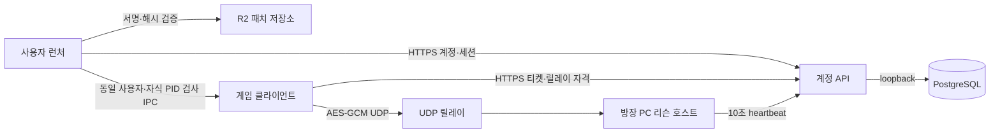

# 서버·게임 배포 보안 검토

검토일: 2026-09-23. 같은 날 코드 대조 재검토로 개정했다.

대상은 작업 폴더 코드와 운영 서버를 읽기 전용으로 조회한 결과다.
- 최초 검토 기준 Git HEAD는 `9088f414d98e`, 재검토 기준은 `4da044c`이다.
- 두 번 모두 인게임 로비 등 **미커밋 변경이 포함된 상태**로 분석했다.
- `rooms.py` 인용은 stage된 미커밋 버전 기준이다.

8장에 적은 P0 일부 조치는 구현했지만 아직 배포하지 않았다.

## 1. 결론과 범위

가장 먼저 처리할 것은 **공개 테스트 배포에 개발 빌드가 그대로 나간 문제**다.
- 게임 0.0.14(`internal` 채널)는 `BuildDevelopment()`로 만들어졌다. 이 빌드에서 개발 도구 잠금은 기본으로 풀려 있다.
- 그래서 정상 계정으로 방에 들어온 참가자가 **조작 클라이언트 없이 브라우저 개발 패널만으로** 자기 캐릭터에 무적·무한 자원을 켤 수 있다.
- 같은 빌드에는 디버거 연결 설정과 빌드 PC 주소도 들어 있다.

**Release로 빌드하는 것만으로는 해결되지 않는다.** `GEUMEUM_DEVTOOLS`가 프로젝트 설정에 정의돼 있어 Release 빌드에도 개발 Command가 컴파일된다. 팀 결정에 따라 이 define은 유지한다(2.1절). 또 팀은 **게임이 어느 정도 완성될 때까지 internal 테스트를 Development 빌드로 게시하고, 디버거 연결도 유지**하기로 했다. 따라서 S-01·S-10의 배포 위험은 Release 전환 시점까지 수용한다. 보안 경계는 컴파일 제거가 아니라 다음 세 가지로 잡는다.
- 서버 판정
- 배포물 종류 검사
- 개발 패널 요청 검사

계정·릴레이에는 기본 보호가 구현돼 있다: HTTPS, 토큰 해시 저장, 일회성 티켓, AES-GCM과 재전송 방어, 방별 호스트 키. 가장 큰 가용성 위험은 **호스트가 heartbeat 실패 한 번에 런을 끝내는 구조**다. API가 잠시만 503을 내도 모든 방이 종료된다. 요청 제한을 늘리기 전에 이 구조부터 완화해야 한다.

검토 범위:

- FastAPI 계정·세션·Discord 설정·방·접속 티켓·UDP 릴레이.
- Unity 개발 도구, 리슨 호스트의 권위 경계, Mirror Command의 호출자 검증.
- 런처 IPC, 게임 실행 전 무결성, 서명 업데이트, 게시 스크립트.
- 운영 수신 포트·서비스 권한·환경 파일 권한·프록시·백업/인증서 타이머.

하지 않은 것:
- 침투·부하·취약점 악용 실험
- 브라우저 CSRF 재현, 실제 토큰 취득
- 의존성 CVE 스캔, IAM/보안 그룹 제어면 감사, 사용자 PC 검사

아래의 **코드 확인**은 공격을 재현했다는 뜻이 아니다.

## 2. 구성과 신뢰 경계

- 일반 참가자와 방장은 모두 사용자가 통제하는 PC에서 실행된다. 리슨 호스트가 게임 판정을 소유하므로 **악성 방장까지 막는 경쟁 게임 수준의 무결성은 보장하지 않는다**. 이 문서의 게임 권위 목표는 "호스트가 허락하지 않은 이득을 원격 참가자가 얻지 못한다"이다.
- AWS API는 계정·방 참가·티켓·호스트 임대를 관리한다. 매 프레임 전투를 재판정하는 전용 서버가 아니다.
- 릴레이 암호화는 네트워크 구간과 연결을 보호한다. 악성 클라이언트·방장 실행 파일의 정당성을 증명하지 않는다.
- `build-identity.json`과 releaseId 검사는 버전 호환성 검사다. 사용자가 수정할 수 있는 파일이므로 바이너리 원격 증명이나 치트 방지가 아니다.

### 2.1 개발 도구 정책 (팀 결정)

- `GEUMEUM_DEVTOOLS`는 Release 빌드에도 정의한다. Release에서는 키 차례(`DevAccess`)를 맞춰야 개발 도구(브라우저 패널·화면 로그·기즈모)가 열린다.
- 이 키 차례는 저장소와 클라이언트 안에 있으므로 **비밀이 아니다**. 사고로 도구가 열리지 않게 하는 편의 잠금이지 권한 검사가 아니다.
- 따라서 게임 결과를 바꾸는 개발 명령은 **서버(호스트) 프로세스의 잠금 상태**로 판정한다. 원격 참가자의 개발 요청은 호스트가 치트 모드를 켠 방에서만 받는다. 호스트가 켠 방에서는 모든 참가자가 개발 명령을 쓸 수 있다. 이것은 호스트가 허락한 상태로 본다.
- 개발 Command를 새로 만들 때는 서버 메서드 첫 줄에서 `DevAccess.IsUnlocked`를 확인한다. `RunManager.ServerDevAdvanceTime`과 `PlayerStatus.CmdDevSetInfiniteResources`가 이 규칙을 따른다.
- 완성 전까지는 internal 채널에 Development 빌드를 게시한다(팀 결정). Development 빌드는 도구 잠금이 기본으로 풀려 있다. 그래서 이 기간에는 호스트 판정이 항상 통과하고, 참가자 누구나 무한 자원을 켤 수 있다. internal 테스트 참가자를 팀과 초대한 인원으로 한정하는 것으로 이 위험을 수용한다.
- 공개 배포(`stable`)는 Release 빌드만 쓴다. Development 빌드는 디버거 연결·검증 드라이버·개발 신원 인자를 포함하기 때문이다. 게시 스크립트가 stable 게시·승격에서 이를 강제한다.

## 3. 우선순위

- P0: 다음 일반 사용자 배포 전에 처리할 항목
- P1: 서비스 공개 범위를 넓히기 전에 처리할 항목
- P2: 이후 운영 안정화 항목

CVSS 점수를 측정하지 않았다. 게임 공정성·가용성과 공격 전제에 따라 정한 작업 우선순위다.

| ID | 우선순위 | 확인 수준 | 문제와 영향 | 공격 전제 | 상태 |
|---|---|---|---|---|---|
| S-01 | P0(공개 배포 전) | 코드 + 배포 산출물 | 개발용 무적·무한 자원 Command를 서버가 권한 검사 없이 실행함. Release 빌드에도 컴파일됨 | 정상 계정/티켓으로 방에 참가한 참가자 | 서버 판정 구현, 미배포. internal Development 게시 기간에는 위험 수용 |
| S-06 | **P0** (상향) | 코드 확인 | 개발 웹 패널에 인증·Origin·Host 검사가 없음. Development 배포본에서는 자동으로 뜸 | 참가자 본인의 브라우저, 또는 게임 실행 중 방문한 웹페이지 | Host·토큰 검사 구현, 미배포 |
| S-10 | P0(공개 배포 전) | 배포 산출물 확인 | 배포 빌드 `boot.config`에 디버거 연결(`player-connection-debug=1`, Listen)과 빌드 PC IP가 포함됨 | 참가자 PC의 네트워크 도달 범위(실제 수신은 미검증) | 팀 결정으로 internal은 유지, stable 게시 가드 구현 |
| S-11 | P1 | 코드 확인 | 게시 스크립트가 빌드 종류를 구분하지 않음. `-Promote`는 재빌드 없이 승격함 | 운영 실수 | stable 채널 가드 구현 |
| S-12 | **P1** | 코드 확인 | 호스트가 heartbeat 실패 1회에 런을 종료. API 전체 503을 일반 계정 요청으로 유발할 수 있음 | 정상 계정 1개 | 미조치 |
| S-13 | **P1** | 코드 확인 | 인증 없이 특정 login_id의 새 로그인을 계속 막을 수 있음 | login_id를 아는 비인증 요청 | 미조치 |
| S-02 | P1 | 코드 확인 | Discord 설정 요청이 전역 버킷 하나를 공유함. 공격이 없어도 5분에 30명이면 포화 | 공개 설정 API 반복 요청 | 미조치 |
| S-03 | P1 | 코드 확인 | 제한 버킷·세션·티켓·방 행을 정리하지 않음 | 다른 login_id를 넣은 비인증 요청 | 미조치 |
| S-04 | P1 | 코드 확인 | 미인증 UDP가 정상 중계와 같은 전역 한도를 소비함 | 공개 릴레이에 패킷 전송 가능 | 미조치 |
| S-14 | P1 | 코드 확인 | 채널 분리는 접근 통제가 아님 | 런처 설정 변경, R2 공개 URL | 미조치 |
| S-05 | P2 | 코드 확인 | 방 목록·internal API에 요청 제한이 부족하고 조회 비용이 큼(S-12의 원인 경로) | 비인증 또는 일반 계정 | 미조치 |
| S-07 | P2 | 코드 확인 | 실행 전 크기 검사만 하므로 교체된 게임에 세션이 전달될 수 있음 | 게임 설치 폴더 쓰기 권한을 가진 로컬 공격자 | 미조치 |
| S-08 | P2 | 코드 확인 | 런처 자기 업데이트의 과거 서명본 재생 방어 부족. 패치 서버 HTTP 허용 | 업데이트 피드 재생/장악 | 미조치 |
| S-09 | P1/P2 | 코드 + 운영 조회 | API·릴레이 단일 프로세스, CPU/메모리 무제한, 서버 내 백업만 있음 | 요청 폭주·프로세스 장애·호스트/디스크 손실 | 미조치 |
| S-15 | P2 | 코드 확인 | 그 밖의 방어 심층화 항목(3.15절) | 경로별 상이 | 미조치 |

### S-01. 개발 Command를 서버가 권한 검사 없이 실행

근거:

- `ProjectSettings/ProjectSettings.asset` Standalone `scriptingDefineSymbols`에 `GEUMEUM_DEVTOOLS`가 있다.
  - 그래서 `BuildRelease()`(`BuildOptions.None`)로 빌드해도 `UNITY_EDITOR || DEVELOPMENT_BUILD || GEUMEUM_DEVTOOLS` 블록이 컴파일된다.
  - `BuildDevelopment()`는 `Development | AllowDebugging`을 쓴다.
- `Assets/01.Scripts/02.Combat/Player/PlayerStatus.cs`의 `CmdDevSetInfiniteResources(bool)`는 Mirror `[Command]`다. 수정 전에는 서버 측 권한 검사가 없었다.
  - 이 플래그가 켜져 있으면 `TakeDamage`가 피해를 무시하고, 자원 소비가 자원을 다시 채운다.
- `DevCheatPanel`은 로컬 플레이어의 이 Command를 부른다.
  - Development 빌드는 `DevAccess` 잠금이 기본으로 풀려 있다. 그래서 일반 참가자도 패널을 바로 쓸 수 있었다.
  - Release에서는 키 차례로 열 수 있다. 조작 클라이언트는 잠금과 무관하게 Command를 직접 보낼 수 있다.
- 게시된 0.0.14 `Assembly-CSharp.dll`에 `CmdDevSetInfiniteResources`, `VerificationCommandDriver`, `DevWebServer`가 들어 있다.

Mirror의 기본 소유권 검사는 남의 플레이어에 명령을 보내는 것을 막는다. **자기 플레이어에 개발 권한을 주는 것은 막지 못한다.** AWS 계정 API 관리자 권한을 얻는 문제로 확인된 것은 아니다.

다른 Command 검토 결과:
- 35개 `[Command]` 중 개발 전용은 이것 하나다.
- `requiresAuthority = false`인 13개(로비·런·보스 트라이·상점·장비 이전)는 모두 서버에서 호출자를 검증한다. 검증 방식은 `sender`·호스트 연결·슬롯 조회·방장 조회다.
- 네트워크 메시지 핸들러는 인증 메시지뿐이다.

대응:
- 서버가 판정한다. 원격 요청은 호스트 프로세스의 `DevAccess.IsUnlocked`가 참일 때만 받는다(2.1절).
- 공개 배포물은 Release 빌드만 쓴다. Development 배포본에서는 호스트 잠금이 기본으로 풀려 있어 서버 판정이 무력해지기 때문이다. 완성 전 internal Development 게시 기간에는 이 한계를 수용한다(2.1절).
- 버튼 숨김이나 클라이언트 측 키 차례만으로 대체하지 않는다.

완료 기준:
- 격리 환경에서 Release 빌드 호스트가 치트 모드를 켜지 않은 상태로 확인한다.
  - 원격 참가자의 무한 자원 요청은 거절 로그와 함께 무시된다.
  - 호스트가 켜면 받아들여진다.
  - 정상 전투는 유지된다.

### S-06. 개발 웹 패널

- `Assets/01.Scripts/99.Dev/DevWebServer.cs`: 잠금이 풀리면 loopback 포트 8787 이후에 자동으로 뜬다. `-devpanellan` 인자가 있으면 전체 인터페이스에 바인딩한다.
- 수정 전에는 `/api/command`에 인증도 Origin/Host 검사도 없었다. 본문 형식도 보지 않았다.
  - 브라우저는 `text/plain` POST를 사전 확인 없이 보낸다. 그래서 게임 실행 중 방문한 웹페이지가 로컬 게임에 개발 명령을 넣을 수 있는 구조였다(실제 재현은 미검증).
  - 호스트에서는 경험치·레벨·시간 전진 같은 서버 조작이 가능하다.
  - DNS 리바인딩으로 `/api/state`를 읽을 여지도 있었다.
- `Assets/01.Scripts/01.Network/Dev/VerificationCommandDriver.cs`: `-verification-command-path`를 준 경우 JSON 명령 파일을 읽는다.
  - `UNITY_EDITOR || DEVELOPMENT_BUILD`에서만 컴파일되므로 Release 빌드에는 없다.
  - 파일을 쓸 수 있는 로컬 공격자와 원격 참가자 공격은 구분한다.

대응: Host 헤더는 IP 리터럴이나 `localhost`, 그리고 실제 포트만 받는다. 명령 POST는 페이지를 내줄 때 심은 프로세스별 무작위 토큰을 사용자 정의 헤더로 요구한다. 사용자 정의 헤더는 교차 출처 사전 확인에서 막힌다. `/api/state` GET은 Live 테스트가 쓰므로 Host 검사만 둔다. LAN 모드는 명시적 opt-in이며, 같은 LAN의 기기는 페이지를 받아 토큰을 얻을 수 있다.

### S-10. 배포 빌드의 디버거 연결 설정

게시된 0.0.14의 `gemeum_Data/boot.config`에는 다음 값이 있다(저장소 object로 확인).
- `player-connection-mode=Listen`
- `player-connection-debug=1`
- `player-connection-ip=<빌드 PC 주소>`

스크립트 디버깅 빌드는 참가자 PC에서 관리 코드 디버거와 플레이어 연결 포트를 열 수 있다. 디버거 프로토콜은 임의 코드 실행이 가능하다. 게임이 호스팅 때문에 방화벽에서 허용될 수 있어 LAN 노출을 배제할 수 없다. 실제 포트 수신은 확인하지 않았다.

팀 결정으로 internal Development 빌드의 디버거 연결은 유지한다. Release 빌드로 게시하면 사라지며, stable 게시 가드가 이를 강제한다.

### S-11. 게시 스크립트의 빌드 종류 검사

수정 전 상태:
- `launcher/scripts/publish-build.ps1`과 `sync-server.ps1`의 기본 입력은 `Builds/Development`였다.
- `-Promote`는 빌드 검사 없이 기존 릴리스를 다른 채널로 올린다.
- `build-identity.json`에는 빌드 종류가 없다. 엄격 JSON 파싱 때문에 필드를 추가하려면 패키저·게임·게시 스크립트를 함께 고쳐야 한다.

대응: 폴더 이름이 아니라 산출물을 검사한다.
- 검사 항목:
  - `boot.config`에 `player-connection-debug=1`이 있으면 거부한다.
  - `Managed/Assembly-CSharp.dll`에 `VerificationCommandDriver` 형식 이름이 있으면 거부한다. 이 드라이버는 `DEVELOPMENT_BUILD` 전용이다.
  - `CmdDevSetInfiniteResources`는 2.1절 결정에 따라 Release에도 있으므로 검사 대상이 아니다.
- 적용 범위:
  - `stable` 채널에만 적용한다. 완성 전 internal 테스트는 Development 빌드로 게시하므로 검사하지 않는다(팀 결정). 기본 입력은 `Builds\Development`로 유지한다.
  - 일반 게시는 빌드 폴더를 검사한다.
  - `-Promote`는 manifest가 가리키는 저장소 object를 검사한다. 그래서 internal에 올린 Development 빌드를 stable로 승격하는 것도 막힌다.
  - `sync-server.ps1`은 내부에서 `publish-build.ps1`을 부르므로 같은 가드를 거친다.

### S-12. heartbeat 실패 1회로 런 종료

동작:
- `Assets/01.Scripts/01.Network/Identity/AccountGameServer.cs`의 임대 루프는 10초마다 `internal/rooms/{room}/heartbeat`를 보낸다.
- 비 2xx 응답이나 네트워크 예외가 한 번이라도 나면 재시도 없이 종료한다.
  - 리슨 호스트는 `ReturnToLobby`로 간다.
  - 그 밖에는 `StopHost()`/`StopServer()` 후 `Application.Quit(13)`로 간다.

API가 프로세스 전체에서 503을 내는 조건:
- `cli.py`의 `limit_concurrency=32`
- `db.py`의 pool 5+2, `pool_timeout` 5초. 풀이 고갈되면 `SQLAlchemyError`가 503으로 바뀐다.
- API 재시작. 이때는 릴레이 peer도 메모리에서 사라진다.

공격 경로와 압박 요인:
- 요청 제한이 없는 `GET /v1/rooms`는 방 50개 기준 한 번에 수백 개 쿼리를 낸다(방·멤버·세션별 조회, 정확한 수는 추정).
- 그래서 정상 계정 하나가 동시 요청으로 풀을 고갈시키면 모든 방이 종료될 수 있다.
- Discord 가입 흐름은 Argon2 해시 동안 DB 커넥션과 advisory lock을 잡는다. 이것도 풀 압박 요인이다.

대응 순서:
1. heartbeat에 짧은 재시도와 유예를 둔다. 예: 연속 실패가 유예 시간을 넘을 때만 종료한다. `revoked`/`closed` 응답은 즉시 반영한다.
2. `/v1/rooms`에 계정별 제한을 두고 쿼리를 JOIN/IN 한 번으로 묶는다.
3. Discord 흐름은 해시 전에 커넥션을 반납한다.

요청 제한 추가(S-02·S-05)는 1이 끝난 뒤에 넣는다. 그러지 않으면 새 429가 곧 런 종료가 된다.

### S-13. 로그인 계정 버킷을 이용한 표적 차단

`api.py`의 `throttle`은 항목을 정렬한 뒤 **한도 초과 여부와 관계없이 모두 upsert하고 commit**한다. 로그인은 인증 전에 `login:account:{login_id}`(300초당 10회)를 증가시킨다. 그래서 login_id를 아는 사람이 5분마다 11회 요청하면 그 계정의 새 로그인이 계속 막힌다. 기존 세션의 refresh는 영향받지 않는다. `discord_web.py`의 `discord-link:{login_id}` 버킷도 티켓 검증 전에 소모된다.

대응: IP 버킷을 먼저 호출하고 통과한 경우에만 계정 버킷을 호출하는 **2단계 호출**로 나눈다. 목록 순서만 바꾸면 효과가 없다. 계정 버킷은 실패한 시도만 세거나, 완전 차단 대신 점진적 지연을 쓴다.

### S-02. Discord 설정 요청의 전역 공유 버킷

`backend/src/geumeum_backend/discord_web.py`의 `proof`는 모든 요청에 `discord-setup-peer` 버킷 하나를 쓴다. 한도는 300초 창(`config.py`)에 **코드 상수 60회**(`discord_web.py`)다. 티켓 검증 전에 소모되므로, 유효한 티켓이 없는 요청도 전체 사용자의 설정 경로를 429로 만들 수 있다. 정상 사용자도 context와 apply로 2회를 쓰므로 공격이 없어도 5분에 30명이면 포화된다. Origin 검사는 비브라우저 클라이언트의 신원을 보장하지 않는다.

대응:
- 출처 IP별 선행 제한은 넉넉한 상한으로만 둔다.
- 실제 제한은 티켓 검증 후 discord_id 기준으로 옮긴다.
- 전역 한도는 서비스 보호용으로 별도 설정한다.

### S-03. 제한 버킷 및 만료 데이터의 보관

- `models.py`의 `RateBucket` 삭제 경로가 애플리케이션 소스에 없다. `ix_rate_buckets_starts_at` 인덱스는 쓰는 곳이 없다.
- 장기 보관 정책이 필요한 대상:
  - `AuthSession`, `RefreshToken`, `JoinTicket`, `DiscordTicket`
  - closed `Room`과 `RoomMember`
- `rooms.state`와 `room_members.account_id` 단독 인덱스가 없다. 그래서 2초마다 도는 sweep·방 생성 count·목록·`leave_other_rooms`가 누적된 행을 순차 스캔한다.

대응:
- 만료 창·세션·티켓·방 정리 작업을 둔다.
- 행 수/디스크 사용량 알림을 추가한다.
- 정리 작업의 FK 순서를 지킨다. `auth_sessions`는 `refresh_tokens`·`join_tickets`·`room_members`·`rooms.host_session_id`·자기참조 `parent_id`가 참조한다.
- 보존 기한을 지킨다.
  - `DiscordTicket`은 10분 발급 한도 계산에 쓰이므로 최소 10분 보존한다.
  - 사용된 refresh 토큰은 세션이 만료·폐기된 뒤 지운다.

### S-04. 미인증 UDP와 전역 중계 한도

`relay.py`는 기본 길이·magic을 통과한 패킷에 전역 제한을 먼저 적용하고, 그 뒤에 peer 존재 및 인증을 검사한다. 기본 전역 한도는 20,000pps/8MBps다. 미인증 트래픽이 정상 중계 예산을 함께 소진할 수 있다.

대응:
- 저비용 peer 검사, 출처별 선행 한도, 인증 성공 후 peer/방별 한도, 전체 보호 상한을 조합한다.
- 출처 IP 한도는 같은 NAT 뒤의 3인(호스트 1 + 게스트 2)을 허용해야 한다. 기존 peer별 버킷(1000pps)의 3배 이상이어야 한다.
- 주소가 아직 없는 peer는 복호화 전에 peer 버킷이 소모된다는 점을 고려한다.
- 네트워크 용량을 넘는 DDoS는 애플리케이션 제한만으로 해결할 수 없다.

### S-14. 채널 분리는 접근 통제가 아님

- 런처 설정에서 사용자가 internal과 stable을 고를 수 있고, 기본값은 internal이다.
- R2는 공개 URL이라 런처 없이도 받을 수 있다.
- 백엔드는 허용 빌드를 하나만 받는다(`config.py`의 `game_build_id`). 그래서 운영 환경 하나에서 개발 빌드와 Release 빌드가 동시에 방을 만들 수 없다.

개발 빌드 검증이 필요하면 별도 백엔드 환경(다른 API 주소와 `game_build_id`)을 쓴다.

### S-05. 방·internal API 부하 경계

- `rooms.py`의 internal 티켓 교환/heartbeat는 서버 키가 틀려도 Room 조회가 먼저 일어난다. 이 경로에는 요청 제한이 없다.
- 인증된 방 목록은 최대 50개 방과 방별 멤버·세션을 조회한다. lobby 동작은 전역 advisory lock을 쓴다.

대응:
- 자격 형식과 누락은 DB 접근 전에 거절한다.
- internal 한도는 **키 검증 후 room_id 기준**으로 둔다. 10초 heartbeat와 재접속 중 redeem 폭주(3명 × 재시도)보다 훨씬 높게 잡는다.
- IP 기준 internal 한도는 두지 않는다. 같은 NAT 뒤에 호스트가 여럿 있을 수 있다.
- 방 단위 직렬화만 쓰면 방 생성의 전체 수 확인과 `leave_other_rooms`에서 용량 초과·교착이 생길 수 있다. 계정 단위 락과 함께 설계한다.

### S-07. 게임 실행 전 무결성과 세션 범위

현재 보호:
- `launcher/Account.Client/GameSessionPipe.cs`는 CurrentUserOnly/FirstPipeInstance와 자식 PID를 확인한다.
- 게임도 `GameSessionPipeClient.cs`에서 런처 PID를 확인한다.
- 토큰은 파이프로만 전달된다. 명령행에는 파이프 이름과 PID만 들어간다.
- 게임 세션은 이미 `launcher_only` 경로에서 제한된다. 닉네임·비밀번호·전체 로그아웃·게임 세션 발급이 막히고, 수명은 최대 1일이다.
- 단, 미커밋 `rooms.py`는 방 생성·lobby·close에서 `launcher_only`를 제거해 게임 세션 권한을 넓힌다.

약점:
- `launcher/Patch.Client/GameProcess.cs`와 `Installer.cs`의 빠른 확인은 파일 크기 기준이다.
- **로컬 설치 경로 쓰기 권한이 선행되는 방어 심층화 문제**다. 기본 설치 위치가 `%LOCALAPPDATA%`라 같은 사용자 권한의 공격자는 DPAPI 토큰을 직접 읽을 수도 있다.

대응:
- exe, `UnityPlayer.dll`, Mono 런타임, `Managed/*.dll` 정도(약 100MB대)의 서명 manifest 해시를 실행 전에 확인한다. 전체 2.48GB 해시는 비현실적이다.
- 게임 세션 범위를 넓히는 변경은 재검토한다.

### S-08. 업데이트 신선도와 서명 키 운영

- 게임 채널에는 서명·만료·단조 증가 sequence 검사가 있다. 다만 채널 문서 유효기간이 180일이라, 이전 기록이 없는 새 설치에서는 과거 서명본을 재생할 수 있다.
- 런처 자체 업데이트(`LauncherUpdater.cs`, `ChannelEnvelope.cs`의 `LauncherRelease`)에는 만료·순서 필드가 없다.
- 런처는 항상 `allowInsecureHttp: true`로 패치 클라이언트를 만든다. 사용자는 서버 주소를 HTTP로 바꿀 수 있다.
- 게임 채널과 런처 업데이트가 같은 서명 키를 쓴다. 개인키는 게시 PC에 평문 PEM으로 있다. 저장소에 커밋된 이력은 없다.

대응:
- 자기 업데이트 메타데이터에 유효 기간과 최고 관찰 순서를 검증한다.
- **기존 런처는 엄격 JSON 파싱으로 모르는 필드를 거부한다.** 그래서 `latest.json`에 필드를 추가하면 1.2.13 이하가 자동 업데이트를 못 한다. 기존 v1 문서는 유지하고 새 런처만 읽는 별도 문서(예: `latest-v2.json`)를 병행한다.
- 게임·런처 키 분리, 키 유출 대응·폐기 절차, R2 게시 권한 최소화를 마련한다.

### S-09. 운영 가용성과 복구

운영 조회에서 확인한 상태:
- API와 릴레이가 같은 프로세스다.
- `MemoryMax=infinity`, `CPUQuotaPerSecUSec=infinity`였다.
- 서버 내 DB 백업 파일과 타이머는 있다. 서버 밖 자동 백업은 후속 과제다.

API·릴레이 분리는 sweep의 "slot 0 부재 시 방 종료" 판단이 프로세스 사이 상태 공유를 필요로 해 단순 분리가 안 된다. S-12 완화가 먼저다.

대응:
- 메모리/작업 수 상한과 재시작 정책을 정한다.
- 요청 지연·릴레이 드롭·DB 크기·디스크·전송 비용 알림을 둔다.
- 서버 밖 암호화 백업과 복구 훈련, 목표 RPO/RTO를 정한다.

### 3.15 기타 방어 심층화 (S-15)

- 운영에서 `/openapi.json`이 공개된다. `/internal/*` 스키마가 노출되지만 영향은 작다.
- 서버가 IPv6로 도달 가능하면 /64 대역으로 IP 버킷을 우회할 수 있다. IPv6 수신 여부를 확인하고 /64 단위로 정규화한다.
- 릴레이 prune은 2초마다 peer당 DB 조회 여러 건을 낸다. peer 주소는 첫 인증 후 고정되므로 공인 포트가 바뀐 peer는 복구되지 않는다. 가용성 문제다.
- 클라이언트 `AccountRelayTransport`가 자격을 재사용하면 같은 키로 sequence 1부터 다시 시작해 AES-GCM nonce가 재사용될 수 있다. 두 번 호출되는 경로가 실제로 있는지는 확인하지 않았다.
- 게시된 빌드가 모두 커밋되지 않은 작업본(`-dirty`)이라 소스 재현이 어렵다.
- 개발 기즈모용 `TargetRpc`가 Release에도 컴파일돼 전송된다. 보안보다는 대역폭 문제다.
- 방장 외 참가자를 내보내는 기능이 없다. 준비하지 않는 참가자가 있으면 방장은 방을 다시 만들어야 한다.

## 4. 확인한 보호 수단

| 보호 | 코드/관찰 근거 | 범위 |
|---|---|---|
| Argon2와 동시 해시 작업 제한 | `security.py` | t=3, m=64MiB, 동시 2. 장비별 비용 측정은 미실행 |
| 존재하지 않는 계정에도 dummy Argon2 | `security.py`, `api.py` 로그인, `discord_accounts.py` | 타이밍 기반 계정 열거 억제. Discord 가입의 409는 별개 |
| 토큰 원문 대신 해시 보관·해시 조회 | `accounts.py`, `models.py` | 서버 키는 `compare_digest` |
| refresh 1회 사용·재사용 시 폐기 | `api.py` | 폐기 범위는 해당 세션 하나 |
| 비밀번호 변경·상태 변경 시 전체 세션 폐기 | `accounts.py`의 `revoke_all` | 로그아웃은 현재 세션, 자식 게임 세션은 parent 확인으로 무효 |
| 짧은 수명의 challenge 결합 일회 티켓 | `rooms.py` | 20초, challenge·room·build·세션 확인 |
| 방 권한과 방별 호스트 키 | `rooms.py` | 봇/시작/종료는 방장만, 호스트 키는 방마다 발급·해시 저장, 다른 방에 쓸 수 없음 |
| AES-GCM·재전송 창·방/슬롯 라우팅 | `relay.py` | 미인증 출처에는 응답하지 않음, keepalive 증폭 비율 1 |
| 프록시 헤더 덮어쓰기와 loopback 신뢰 | `Caddyfile`, `cli.py` | XFF를 외부에서 위조할 수 없음. 앞단에 ALB/CloudFront를 붙이면 재검토 |
| CORS·쿠키 없음, Discord 페이지 보호 | `api.py`, `discord_account.js` | Bearer 헤더 인증, 티켓은 fragment로 받아 즉시 제거, CSP·no-referrer |
| 에러 응답·로그 비밀값 축소 | `api.py`, `cli.py`, `discord_bot.py` | 접근 로그 꺼짐, 예외 타입명만 출력. 운영 Caddy 로그 설정은 미확인 |
| 서명 업데이트·객체 SHA256 | `ChannelEnvelope.cs`, `Installer.cs` | 채널 이름·sequence 검사, 패치 전달 무결성 |
| 패치 경로 조작 방어 | `RelativePath.cs`, `PathGuard` | `..`·절대 경로·예약 장치명·링크/정션 거부 |
| 런처 IPC 토큰 전달 | `GameSessionPipe.cs`, `GameSessionPipeClient.cs` | 동일 사용자·양쪽 PID 확인, 명령행·환경변수에 토큰 없음 |
| 서명 개인키 저장소 밖 보관 | `.gitignore`, git 이력 | 키 파일 커밋 이력 없음 |

SQL injection, 무인증 계정 관리자 권한 획득은 이번 범위에서 확인하지 않았다. 발견하지 못했다는 사실이 부재 증명은 아니다.

## 5. 운영 읽기 전용 조회 결과

| 항목 | 2026-09-23 관찰 | 해석 |
|---|---|---|
| API / DB bind | `127.0.0.1:8766`, `127.0.0.1:5432` | 해당 서비스가 모든 인터페이스에 직접 수신하지 않음 |
| 외부 인터페이스 수신 | TCP22/80/443, UDP18001 및 Caddy UDP443 | 실제 인터넷 도달성은 보안 그룹/경로에 따라 다름 |
| SSH | passwordauthentication=no, pubkeyauthentication=yes, permitrootlogin=without-password | 패스워드 로그인 차단. root 키 로그인 정책은 추가 축소 검토 |
| API 서비스 | 전용 사용자, NoNewPrivileges, PrivateTmp, ProtectSystem=strict, ProtectHome, UMask0077 | 권한/파일시스템 방어 적용 |
| 환경 파일 | root:root, 600 | 원문 내용은 수집하지 않음 |
| Caddy | HTTPS, HSTS, 본문1MB, X-Forwarded-For 덮어쓰기 | 운영 설정에서 확인 |
| 인증서/백업 | 두 타이머 active, DB dump 파일 존재 | 최근 성공 내용·실제 복구 성공과 구분 |
| 호스트 방화벽 | UFW inactive | AWS SG가 있으므로 이것만으로 전체 포트 공개라고 단정 불가 |
| AWS SG/IAM/IMDS, IPv6 | 제어면 미조회 | SSH 출처 제한, IAM 최소 권한, IMDSv2 강제, IPv6 수신 여부 후속 확인 |

계정 식별자·키·개인키·토큰·DB 덤프 원문을 문서에 넣지 않았다.

## 6. 대응안 적용 시 주의

그대로 적용하면 기존 흐름이 깨지는 곳이다.

- **Release 게시 전환(완성 시점).** 아래 경로는 Development 빌드에만 있으므로 이 검증들은 Development 빌드와 별도 백엔드로 유지한다.
  - `VerificationCommandDriver` 기반 Live 테스트: Release에서는 조용히 무시되어 타임아웃난다.
  - 로컬 `http://127.0.0.1` 계정 서버: `Debug.isDebugBuild`가 false라 거부된다.
  - `steam_appid.txt` 복사
  - 두 빌드는 SyncVar 배치와 releaseId가 달라 섞이지 않는다.
- **Release 빌드는 게시된 적이 없다.** 첫 게시 전에 격리 환경에서 3인 L3(방 생성·참가·출발·전투·재접속·종료)를 확인한다.
- **IP 버킷.** 로그인 IP 한도와 `refresh:ip`가 같은 값(60)을 공유한다. 학교망처럼 NAT 하나 뒤에 사용자가 많으면 refresh가 429에 걸린다. IP 버킷은 넉넉한 상한으로 두고 실제 제한은 계정·티켓 기준으로 둔다.
- **재접속 경로 한도.** 재접속 1회에 게임 세션 발급·relay·tickets를 호출한다. 한도를 추가하거나 줄일 때는 재시도 패턴으로 계산한다. 같은 세션의 relay 재요청은 409다.
- **S-12 없이 한도 추가 금지.** 호스트는 429나 503 한 번에 런을 끝낸다.
- **런처 업데이트 형식 변경.** 기존 런처가 새 필드를 거부하므로 v1 문서를 병행 유지한다. 런처 버전은 올라가기만 한다.

## 7. 실행 계획과 완료 기준

| 순서 | 담당 영역 | 조치 | 확인할 결과 | 상태 |
|---|---|---|---|---|
| 1 | 네트워크·배포 | 개발 Command 서버 판정, 개발 패널 Host·토큰 검사, stable 게시 가드 | 다른 사이트의 패널 명령 차단, 패널 정상 조작. stable 가드가 개발 빌드·승격을 거부 | 구현, Unity 컴파일·실기 미검증 |
| 2 | 네트워크·배포 | 완성 시점에 Release 빌드 3인 L3 확인 후 stable 게시 | Release 호스트에서 원격 개발 요청 거절, 호스트 허용 시 수락, 정상 전투 유지. 게시본에 디버거 설정 없음 | 팀 결정으로 보류 |
| 3 | 네트워크 | heartbeat 재시도·유예 | API 재시작·일시 503 중에도 런 유지, `revoked`/`closed`는 즉시 반영 | 미착수 |
| 4 | 백엔드 | `/v1/rooms` 제한·쿼리 축소, 로그인/Discord 버킷 2단계화, 만료 행 정리 | 한 출처 초과가 다른 사용자 차단·행 무한 증가·런 종료로 이어지지 않음 | 미착수 |
| 5 | 네트워크·운영 | 미인증 UDP 제한 분리, internal room_id 한도, 관측/비용 상한 | 정상 3인·재접속 유지, 요청 폭주를 국소 차단 | 미착수 |
| 6 | 런처 | 실행 전 주요 파일 해시, `latest-v2`, 서명 키 분리, HTTPS 강제 | 변조 실행 거절·기존 런처 업데이트 유지 | 미착수 |
| 7 | 운영 | SG/IAM/IMDS/IPv6 확인, 오프호스트 백업·알림·복구 훈련 | 승인된 외부 노출만 존재, 정한 RPO/RTO 내 복구 | 미착수 |

실서비스를 대상으로 공격·부하 검증하지 않는다. 별도 환경에서 승인된 테스트 계정과 제한된 부하로 재현하고, 조치 전후 결과를 비교한다. 게시는 기존 배포 절차를 따른다: 활성 방 확인·환경 백업·허용 빌드 일치·원격 서명/해시 확인.

## 8. 조치 기록

2026-09-23 변경 내역이다. 재배포는 하지 않았다.

| 파일 | 변경 |
|---|---|
| `Assets/01.Scripts/02.Combat/Player/PlayerStatus.cs` | `CmdDevSetInfiniteResources`가 켜기 요청을 호스트의 `DevAccess.IsUnlocked`일 때만 받고, 거절 시 경고 로그. 끄기는 항상 허용 |
| `Assets/01.Scripts/99.Dev/DevWebServer.cs` | Host 헤더 검사(IP 리터럴·localhost·실제 포트), 명령 POST에 프로세스별 무작위 토큰 헤더 요구 |
| `Assets/01.Scripts/99.Dev/DevWebPage.cs` | 명령 요청에 토큰 헤더 추가 |
| `launcher/scripts/publish-build.ps1` | `stable` 채널 게시·승격에서 산출물 검사로 개발 빌드 거부. internal과 기본 입력(`Builds\Development`)은 기존 그대로 |
| `docs/unity/PATCH_SYSTEM_DESIGN.md` | internal은 개발 빌드, stable은 릴리스 빌드만이라는 규칙 반영 |

검증:

- 생성된 `Assembly-CSharp.csproj`를 `dotnet build`로 두 define 조합에서 컴파일했다. 둘 다 오류 0이고 변경 파일에서 새 경고는 없다.
  - 에디터 define 조합
  - Release define 조합: `UNITY_EDITOR`·`DEVELOPMENT_BUILD` 제거, `GEUMEUM_DEVTOOLS` 유지
- Unity 에디터 컴파일과 Mirror weaver는 실행하지 않았다.
- 게시 가드 함수를 스크립트에서 추출해 실행한 결과(stable 게시·승격 시 적용되는 판정):
  - 거부: 실제 `Builds/Development`, 저장소의 0.0.14 승격, 드라이버 포함 DLL, `boot.config` 없음
  - 통과: 디버거 설정 없는 산출물
- Host·헤더 판정 함수를 추출해 14개 경우를 확인했다. 전부 PASS.

미검증:

- internal 게시가 이전처럼 통과하는지 실제 스크립트 실행(가드 분기만 추가했고 파싱 오류 0)
- Release 빌드 생성과 실기 실행
- 원격 참가자 개발 요청 거절 L3
- 브라우저 패널 조작 정상 여부
- 교차 출처 요청 차단 실측
